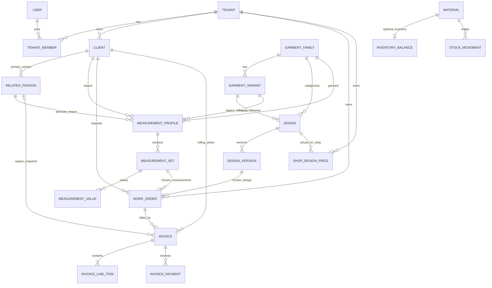
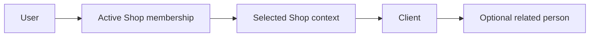
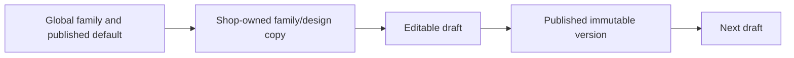
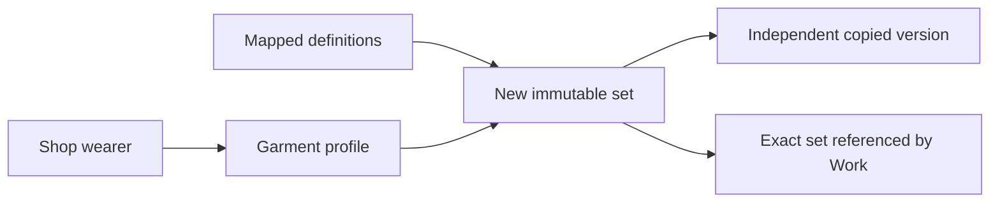
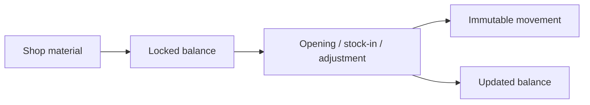
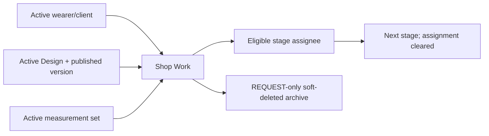
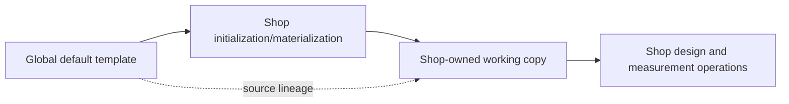
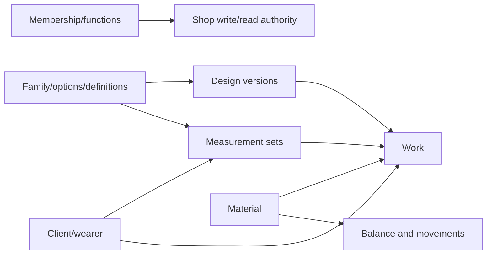

# 01 — DATA FLOW

### 2026-10-26 — Phase 5 local database migration delta

After a user-authorized migration, local `devdb` now has `catalog.0025`/
`0026`, `works.0003`, and `billing.0001`–`0006` applied (9 migrations).
Before migration, a local `pg_dump` backup was created and successfully
restored into an isolated disposable database. A row-count comparison between
that pre-migration restore and current `devdb` found no row-count changes in
pre-existing business/catalog/work tables; only expected `auth_permission`,
`django_content_type`, and `django_migrations` rows increased. The 12 new
Phase 5 tables are present. The disposable comparison DB was removed; the
ignored local backup remains available for recovery. Staging/production were
not touched. Source data ownership and Shop boundaries did not change.

## 0. Purpose

Current local source-based map of where business data originates, is validated, stored, copied, consumed, and retained. This is **not** an API inventory or a production-data assertion. Evidence is the dirty local `main` checkout at `d6560c7c5457df11820686c6b6f3f204338c530a`, including uncommitted and untracked files. The separately checked-out frontend at `../sgtp-frontend` (`frontend/parallel-foundation`) is identified where used; its deployment parity is **UNVERIFIED**. Model/service behavior is **VERIFIED FROM REPOSITORY**. Targeted read-only DB snapshots now verify local dev/test and the auxiliary Compose database; staging DB rows and Production state remain **UNVERIFIED**. See §14–15.

## 1. System Data Flow — One-View Map

### 2026-10-25 — Manual financial purge data-flow delta (local, unpublished)

Main Supplier Super Admin may initiate a manually confirmed invoice-bundle
purge for an explicitly selected Shop. The backend first persists a purge
tombstone/idempotency binding and marks the request pending; private objects
are deleted before the financial database rows. A storage failure leaves the
invoice bundle intact and records a retryable failure. On success, the invoice,
lines, linked payments, credit notes/refunds, and document metadata are
deleted, followed by an append-only purge audit event and completion state.
Existing audit/idempotency rows (including response snapshots) and Shop
sequence counters are deliberately retained. This changes the normal
financial-history retention path only for this approved Main Supplier action.
Migration `billing.0006` is additive; it has passed disposable DB-backed tests
but has not been applied to the persistent application DB. No persistent DB or
R2 application data was changed in this task.

```mermaid
flowchart LR
  actor[Authenticated actor] --> actor_kind{Actor context}
  actor_kind -->|Main Supplier| supplier[Supplier / Back Office context]
  actor_kind -->|Ordinary user| member[Active Shop membership]
  supplier -->|authorized selected Shop| shop_scope[Shop-scoped context]
  member --> shop_scope
  supplier --> global[Global Back Office defaults]

  global -->|copy family, mappings and published Design content only| shop_catalog[Shop-owned Family, mappings and Family-level Design]
  legacyVariant[Legacy Variant rows; historical migration seeds remain]
  global_groups[Reusable global option groups / options] -->|may be mapped or selected| shop_catalog
  shop_catalog --> design[Mutable Design draft]
  legacyVariant -. nullable legacy FK .-> design
  design -->|publish / snapshot| version[Immutable published DesignVersion]

  shop_scope --> clients[Shop Client / Related Person]
  clients --> profile[Measurement Profile]
  legacyVariant -. nullable legacy FK .-> profile
  shop_catalog --> profile
  profile -->|save version| set[Immutable MeasurementSet]
  set --> values[Immutable MeasurementValues]
  version -. optional exact published version .-> set

  shop_scope --> material[Shop Material]
  material --> balance[Current InventoryBalance]
  material --> movement[Append-only StockMovement ledger]
  movement -->|atomic service update| balance

  shop_scope --> shop_price[ShopDesignPrice]
  design --> shop_price

  clients --> work[WorkOrder]
  version -->|exact reference| work
  set -->|exact reference| work
  shop_price -->|amount + currency snapshot at Work creation| work
  design -. same Family required .-> work
  profile -. same Family required .-> work
  material -. optional material reference; no automatic stock use .-> work

  work --> invoice[Invoice]
  clients -->|Primary Client billing owner| invoice
  related_person -. optional wearer snapshot .-> invoice
  invoice --> invoice_line[InvoiceLineItem]
  invoice --> payment[Append-only InvoicePayment]
  invoice --> credit[CreditNote / Refund]
  invoice -->|private derived file| financial_doc[FinancialDocument metadata]
  supplier -->|select Shop + confirm invoice| purge[Manual purge request]
  purge --> purge_tombstone[FinancialPurgeRequest + idempotency]
  purge -. success only .->|delete bundle rows and private files| invoice
  purge_tombstone -->|append-only outcome| audit[FinancialAuditEvent]
  purge_tombstone -. retain .-> sequence[Shop financial sequence]
```

Shop initialization copies global Families, FamilyOptionGroup mappings, and each available published default Design into a Shop-owned Family-based Design. The copy starts with a PUBLISHED snapshot and a next editable DRAFT; bootstrap does not create or require Variant rows. This applies to new materializations only: existing Shop copies are not refreshed or backfilled by later Back Office default changes. In `main`, Variant create/update/lifecycle API methods now return 405 while scoped list/detail reads remain for legacy compatibility. The active sibling frontend's catalog/design/measurement/order flows no longer require a Variant; the separate sibling backend copy still has an older Variant-required Design contract and is not the backend owner under its `AGENTS.md`. Historical migrations `0002`/`0012`/`0018` still create seeded Variant rows on fresh replay; those files were intentionally not changed, and the rows remain compatibility data rather than an active workflow input. Work now validates Family equality while preserving client/wearer, ownership, published-version, active-set, permission and tenant checks. The Variant-retirement change made no Variant data/schema migration; the separate Phase 5 migrations applied to local `devdb` on 2026-10-26 are recorded in E15. Staging/deployed behavior remains unverified. Family mappings may reuse global option groups, and per-Design snapshots preserve selected historical content. A Design draft is distinct from its immutable published `DesignVersion`. A Measurement Profile is the continuing wearer/garment record; each saved `MeasurementSet` and its values are immutable, and Work pins exact set/version rows when present. `StockMovement` is the append-only ledger entry and `InventoryBalance` is current materialized state updated with the movement atomically. Work may reference a Material, but neither that reference nor the frontend's fabric-availability display reserves or consumes stock [E4–E8,E10,E11].

**R5-01 data-flow delta (2026-10-21; local, unpublished):** ShopDesignPrice owns a current Shop+Design price/currency; Work copies it at create time when present. Invoice, line, and payment records belong to Shop-scoped Work and retain Primary Client billing ownership; one invoice has immutable currency, issued invoices/lines cannot be edited, and payments append to one invoice. At this historical checkpoint, additive migrations `catalog.0026`, `works.0003`, and `billing.0001` were generated and tested only on disposable PostgreSQL. The subsequent local `devdb` migration state is recorded in §15 and E15. See §4.8. No existing Work or history was backfilled.

## 2. Data Ownership Map

| Data / entity | Source of truth | Owner / scope | Mutable? | History? |
|---|---|---|---|---|
| User identity | `User` | Platform; ordinary user has owning Shop | Controlled | Auth version, not general audit history |
| Shop, membership, work functions | `Tenant`, `TenantMember`, `MembershipWorkFunction` | Shop; supplier controls bootstrap | Controlled | Soft-delete metadata; no generic event ledger verified |
| Client, related person | `Client`, `RelatedPerson` | Shop | Yes | Soft-delete metadata, no revisions |
| Garment family/option/definition | Catalog models | Global (`tenant=NULL`) or Shop | Controlled | Shop template lineage, not universal change history |
| Legacy GarmentVariant | `GarmentVariant`; nullable Design/Profile FKs | Global or Shop | API writes retired; legacy list/detail reads retained; historical migrations still seed rows | Retain only for compatibility/history/migration safety |
| Design and version | `Design`, `DesignVersion`, selections/snapshots | Global or Shop | Draft yes; published locked | Numbered published versions |
| Shop Design price | `ShopDesignPrice` | Shop, including Shop-specific prices for global Designs | ADMIN or CASHIER STAFF; mutable | Current price; copied into each new Work snapshot |
| Measurement profile/set/value | Measurement models | Shop, person and garment | Profile controlled; set/value create-only | Numbered sets with copied-from and label snapshots |
| Material | `Material` | Shop | Controlled | Inventory movements if enabled |
| Inventory | `InventoryBalance`, `StockMovement` | Shop | Service-controlled balance | Append-only movements |
| Work/order | `WorkOrder`, `WorkEvent` | Shop | Controlled until completed | Append-only mutation events; Request soft-delete timestamp; source references retained |
| Billing | `Invoice`, `InvoiceLineItem`, `InvoicePayment` | Shop; invoice references Work and its Primary Client | Draft invoice/lines mutable; issued invoice/lines immutable; payments append-only | Issued invoice and payment history retained; one payment belongs to one invoice |
| Financial document rendition | `FinancialDocument` metadata and private file | Shop; one invoice/payment/credit note, locale, and layout version | Append-only; old rendition remains immutable | Layout v1 files remain intact; current v2 creates A5 renditions without rewriting financial values or v1 files |

`created_by`/`updated_by` on shared base models are attribution, not ownership or a full audit trail [E1].

## 3. Core Domain Relationship Map



An active measurement profile has exactly one of `client` or `related_person`; `WorkOrder` may retain both the primary client and related wearer. Work requires Design and MeasurementProfile Families to match; Variant equality is not a Work invariant. Global catalog roots use nullable tenant, while customer/stock/work data require a Shop [E2–E8].

| Parent | Related Data | Relationship | Ownership Rule | Delete/Archive Effect |
|---|---|---|---|---|
| Tenant | Membership, Client, Material, Work | One-to-many | Same Shop | Operational rows use active/soft-delete filters; protected FKs can restrict deletion |
| Client | RelatedPerson, MeasurementProfile, Work | One-to-many | Same Shop; related wearer has primary Client | Active paths hide deleted contact; historical FK handling must be preserved |
| GarmentFamily | Design, MeasurementProfile, definition mapping | One-to-many | Global or selected Shop | Archive blocks new use, not historical readability |
| Design | DesignVersion/selection | One-to-many | Version inherits Design scope | Published version retained and immutable |
| MeasurementProfile | MeasurementSet/value | One-to-many | Shop and exactly one wearer | Set deactivation retains values |
| Material | InventoryBalance/StockMovement, optional Work | One-to-one / one-to-many | Same Shop | Stock ledger retained; archive guarded by stock state |
| WorkOrder | DesignVersion/MeasurementSet/Client refs, optional Design price snapshot | Many-to-one | All compatible with Work Shop | REQUEST soft delete hides Work; invoices block deleting Work; sources remain |
| ShopDesignPrice | Shop + global/Shop Design | Many-to-one | One current price per Shop/Design; currency follows configured Shop default | Work keeps the creation-time price/currency snapshot |
| Invoice | Work, Primary Client, optional RelatedPerson | Many-to-one | One Shop; currency fixed on invoice creation | PROTECT FKs; Draft may be edited, Issued is immutable |
| InvoiceLineItem / InvoicePayment | Invoice | Many-to-one | Same Shop is inherited through Invoice | Issued line values immutable; payments append-only; no delete/void/refund API |

## 4. Entity Data Flow Registry

### 4.1 — User and Shop access

#### Identity
- Model: `User`; `Tenant`; `TenantMember`; `MembershipWorkFunction`.
- Database table: Django-default `accounts_user`, `tenants_tenant`, `tenants_tenantmember`, `tenants_membershipworkfunction` (no `db_table` override found).
- Stable identity: UUID primary keys; immutable `User.user_code`; membership joins User and Shop.
- Human-readable label: login ID / Shop name / role and function code.
- Tenant/owner: User may be platform supplier or Shop-owned; Shop owns membership/functions.
#### Creation
Account/Shop/membership services create records; Shop bootstrap creates first ADMIN [E2,E9].
#### Input Sources
Actor-controlled account and Shop administration inputs; supplier context for global administration.
#### Validation
User owner/login immutability and uniqueness; membership active/user active/Shop active, role/admin bounds; Work Function allowlist [E2,E9].
#### Persistence
User is not `BaseModel` soft-delete; Tenant and membership are. Work-function rows are membership children.
#### Relationships
One Shop has many memberships, Clients, catalog copies, and Works; a member ties an active User to a Shop.
#### Consumers
Shop context, permission gates, catalog, Clients, measurement, stock, and Work services.
#### Updates
Account lifecycle and membership services; Work Function replacement is transactional.
#### History / Versioning
`auth_version` affects session validation; no complete membership change-event log verified.
#### Archive / Delete
Membership removal uses soft deletion and recovery service; Shop deletion lifecycle beyond model semantics is **UNVERIFIED**.
#### Tenant / Ownership Boundary
Active Shop membership/context gates operational data; supplier-global authority is a separate path.
#### Failure / Integrity Risks
Changing a membership/function changes access to downstream data; historical actor attribution remains by FK. See DF-RISK-004.
#### Evidence
Backend: `apps/accounts/models/users.py`; `apps/tenants/models/{tenant,membership,work_functions}.py`; `apps/tenants/services/{membership,work_functions}.py` [E1,E2,E9]. Frontend consumers: `../sgtp-frontend/frontend/src/features/users/` [E10]. Tests: `apps/tenants/tests/test_membership.py` [E11]. Status: **PARTIAL** (repository path verified; deployed state unverified).

### 4.2 — Client and related person

#### Identity
- Model: `Client`; `RelatedPerson`. Database table: `clients_client`; `clients_relatedperson` (Django default).
- Stable identity: UUID primary key. Human-readable label: contact name. Tenant/owner: Shop `tenant`; related person belongs to a primary Client.
#### Creation
Client service creates each under an authorized Shop [E3].
#### Input Sources
Client/related-person UI or API-provided names and contact data.
#### Validation
Normalization and same-Shop parent check; duplicate phone/email is a warning, not a merge or hard uniqueness rule.
#### Persistence
`Client`/`RelatedPerson` `BaseModel` rows; no revision table.
#### Relationships
Measurement profile owner; Work has primary Client and optional related wearer.
#### Consumers
Client workspace, measurement profiles, Work creation/read [E3,E8,E10].
#### Updates
Service-controlled contact edits.
#### History / Versioning
No Client field version history verified; downstream measurements are separately versioned.
#### Archive / Delete
Client service invokes soft delete; related history is hidden by active query paths, while physical rows remain. Exact propagation of every dependent relation requires runtime verification.
#### Tenant / Ownership Boundary
Service and view filter by selected Shop; cross-Shop IDs are non-disclosing in inspected tests.
#### Failure / Integrity Risks
Soft-deleted person may still be referenced historically; active-use checks must remain in downstream writes.
#### Evidence
Backend: `apps/clients/{models,services,views,serializers}.py`; `apps/works/models.py` [E3,E8]. Frontend consumers: `../sgtp-frontend/frontend/src/features/clients/` [E10]. Tests: `apps/clients/tests/test_clients_api.py` [E11]. Status: **PARTIAL** (soft-delete propagation not runtime verified).

### 4.3 — Garment catalog and configuration

#### Identity
- Model: `GarmentFamily`; `GarmentVariant`; `OptionGroup`; `StyleOption`; `FamilyOptionGroup`; `MeasurementDefinition`/mapping.
- Database table: Django-default `catalog_garmentfamily`, `catalog_garmentvariant`, `catalog_optiongroup`, `catalog_styleoption`, `catalog_familyoptiongroup`, `catalog_measurementdefinition`, `catalog_measurementdefinitionmapping`.
- Stable identity: UUID primary keys and scoped codes. Human-readable label: translated family/option/definition names. Tenant/owner: global `tenant=NULL` or owning Shop; family/variant Shop copies retain `template_source`.
#### Creation
Supplier/global seed paths create Family defaults; Shop workflows create owned options/families or materialize current Family/default Design content [E4,E6]. Historical migrations still create Variants, and `0012`/`0018` use Variants while seeding Global Designs [E4]. New forward migration `catalog.0025_reconcile_family_design_defaults` reuses the approved `0018` preset definitions to add only missing global FamilyOptionGroup/options and published Family-linked Design presets; it does not require an active Variant, rewrite existing Design/version/selection rows, or touch Shop-owned catalog data. Shop bootstrap then copies published Designs by Family and creates Shop Designs without copying a Variant. Fresh, Variant-absent and representative upgrade replays on isolated PostgreSQL 15 verified the `0025` data behavior and `works.0001` ordering on 2026-10-19. The ordinary fresh replay retained the existing `0018` Variant-linked presets; newly reconciled presets in the absent-Variant replay were Family-linked with `variant=NULL`. No development, staging, or production database was used for these replays.
#### Input Sources
Global Back Office configuration and Shop catalog editing.
#### Validation
Family/Option Group ownership and uniqueness remain active rules. Legacy Variant ownership/model checks and internal service functions remain for compatibility; public Variant mutation routes reject writes, while GET list/detail compatibility remains [E4,E6].
#### Persistence
Catalog tables plus translations, mapping rows, and optional private images; Shop materialization creates new rows, not a live alias.
#### Relationships
Families classify Designs and MeasurementProfiles; mappings constrain DesignSelections and MeasurementDefinitions.
#### Consumers
Design editing/publishing, measurement entry, Shop catalog and Work garment validation.
#### Updates
Global and Shop service paths are distinct; edits to global roots do not automatically rewrite existing Shop copies.
#### History / Versioning
`template_source` tracks origin, not a full version series. Historical selected text/images are copied into DesignSelection snapshots.
#### Archive / Delete
Family/design status blocks unavailable records. Variant rows and their `is_active` state remain because historical migrations/data and read compatibility are preserved; public mutation routes do not permit active management. Model FK `PROTECT`/`CASCADE` is not itself a business deletion policy.
#### Tenant / Ownership Boundary
Global rows (`tenant=NULL`) are shared read inputs; Shop-owned copies and custom definitions are isolated.
#### Failure / Integrity Risks
Current global defaults and pre-existing Shop copies can diverge intentionally; see DF-RISK-002.
#### Evidence
Backend: `apps/catalog/{models,measurement_models,services,measurement_services}.py` [E4,E5,E6]. Frontend consumers: `../sgtp-frontend/frontend/src/features/{catalog,designs,measurements}/` [E10]. Tests: `apps/catalog/tests/{test_catalog_api,test_measurements_materials_api}.py` [E11]. Status: **PARTIAL** (all live template-copy states unverified).

### 4.4 — Design and design version

#### Identity
- Model: `Design`; `DesignVersion`; `DesignSelection` and translation/image snapshots.
- Database table: Django-default `catalog_design`, `catalog_designversion`, `catalog_designselection` (plus child tables).
- Stable identity: UUID PK and `(design, number)` for a version. Human-readable label: translated design/version name. Tenant/owner: global or Shop through Design; optional `client_request_id` is a retry key, **not** a Client FK.
#### Creation
Shop design service creates Design + draft version transactionally; global supplier has separate path [E4,E6].
#### Input Sources
Chosen family, name/translations, style selections, optional source template and retry key. The `main` Design-create API and active sibling Design editor are Family-only. A stale main-checkout frontend copy still contains Variant UI; the sibling checkout's duplicated backend still requires `variant_id` and is not modified under its ownership instructions.
#### Validation
Family/scope, configured option groups, required/single-selection rules; publish requires Shop ADMIN or STAFF Tailor. Model-level legacy Variant family/tenant checks remain for referenced rows; Work requires matching Design/Profile Family and no longer compares Variant IDs.
#### Persistence
Design, DesignVersion, selections, translations, images/references; published core/content becomes immutable.
#### Relationships
Family; nullable legacy Variant FK; source Design; MeasurementSet optional exact published version; Work exact published version.
#### Consumers
Design editor/list, measurement review, Work creation/details [E6,E8,E10].
#### Updates
Draft content can change; publish creates next draft cloned from published content.
#### History / Versioning
Published numbered versions persist; copied selections include code/name and image/translation snapshots.
#### Archive / Delete
Design status archives new use; published version deletion prohibited; draft cleanup/restore has controlled service paths.
#### Tenant / Ownership Boundary
Global templates and Shop-owned Designs have separate create/publish authority; Work validates published version available to its Shop.
#### Failure / Integrity Risks
Template restoration may use latest global published version rather than original Shop copy; see DF-RISK-002.
#### Evidence
Backend: `apps/catalog/{models,services,views,serializers}.py`; `apps/works/models.py` [E4,E6,E8]. Frontend consumers: `../sgtp-frontend/frontend/src/features/designs/` [E10]. Tests: `apps/catalog/tests/test_catalog_api.py` [E11]. Status: **PARTIAL** (published row state unverified).

### 4.5 — Measurement definition, profile, set, and value

#### Identity
- Model: `MeasurementDefinition`; `MeasurementProfile`; `MeasurementSet`; `MeasurementValue`; `MeasurementValueTranslationSnapshot`.
- Database table: Django-default `catalog_measurementdefinition`, `catalog_measurementprofile`, `catalog_measurementset`, `catalog_measurementvalue`, `catalog_measurementvaluetranslationsnapshot`.
- Stable identity: UUID PK; scoped Definition code; profile identity by wearer/garment; `(profile, version)` set; set+definition value. Human-readable label: definition translation/snapshot. Tenant/owner: profile Shop, set/value inherited through profile; Definition global or Shop.
#### Creation
Authorized measurement services create definitions/mappings, profiles, sets, values, and copies transactionally [E5].
#### Input Sources
Global/Shop definitions mapped to garment; chosen Client/related wearer, optional published DesignVersion, explicit numeric value and `CM`/`INCH` unit.
#### Validation
Exactly one profile owner; same-Shop person; active family; mapped, active, visible definitions; no duplicate definition in a set; design family/scope match.
#### Persistence
Profile, immutable set/value rows, definition code/label and translation snapshots; copy creates independent values and `copied_from` link.
#### Relationships
Profile → wearer and family; set → profile, optional DesignVersion; value → definition; Work → exact set.
#### Consumers
Measurement entry/history/compare/PDF, Client workspace, Work creation [E5,E8,E10].
#### Updates
Definition metadata/mapping may change within permissions; set/value are create-only. No unit conversion in compare.
#### History / Versioning
Next number derives from all sets including inactive; copies preserve original snapshots; deactivation hides version without destroying data.
#### Archive / Delete
Definition archive prevents new use; last active set cannot be deactivated; profile/set/value hard deletion is prohibited by model/service paths.
#### Tenant / Ownership Boundary
Profile Shop and wearer determine scope; global definition is shared read-only input, Shop definition limited to owner.
#### Failure / Integrity Risks
Cross-module Work must reject inactive/incompatible set; historical labels should never be recomputed from current definition. See DF-RISK-001.
#### Evidence
Backend: `apps/catalog/{measurement_models,measurement_services,measurement_views,measurement_serializers}.py`; `apps/works/models.py` [E5,E8]. Frontend consumers: `../sgtp-frontend/frontend/src/features/measurements/` [E10]. Tests: `apps/catalog/tests/test_measurements_materials_api.py` [E11]. Status: **PARTIAL** (live history unverified).

### 4.6 — Material, balance, and stock movement

#### Identity
- Model: `Material`; `InventoryBalance`; `StockMovement`. Database table: `catalog_material`, `catalog_inventorybalance`, `catalog_stockmovement` (Django default).
- Stable identity: UUID PK; Shop-local Material code; one-to-one Balance; movement UUID. Human-readable label: Material name/code. Tenant/owner: Shop for all three.
#### Creation
Material service creates plain Material; inventory service can create inventory-enabled Material + zero balance or enable an existing active Material [E5,E7].
#### Input Sources
Shop-admin inventory data, quantity, unit/category, reason, actor.
#### Validation
Same-Shop Material; quantity precision/whole-unit rules, nonnegative available stock, one-time opening, no category/unit change after movement history.
#### Persistence
Material/Balance mutable rows; every stock operation inserts a movement with before/after quantity and unit snapshot in the same transaction.
#### Relationships
Balance and movement reference Material; Work may reference Material, but no Work stock reservation is verified.
#### Consumers
Inventory screen and movement history; measurement preparation may display fabrics; Work displays selected Material [E7,E8,E10].
#### Updates
Services lock and update balance; direct balance/movement edits are guarded by model/manager.
#### History / Versioning
Append-only movement ledger; Material field revisions outside that ledger are not verified.
#### Archive / Delete
Material status can archive when stock rules allow; movement history remains. Hard-delete path is not documented as supported.
#### Tenant / Ownership Boundary
Material, balance, movement require same Shop; supplier must select a Shop to manage it.
#### Failure / Integrity Risks
Balance/ledger consistency depends on service-only writes; no stock consumption when advancing Work. See DF-RISK-003.
#### Evidence
Backend: `apps/catalog/{measurement_models,measurement_services,inventory_models,inventory_services,inventory_views}.py` [E5,E7]. Frontend consumers: `../sgtp-frontend/frontend/src/features/{materials,measurements}/` [E10]. Tests: `apps/catalog/tests/{test_inventory_api,test_measurements_materials_api}.py` [E11]. Status: **PARTIAL** (live ledger unverified).

### 4.7 — Work order

#### Identity
- Model: `WorkOrder`. Database table: `works_workorder` (Django default).
- Stable identity: UUID PK plus per-Shop sequence/`ORD-######`; high-water mark includes soft-deleted Works. Human-readable label: `work_number`. Tenant/owner: Shop.
#### Creation
`create_work` in a transaction; Shop ADMIN or STAFF with SALES/MEASUREMENT function. The service locks Shop, parent Family, then Design rows to serialize numbering and eligibility against Shop, Family, and Design archival [E8].
#### Input Sources
Primary Client, optional related wearer, published DesignVersion, active MeasurementSet, optional Material, due date/priority/notes.
#### Validation
Same-Shop active customer/wearer/material, available published DesignVersion whose parent Family and Design are ACTIVE, and measurement person/family match; model `full_clean` on save. An archived Family or Design cannot be selected for new Work, but existing Work keeps its protected source references and remains readable.
#### Persistence
One WorkOrder row per garment; no copied measurement-value rows and no stock movement on creation are verified. Each successful create, edit, assignment, stage transition, and Request soft-delete writes a same-transaction `WorkEvent` with actor UUID, action, allowlisted before/after state, and changed field names. Note contents are excluded. WorkEvent is internal and has no history API in this flow.
#### Relationships
FKs to Client/related person, DesignVersion, MeasurementSet, Material, assigned membership; optional non-relational Work snapshot stores Design price amount/currency. Invoice references Work and snapshots its Client/RelatedPerson billing identities.
#### Consumers
Orders list/detail/deleted archive; assignment and stage workflow [E8,E10].
#### Updates
ADMIN edits non-completed record; ADMIN assigns eligible member; authorized operator advances stage and clears assignment each time.
#### History / Versioning
WorkEvent retains lifecycle actions and stage before/after states, including after Request-stage soft deletion; deleted archive continues to expose its `deleted` timestamp. Event writes are append-only through the model save/delete interface and share the Work mutation transaction. The initial migration creates no synthetic events for pre-existing Work rows; event history begins with mutations after deployment.
#### Archive / Delete
ADMIN may soft-delete only REQUEST-stage Work; deleted list is ADMIN-only and Shop/date filtered.
#### Tenant / Ownership Boundary
Queries and service locks constrain Work to selected Shop; supplied linked IDs are validated against Shop.
#### Failure / Integrity Risks
Deletion hides Work but linked source records and audit events persist. A failed audit-event write rolls back its associated Work mutation.
#### Evidence
Backend: `apps/works/{models,services,views,serializers,constants}.py` [E8]. Frontend consumers: `../sgtp-frontend/frontend/src/features/orders/` and `../sgtp-frontend/frontend/src/features/measurements/MeasurementReview.tsx` [E10]. Tests: `apps/works/tests/test_work_api.py` [E11]. Status: **PARTIAL** (deployed schema/data unverified).

### 4.8 — Shop Design pricing and billing

#### Identity
- Models: `ShopDesignPrice`, `Invoice`, `InvoiceLineItem`, `InvoicePayment`, `CreditNote`, `InvoiceRefund`, `ShopFinancialSequence`, `FinanceMutation`, `FinancialAuditEvent`, and `FinancialDocument`; tables use Django app naming.
- Owner: selected Shop. A Shop may set its own price for a Shop-owned or global Design; a `WorkOrder` snapshots amount/currency at Work creation when a price exists.
#### Creation / Input
Shop ADMIN or STAFF with CASHIER function may read/set a Shop Design price and use Billing. The authorized Shop request-context response carries nullable `billing_currency` from the same Shop `default_currency` only for those finance roles; non-financial members do not receive it. Invoice creation attaches to an existing same-Shop Work; AUTO mode adds the Work price snapshot when present, and MANUAL line values are description, quantity and unit price. A payment attaches to one issued invoice. A paid invoice may receive a linked credit note; an external refund already transferred is recorded against the actual payment and credit note.
#### Validation / Persistence
Shop `default_currency` must be valid for price entry and when no Work price snapshot supplies the invoice currency. It is locked after Shop Design prices or financial history exist unless a reviewed migration is explicitly used. Monetary input must fit currency minor-unit precision; excess decimals are rejected. Decimal line totals, proportional fixed-discount allocation, per-line optional tax, and totals use the approved minor-unit `ROUND_HALF_UP` rules. Payments must be positive and cannot exceed invoice balance. Shop/actor/idempotency-key uniqueness, request hashes, per-Shop serialization locks, and stored response snapshots protect new financial mutation retries; legacy mutation rows with no snapshot remain readable through a fallback.
#### History / Immutability
Draft invoice lines may be added, edited or removed. Issue assigns a Shop-sequential number and makes the invoice/lines immutable. Payments, issued credit notes, refunds, idempotency rows, audit events, and generated document metadata are append-only at the model API. Draft deletion and unpaid invoice void are reason/policy bounded; voided numbers are not reused. Multiple invoices may reference one Work, each with one currency. Work stage is not changed by billing; Work deletion is refused while billed.
#### Derived Documents
Invoice, receipt, and credit-note PDFs are generated from persisted financial rows and the approved document locale, then stored as `FinancialDocument` metadata plus file, locale, layout version, generation actor/time, and SHA-256. Uniqueness is per source, locale, and layout version. New layout version 2 renders portrait A5; existing immutable version 1 files remain unchanged and downloadable. The file uses existing private local/R2 storage; no public file URL is exposed. The download API rechecks selected-Shop ownership and streams the stored PDF. Generation is synchronous; there is no background job record, retry/dead-letter queue, or aggregate report flow.
#### Tenant / Failure Boundaries
Financial view/services lock the selected active Shop and recheck financial permission; reads and document downloads filter by Shop. Shop context exposes only the billing currency to authorized finance roles while continuing to omit defaults for other members. RelatedPerson Work billing belongs to Primary Client while retaining wearer identity. `FinancialAuditEvent` records actor, Shop, action, object, request correlation, and safe before/after values; no credential/payment-provider secret is included. Document files are private. No external payment transfer or notification occurs.
#### Evidence
Backend: `apps/tenants/context_views.py`, `apps/catalog/{models.py,price_services.py,views.py,serializers.py}`, `apps/billing/{models.py,calculations.py,idempotency.py,pdf.py,services.py,views.py,serializers.py,urls.py}`, `apps/works/{models.py,services.py}`; frontend consumers are in `../sgtp-frontend/frontend/src/features/{designs,orders,billing}/` and `hooks/useCurrentShop.ts`. Tests passed: backend full suite 587/587 before the narrow context-contract addition; focused context/Work/Billing set 54/54 afterward; frontend 225/225 plus typecheck/build. Authenticated browser E2E passed on a synthetic disposable Shop. Fresh disposable migration/restore passed; restore verified one invoice PDF file only, while API tests cover invoice/receipt/credit-note protected download and cross-Shop denial. Persistent application DB migration is not verified/applied. Local filesystem storage is verified; external R2 and production restore are not. Status: **LOCAL BILLING FLOW VERIFIED; APPLICATION-DB/PRODUCTION PARITY UNVERIFIED**.

**Portrait A5 PDF follow-up (2026-10-22):** focused renderer/API tests passed 5/5, including A5 page dimensions, multi-page continuation, and preservation/download of an immutable A4 layout-version 1 invoice. Fresh migration replay includes `billing.0005`; only disposable `test_devdb` was used and removed. Persistent `devdb` was not migrated or written.

## 5. BUSINESS WORKFLOW DATA FLOWS

## 5.1 — Shop access and Client intake



### Trigger
Shop administration or Client form.
### Reads
Actor, membership, Shop, duplicate contact candidates.
### Writes
Shop/member/function or Client/related person.
### Derived / Copied Data
Normalized contacts; duplicate warning, not merge.
### History
Soft-delete fields, no Client revisions.
### Downstream Effects
Wearer becomes eligible for profiles and Work.
### Transaction Boundary
Membership and Client service write paths are atomic.
### Failure Behavior
Rejected permissions/cross-Shop parent leave no new record; DB write rolls back [E2,E3,E9,E11].

## 5.2 — Global catalog to Shop design



### Trigger
Shop bootstrap/materialization, design creation or publish.
### Reads
Active global family/configuration, Shop, mapped groups/selections.
### Writes
Shop copies, Design + versions + snapshots.
### Derived / Copied Data
`template_source`, selected option labels/images, published→new draft.
### History
Published numbered versions.
### Downstream Effects
Measurements and Work can reference exact published version.
### Transaction Boundary
Materialization/create/publish services are atomic; private file side effects have separate on-commit handling in relevant upload paths.
### Failure Behavior
Invalid scope/configuration aborts DB transaction; deployment/file-store equivalence not runtime-verified [E4,E6,E11].

## 5.3 — Measurement intake and correction



### Trigger
Measurement entry, copy, or deactivation.
### Reads
Active wearer/profile, family mappings, definitions, optional published design, prior set.
### Writes
Profile, numbered set/value/label snapshots; deactivation changes `is_active`.
### Derived / Copied Data
Original labels/units and `copied_from`; compare never converts units.
### History
All sets retained, inactive set hidden from normal active-use paths.
### Downstream Effects
Work and worksheet refer to chosen version. Private worksheet exports use portrait A5 pages; long measurement tables continue onto additional A5 pages without dropping values.
### Transaction Boundary
Service operations atomic, profile row locked for sequence.
### Failure Behavior
Invalid family/definition/version prevents set creation; last active version cannot be deactivated [E5,E11].

## 5.4 — Material inventory



### Trigger
Inventory creation/enablement or stock operation.
### Reads
Active Material, Shop, locked Balance, existing movements.
### Writes
Material/Balance and a movement for each stock change.
### Derived / Copied Data
Before/after balances and unit snapshot.
### History
Append-only movements.
### Downstream Effects
Available stock shown in inventory/fabric selection; no Work reservation/consumption proven.
### Transaction Boundary
Stock service atomic; material and balance locked.
### Failure Behavior
Insufficient available stock or invalid unit rejects whole operation, no movement [E7,E11].

## 5.5 — Order creation, stage progression, and removal



### Trigger
Measurement final review/New Order or Orders management.
### Reads
Shop context, actor functions, linked Client/DesignVersion/parent Design status/MeasurementSet/Material.
### Writes
Work row and append-only WorkEvent in one transaction; subsequent status/assignment events; optional soft-delete timestamp and event.
### Derived / Copied Data
Per-Shop work number and due indicator (Shop timezone; two-day due-soon window); links remain references, not copies.
### History
WorkEvent stores create, edit, assignment, stage-transition, and Request soft-delete actor/action/state metadata. Notes content is not copied into the ledger; no history read API is exposed.
### Downstream Effects
Orders list/detail; Work does not mutate stock.
### Transaction Boundary
Create/update/assign/advance/delete services are atomic with Work and relevant membership row locks; each mutation and its WorkEvent commit or roll back together. Creation locks Shop → membership → Family → Design for sequence and current eligibility, coordinating with Family/Design archive and membership-function writes.
### Failure Behavior
Wrong-Shop/inactive/incompatible links, archived parent Family or Design, or insufficient authority reject write; completed Work cannot edit/advance, non-REQUEST Work cannot remove [E8,E10,E11]. Existing Work referencing an archived Family or Design remains readable.

## 6. GLOBAL / TENANT DATA LIFECYCLE



| Data | Global Source | Copied to Tenant? | Later Global Change Propagates? | Tenant Editable? |
|---|---|---|---|---|
| Family defaults | `GarmentFamily` `tenant=NULL` | Family, FamilyOptionGroup mappings, and published Design content; no Variant rows | No automatic rewrite verified; explicit restore/materialization paths | Shop-owned Family-level copy within permission |
| Legacy Variant seeds/references | `GarmentVariant` `tenant=NULL` or Shop-owned | Historical migrations still seed Global Variants; Shop initialization does not materialize them | No data rewrite in this task | Retained for compatibility/history/migration safety; public CRUD writes are rejected |
| Design defaults | Global published `DesignVersion` | Shop Design/version copy | No automatic rewrite; restore may use latest source | Shop draft yes; published no |
| Option groups/styles | Global configuration | Some mappings/selected options copied or snapshotted in Shop design | Existing selection snapshots not rewritten | Shop-owned configuration within scope |
| Measurement definitions | Global definitions/mappings | Generally referenced/shared; Shop may add own definition/mapping | Existing value labels snapshotted; future choices can change | Global no; Shop custom within permission |

Source [E4,E5,E6,E11].

## 7. MUTABLE VS HISTORICAL DATA

| Data | Active Mutable | Versioned | Immutable History | Snapshot |
|---|---|---|---|---|
| Client/contact, membership/functions | Yes, controlled | No generic revision verified | Soft-delete metadata only | No |
| Shop catalog working copy | Yes, controlled | Template lineage, not full versions | Published design content only | Selected labels/images copied |
| Design | Draft yes | Numbered versions | Published version/content | Selection translation/image/code/name |
| Measurement profile/set/value | Profile limited; set/value no | Numbered sets | Set/value and label translation | Definition code/label/unit |
| Material/inventory | Material and balance service-controlled | No Material revision verified | StockMovement ledger | Unit and before/after quantities |
| Work | Until completed | No stage-event version verified | Soft-deleted row retained | Exact DesignVersion/MeasurementSet references, not value copies |

Do not infer that `BaseModel` automatically makes an entity historically immutable: its default SafeDelete policy is a deletion mechanism [E1].

## 8. CROSS-MODULE DATA DEPENDENCIES



| Source | Consumer | Data used | Why required | Change risk |
|---|---|---|---|---|
| Membership/Work Function | Client, measurement, catalog, inventory, Work | Active user/Shop, role, function | Authority and stage eligibility | Revocation changes access; historical attribution remains |
| Family/variant/mapping/definition | Design publish, profile/set creation, worksheet | Garment and allowed option/definition set | Compatible design/measurement input | Old published/value snapshots must remain legible |
| Design publish/archive | Measurement, Work | Exact published DesignVersion | Chosen garment configuration | New-use availability versus old references |
| Client/related-person | Profile, Work | Person identity and Shop | Same wearer across flow | Cross-Shop leak or wrong owner |
| Measurement set | Copy/compare/export, Work | Exact active set and values | Garment measurements | Deactivation versus existing Work FK |
| Material | Inventory, Work | Item, unit, optional Material FK | Stock tracking or display | Ledger unit/history; no reservation proven |
| Work status/function | Assignment, advance, deleted archive | Current stage and assignee | Workflow authority | Lost stage audit detail or wrong reassignment |

## 9. DATA INTEGRITY INVARIANTS

| Invariant | Enforcement observed | Status |
|---|---|---|
| Operational rows belong to selected Shop; global catalog is explicit exception | Shop context, service filters/model `clean` | VERIFIED FROM REPOSITORY [E2–E8] |
| Measurement profile has exactly one wearer and one garment identity | DB/model constraints and service | VERIFIED FROM REPOSITORY [E5] |
| Set version unique within profile; value definition unique and applicable | DB/model constraints and service lock | VERIFIED FROM REPOSITORY [E5] |
| Published design content and measurement values cannot be edited in place | Model guards and services | VERIFIED FROM REPOSITORY [E4,E5] |
| Work's design/set/person/material are compatible and Shop-visible | `WorkOrder.clean`/service | VERIFIED FROM REPOSITORY [E8] |
| Stock balance never negative and ledger records service mutations | DB/model constraints/service | VERIFIED FROM REPOSITORY [E7] |
| Work number is unique per Shop and not reused after soft delete | DB constraint + `all_objects` high-water mark | VERIFIED FROM REPOSITORY [E8,E11] |

## 10. ARCHIVE / DELETE PROPAGATION MAP

| Entity | Archive allowed? | Delete allowed? | Blocked when | Downstream effect |
|---|---|---|---|---|
| Client/related person | No separate archive verified | Soft delete through service | Authorization/dependent checks; exact cascade outcome UNVERIFIED | Active views hide; historical links retained where deletion succeeds |
| Legacy GarmentVariant | `is_active` and protected FKs remain; approved policy forbids new active use | No supported hard-delete workflow verified | Legacy references / migration safety; canonical backend mutation routes return 405; deprecated frontend copies may still issue writes | History retained; historical migrations still seed rows; stale unsupported copies remain documented |
| Design/version | Design status archive; draft cleanup | Published version no | Published immutability/protected refs | Existing selected version persists |
| Measurement definition | `is_active=False` | Model hard delete prohibited | Global immutable; permission | Existing label snapshots survive |
| Measurement set/value | Set deactivation | Hard delete prohibited | Last active set; protected Work refs for future changes | Active list/use hides version; values retained |
| Material/inventory | Material archive | No supported hard-delete ledger path | Nonzero balance/reserved; history rules | Movement history retained |
| Work | Deleted archive | REQUEST-only soft delete | Non-ADMIN or later stage | Removed from active list; Shop ADMIN deleted list shows record |

`on_delete` declarations are relational constraints, not proof of a product-level delete action [E1,E4,E5,E7,E8].

## 11. CURRENT DATA FLOW RISKS

| ID | Severity | Area | Evidence | Risk / affected flow | Recommendation |
|---|---|---|---|---|---|
| DF-RISK-001 | B | Measurement→Work | [E5,E8] | MeasurementSet may be deactivated while historical Work references it; read compatibility, not a proven bug | Preserve historical read of exact set; test active/new-use distinction before change |
| DF-RISK-002 | B | Global→Shop catalog | [E6] | Shop defaults may diverge from changed global templates; restore uses latest source; IMPLEMENTATION-DERIVED — BUSINESS RULE NOT VERIFIED | Confirm desired refresh policy before automatic sync |
| DF-RISK-003 | B | Material→Work | [E7,E8] | Work references Material but create/advance do not reserve/consume stock; inventory allocation is not established | BUSINESS DECISION REQUIRED before promising allocation |
| DF-RISK-004 | C | Work audit policy | [E8] | WorkEvent is internal only; no user-facing history, export, or retention/purge policy is established | Keep events scoped and notes-free; define retention/access only before adding exposure or purge behavior |
| DF-RISK-005 | C | Release parity | [E0,E10,E12] | Dirty local `main`, untracked migrations/Works and separate frontend checkout cannot establish deployed schema/contract | Verify exact deployed revisions/migrations in release task |
| DF-RISK-006 | B | Variant retirement | [E4,E5,E8,E12,E13] | Local dev has active Variant rows and active Variant-linked Design/version history; canonical backend writes are retired, but stale frontend/backend checkout copies remain and staging DB state is inaccessible | Pair only canonical backend with active sibling frontend; preserve Design/Profile legacy references and verify each environment before migration or release |

No data mutation or remediation was performed in this documentation task.

## 12. UNRESOLVED / BUSINESS DECISIONS

| Question | Classification | Why it matters |
|---|---|---|
| Should placing/advancing Work reserve or consume Material stock? | BUSINESS DECISION REQUIRED | Current flow links Material only; inventory is separate [E7,E8]. |
| Should Shop default copies receive global template updates automatically, or only on explicit restore? | BUSINESS DECISION REQUIRED | Existing copies are independent; restore can refresh from latest published source [E6]. |
| What retention/access/export policy should apply to WorkEvent? | BUSINESS DECISION REQUIRED | Events are internal lifecycle records; no API/UI exposure or purge policy is implemented [E8]. |
| Which migrations/frontend revision are deployed to each environment? | PARTIALLY VERIFIED | Local dev/test and auxiliary Compose migration ledgers were inspected. Render's live staging SHA `4db6d9fe14d389c89721707e44ed4526af6a5be3` is present locally and on `origin/staging`; its source contains Variant write routes. Staging DB ledger/data and frontend revision remain unverified; Production is not provisioned [E12,E13]. |
| Exact behavior of soft-delete propagation for every historical FK combination | UNVERIFIED | Static `on_delete` plus SafeDelete alone is insufficient to prove all live cases [E1,E3–E8]. |

## 13. CHANGE IMPACT ENTRY POINTS

| Domain change | Direct consumer | Indirect consumer | History/data risk |
|---|---|---|---|
| Identity or role | Shop access gates | All operational data | Historical actor FKs and session version |
| Client/owner | Profile and Work | Measurement history/Orders | Existing history and cross-Shop disclosure |
| Global catalog | Shop materialization | Design/measurement/Work | Copies versus source; published snapshots |
| Design version | Measurement/Work validation | Orders/worksheet | Exact version links, immutability |
| Measurement definition/set | Set creation and Work | PDF/compare/Orders | Old labels/units and inactive set reads |
| Stock | Material/Balance/Movement | Fabric display, Work optional link | Ledger atomicity and unit stability |
| Work | Assignment/stage/deleted archive | Orders UI | Sequence and stage attribution |

See [03-DEPENDENCY-IMPACT-MAP.md](03-DEPENDENCY-IMPACT-MAP.md) for current cross-module impacts.

## 14. EVIDENCE INDEX

Backend models: `backend/core/models/base.py`; `apps/accounts/models/users.py`; `apps/tenants/models/tenant.py`; `apps/tenants/models/supplier.py`; `apps/tenants/models/membership.py`; `apps/tenants/models/work_functions.py`; `apps/clients/models.py`; `apps/catalog/models.py`; `apps/catalog/measurement_models.py`; `apps/catalog/inventory_models.py`; `apps/works/models.py`.

Services/domain logic: `apps/clients/services.py`; `apps/catalog/services.py`; `apps/catalog/measurement_services.py`; `apps/catalog/inventory_services.py`; `apps/works/services.py`; `apps/tenants/services/membership.py`; `apps/tenants/services/work_functions.py`.

Migrations inventoried by file name (not content-audited): `apps/works/migrations/0001_initial.py`; `apps/catalog/migrations/0006_measurement_material_foundation.py`; `apps/catalog/migrations/0008_inventorybalance_stockmovement_and_more.py`; `apps/catalog/migrations/0017_measurement_version_deactivation_design_retry.py`; `apps/catalog/migrations/0019_shop_owned_garment_systems.py`; `apps/catalog/migrations/0024_retire_variant_measurement_mappings.py`; `apps/catalog/migrations/0025_reconcile_family_design_defaults.py`; `apps/tenants/migrations/0010_add_check_work_function.py`. File presence is not proof of application to a database.

Frontend consumers (separate checkout): `../sgtp-frontend/frontend/src/features/clients/api.ts`; `../sgtp-frontend/frontend/src/features/designs/api.ts`; `../sgtp-frontend/frontend/src/features/measurements/api.ts`; `../sgtp-frontend/frontend/src/features/measurements/ClientMeasurementsPage.tsx`; `../sgtp-frontend/frontend/src/features/measurements/MeasurementReview.tsx`; `../sgtp-frontend/frontend/src/features/orders/api.ts`; `../sgtp-frontend/frontend/src/features/orders/OrdersPage.tsx`.

Tests inspected (source only): `apps/clients/tests/test_clients_api.py`; `apps/catalog/tests/test_catalog_api.py`; `apps/catalog/tests/test_measurements_materials_api.py`; `apps/catalog/tests/test_inventory_api.py`; `apps/works/tests/test_work_api.py`; `apps/tenants/tests/test_membership.py`.

Business-rule docs and decision/architecture context (documentation claims unless corroborated above): `docs/BUSINESS_RULES.md`; `docs/DECISIONS.md`; `docs/PRODUCT_DEFINITION.md`; `docs/ARCHITECTURE.md`; `docs/DATABASE.md`; `docs/PROJECT_STATE.md`; `docs/HANDOFF.md`.

| ID | Evidence inspected | Supports / limit |
|---|---|---|
| E0 | `git status --short`, `git rev-parse HEAD`, branch inspection; `docs/` listing | Dirty `main`, no pre-existing canonical data-flow doc; no runtime claim |
| E1 | `backend/core/models/base.py` | UUID/timestamps/soft-delete base behavior |
| E2 | `apps/accounts/models/users.py`; `apps/tenants/models/{tenant,supplier,membership}.py`; `apps/tenants/models/work_functions.py` | Identity, ownership, role and function structure |
| E3 | `apps/clients/{models,services,views,serializers}.py` | Client/related-person lifecycle and Shop scope |
| E4 | `apps/catalog/models.py` | Global/Shop catalog, design, versions, selections/snapshots |
| E5 | `apps/catalog/{measurement_models,measurement_services,measurement_views,measurement_serializers}.py` | Definition/profile/version creation and read paths |
| E6 | `apps/catalog/services.py` | Materialization, design create/copy/publish/archive |
| E7 | `apps/catalog/{inventory_models,inventory_services,inventory_views}.py` | Balance, movement, and stock mutation |
| E8 | `apps/works/{models,services,views,serializers,constants}.py` | Work links, permissions, stages, archive |
| E9 | `apps/tenants/services/{membership,work_functions,shop_accounts}.py` | Shop/user/function write paths |
| E10 | `../sgtp-frontend/frontend/src/features/{clients,designs,measurements,materials,orders}/` API and page files | Local parallel frontend consumers only; deployment UNVERIFIED |
| E11 | Inspected test names/assertion areas: `apps/clients/tests/test_clients_api.py`, `apps/catalog/tests/test_catalog_api.py`, `apps/catalog/tests/test_measurements_materials_api.py`, `apps/catalog/tests/test_inventory_api.py`, `apps/works/tests/test_work_api.py`, `apps/tenants/tests/test_membership.py` | Intended contract/regression evidence; tests **not executed** |
| E12 | Migration files under `apps/{accounts,catalog,tenants,works}/migrations/`; `docs/{ARCHITECTURE,DATABASE,PROJECT_STATE,HANDOFF,BUSINESS_RULES}.md` | Source/schema and documentation context; migration files were not run |
| E13 | Read-only PostgreSQL snapshots for configured local dev/test and auxiliary Compose DB; Render service/Postgres metadata for `birky-staging-api` / `birky-staging-db` (2026-10-18) | Local DB rows/ledgers verified; staging DB SQL blocked by empty IP allowlist; Production not provisioned. No writes, migrations, tests, or deploys performed |
| E14 | R5-01 `apps/catalog/{models.py,price_services.py}`, `apps/works/{models.py,services.py}`, `apps/billing/{models.py,services.py}` and additive migrations `catalog.0026`, `works.0003`, `billing.0001` | Historical 2026-10-21 checkpoint: ownership verified from repository; migrations generated but not applied at that checkpoint |
| E15 | 2026-10-26 `devdb` migration ledger and row-count comparison against the validated pre-migration backup restore; `manage.py migrate`, `check`, and `makemigrations --check --dry-run` | Nine catalog/works/billing migrations applied to local `devdb`; no planned operations or model drift; pre-existing business/catalog/work table counts unchanged; expected auth/content-type/migration-ledger counts and 12 new Phase 5 tables. Staging/production not inspected or changed |
| T8 | R5-01 focused Work and Design price API tests | 30 backend tests passed on disposable PostgreSQL 15; no app DB mutation |

Evidence hierarchy: inspected code/model/service and tests are repository evidence; read-only local PostgreSQL results are runtime/DB evidence; Render metadata verifies service configuration/deploy identity only, not staging schema or rows. Existing docs are **DOCUMENTATION CLAIM** where not cross-checked; frontend copy is a different local branch.

## 15. VERIFICATION STATUS

Last verified against:

| Dimension | Value |
|---|---|
| Git branch | `main` for backend/document; `frontend/parallel-foundation` for separate consumer checkout |
| Commit | Backend `d6560c7c5457df11820686c6b6f3f204338c530a`; frontend `9ff32bc30d94744cfa0c432e4bb1c57d4182a20c` (both have uncommitted changes) |
| Working tree status | Both checkouts dirty; backend contains untracked migration/Works files; all preserved |
| Backend | Relevant source inspected; focused Billing/pricing tests passed 21/21; Django system check and migration drift check passed |
| Frontend | Selected API/page consumers inspected in separate checkout; root returned HTTP 200; deployment parity UNVERIFIED |
| Database/schema | Local `devdb` has nine Phase 5 migrations applied after validated backup/restore and row-count comparison; staging DB SQL blocked by empty IP allowlist; Production not provisioned |
| Tests | Focused backend Billing/pricing suite 21/21 on disposable PostgreSQL; no authenticated browser E2E rerun against migrated `devdb` in this refresh |
| Date | 2026-10-26, local task date |

**Overall status: LOCAL PHASE 5 DATABASE SETUP VERIFIED; RELEASE STATUS PARTIAL.** The local schema is migrated and checked. Staging/production parity, external storage, production restore/monitoring/retention and deployed frontend/backend behavior remain unverified.

### Historical baseline — 2026-10-21 R5-01 local data-flow delta

ShopDesignPrice owns each Shop-specific Design amount/currency; Work creation
copies an existing price and currency into immutable Work snapshot fields.
Invoices and their lines/payments are Shop-owned and reference Work and its
Primary Client (optionally Related Person); each payment belongs to one
invoice. No prices were backfilled, and none of the generated migrations were
applied to the configured application database, staging, or production.
Focused model/API tests passed against a separate disposable database. These
are repository and isolated-test findings, not evidence of deployed data.

| Area | Result |
|---|---|
| Repository model/service data paths | VERIFIED FROM REPOSITORY for the flows above; not an exhaustive endpoint-by-endpoint audit |
| Frontend consumers | VERIFIED FROM REPOSITORY in separate `frontend/parallel-foundation` checkout; same deployed version UNVERIFIED |
| Migrations | File inventory inspected; application status and DB constraints in deployed database UNVERIFIED |
| Runtime/DB/staging/production | Local DB snapshots and Render service metadata inspected read-only; staging DB data/ledger and Production remain UNVERIFIED |

### 2026-10-21 PHASE-5-INTEGRATED-CLOSURE-01 data-flow checkpoint

The verified source model now extends the earlier price → Work snapshot →
invoice/line/payment flow with issued credits/refund records, Shop-scoped audit
and idempotency records, and a derived-document flow:

`Invoice | Payment | Issued CreditNote → locale-specific PDF → FinancialDocument metadata + private file → Shop-authorized streamed download`.

`FinancialDocument` keeps its Shop owner and source-record FK, locale, file,
SHA-256, generated actor, and generation time. It does not store new canonical
money or recalculate historical values. New `FinanceMutation` rows persist the
first API response snapshot/status so a retry returns that response even if the
resource changes later; old rows remain nullable and use their existing
resource fallback. No historical prices, invoices, or audit records were
backfilled by this task. Migrations through `billing.0004` are additive source
only and remain unapplied.

| Area | Current evidence |
|---|---|
| Data ownership and derived records | VERIFIED FROM REPOSITORY in billing/catalog/work models and services |
| Tests | Full backend suite 587/587 before the finance-context addition; focused post-addition Shop-context/Work/Billing set 54/54. Full Vitest 225/225, frontend typecheck/build, Django check, migration drift, and OpenAPI validation pass. Authenticated synthetic browser E2E verifies AUTO/MANUAL billing and history. Disposable restore verifies totals, Shop ownership and one invoice PDF file/checksum; API tests separately cover all three protected download types. |
| Deployment / configured application DB | Local `devdb` migration state VERIFIED; staging/production remain UNVERIFIED |
| Current status | Local Billing migrations and data compatibility verified; external R2 production behavior, production restore/monitoring/retention remain UNVERIFIED |
| Persistent application data | `devdb` was backed up, restored to a disposable comparison DB, then migrated; old business-table row counts were unchanged. No financial records were created or purged by the migration. |
| Automated tests | Focused DB-backed and full backend/frontend suites executed; the corrected backend expectation passed focused rerun; see current handoff for the exact run boundary and remaining unverified gates |
| Open questions | §12; label implementation-derived behavior without presenting it as approved business policy |

### Variant retirement runtime-data checkpoint (2026-10-18)

All database queries below were read-only. Counts describe these databases only; they are not staging/production estimates.

| Environment / database | Access and relevant migration state | Variant/design data | Other direct references |
|---|---|---|---|
| Local development `.env` → `django_app_db` / `devdb` | Latest Phase 5 migrations applied: `catalog.0025`/`0026`, `works.0003`, `billing.0001`–`0006`; no pending operations | Existing Variant/design data from the 2026-10-18 snapshot remains historical evidence; this migration did not remove or rewrite it | Work/Client/Measurement data row counts matched the pre-migration backup comparison; new Billing tables were empty at migration time |
| Configured test `.env.test` → `test_testdb` | Inspected, not used to run tests. `catalog.0024` applied; `tenants.0009` is latest (repo has `0010`); `works_workorder` table absent: schema/migration drift | 4 Variants, all active/global/default; 12 active Designs, all Variant-linked; 12 associated DesignVersions, published | 0 MeasurementProfiles; Work table absent; no data writes or tests |
| Auxiliary `sgtp-db-1` from `docker-compose.prod.yml` → `devdb` | Inspected; this historical Compose DB is not the selected `.env` app DB. `catalog.0024` applied; `tenants.0009` latest; no Work table: schema/migration drift | 4 Variants, all active/global/default; 12 active Designs, all Variant-linked; 12 associated DesignVersions, published | 0 MeasurementProfiles; Work table absent |
| Render staging `birky-staging-db` | Resource available; read-only SQL rejected because IP allowlist is empty. Migration ledger/data: **RUNTIME DATA STATE — UNVERIFIED** | UNKNOWN | UNKNOWN |
| Production | Not provisioned per current environment documentation; no database to inspect | UNKNOWN / not applicable | UNKNOWN / not applicable |

An additional database name `test_sgtp_remediation_test` was present in the local PostgreSQL cluster but is not referenced by repository environment configuration; it is not classified as a configured SGTP runtime. The current local `main` source has retired Variant writes, while the exact Render staging artifact source at `4db6d9fe14d389c89721707e44ed4526af6a5be3` still has Variant write methods. No live request reached that runtime and no mutation was attempted, so whether deployed requests currently create Variant references is **UNVERIFIED**. Staging rows/ledger are also unknown because SQL access is blocked. Local active Design links are real current rows, not proof that a data rewrite is required: all have Family IDs, and `DesignVersion` preserves history through its Design relation. Keep Variant links/readers until a coordinated application and per-environment migration plan proves they can be retired safely. Overall migration classification for this audit: **UNVERIFIED — RUNTIME ACCESS INSUFFICIENT** because staging rows/ledger are unavailable and Production is not provisioned.

This document describes the **current local code**, not a release guarantee. Re-verify after merge/deploy or substantive schema/service changes.
