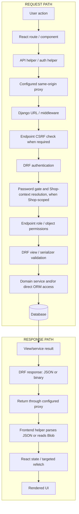
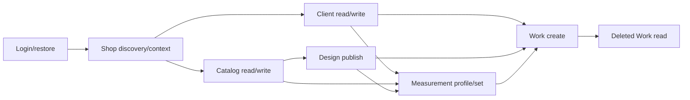
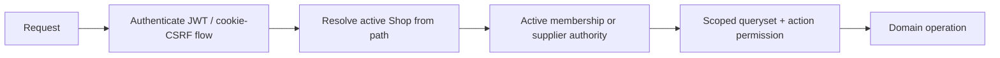

# 02 — API FLOW

## 0. Purpose

This is an execution map of **current local code**, not an endpoint catalog or a release guarantee. A planned API is never current until implemented and verified. Backend evidence is dirty `main` at `d6560c7c5457df11820686c6b6f3f204338c530a`; the active sibling frontend checkout is dirty `frontend/parallel-foundation` at `9ff32bc30d94744cfa0c432e4bb1c57d4182a20c`. `main/frontend` contains a different, newer local auth/recovery implementation. Both are explicitly identified below; neither deployed version is verified. Detailed ownership/history belongs in [01-DATA-FLOW.md](01-DATA-FLOW.md). Code proves implementation, not automatically approved business meaning. Targeted local DB snapshots and Render service metadata were inspected for the Variant-retirement audit. A staging HTTP smoke request was attempted in the release preflight but DNS resolution failed before an HTTP response; staging DB SQL is blocked, and no Production DB exists to inspect.

### 2026-10-26 — Phase 5 local runtime schema delta

The 9 pending local `devdb` migrations (`catalog.0025`/`0026`, `works.0003`,
`billing.0001`–`0006`) were applied after a verified local backup and isolated
restore check. Django system check and migration drift check pass; local backend
readiness and frontend root both return HTTP 200. Billing callers/contracts did
not change in this migration. Authenticated feature flow was previously tested
with synthetic data on disposable PostgreSQL; a new authenticated browser flow
against this migrated `devdb` was not run in this refresh. Staging/production
parity remains unverified.

## 1. System API Flow — One-View Map

The request and response lanes are opposite directions through one endpoint interaction. `main/frontend` has a Vite development proxy that forwards `/api` to the configured backend and checks browser Origin for mutations, plus a Cloudflare Pages proxy function; the separately checked-out sibling frontend has its own configuration too. Deployment/proxy parity is **UNVERIFIED**. The client includes cookies, sends the in-memory Bearer access JWT when present, adds `X-CSRFToken` for mutations when bootstrapped, and retries one authenticated 401 after a single-flight refresh. Endpoint-specific CSRF protection runs where configured; DRF then authenticates, and `ShopContextMixin.perform_authentication` applies the password gate and resolves/attaches Shop context before DRF endpoint permission checks. JSON helpers parse JSON; binary endpoints use a separate Blob reader through the same request path. Identical in-flight no-options reads are coalesced; this is **not** a persistent cache, and no React Query/SWR cache was found in the inspected paths [AF1]. Django/DRF execution is not a single universal service chain: a view uses a domain service, direct ORM access, or both. Response serialization/format is endpoint-specific [AF1,AB1,AB2].

## 2. API Surface Overview

| Domain | Main endpoint area | Frontend consumer | Auth/Tenant scope | Read/Write |
|---|---|---|---|---|
| Session/profile | `/api/v1/auth/` | Login, AuthProvider, profile | Login/CSRF public; protected profile JWT | Both |
| PIN recovery (main copy) | `/api/v1/auth/pin-reset-requests/` | `main/frontend` recovery/back office | Public request; supplier review | Both |
| Shop context/admin | `/api/v1/tenants/`, `/api/v1/shops/{shop_id}/context/` | ShopProvider, BackOffice | JWT; supplier or active membership | Both |
| Users/memberships/functions | `/api/v1/auth/users/`, `/api/v1/memberships/`, `/api/v1/shops/{shop_id}/users/` | Users page | Role/function and Shop service checks | Both |
| Clients/related people | `/api/v1/shops/{shop_id}/clients/` | Clients and Measurements | Active Shop; Client role matrix | Both |
| Global/Shop catalog | `/api/v1/catalog/`, `/api/v1/shops/{shop_id}/catalog/` | Catalog/back office/Designs | Supplier-global or Shop permission | Both |
| Designs/private media | `/api/v1/shops/{shop_id}/designs/`, `design-versions/` | Designs, Measurements | Shop draft/publish checks; private media scope | Both |
| Measurements/materials | Shop `measurement-definitions/`, nested `measurement-profiles/`, `materials/` | Measurements, Client workspace | Shop, wearer and function checks | Both |
| Inventory/stock | Shop `inventory/items/` | MaterialsInventoryPage | Shop Material policy | Both |
| Work/orders | Shop `works/` | Orders, Measurement final review | Shop + role/function/stage checks | Both |
| Design price | Shop `design-prices/{design_id}/` | Supported sibling frontend `DesignEditor` | Active Shop + ADMIN or CASHIER STAFF | Both |
| Billing | Work invoices, invoice detail/items/issue/payments, outstanding | Supported sibling frontend `BillingPanel`, Orders, Billing History | Active Shop + ADMIN or CASHIER STAFF | Both |

All relative paths above have `/api/v1/` prefix unless displayed fully. Billing is implemented locally by R5-01; Reports remain a target product area and are not a registered API flow [AB1].

## 3. API Flow Registry

### 3.1 — Login, restore, protected request, logout

#### User / System Trigger
Login form submit; AuthProvider mount; protected API 401; explicit sign-out.
#### Frontend Entry Point
- Route/page: `/login`, protected routes in `frontend/src/App.tsx`.
- Component: `LoginPage`, `AuthProvider`.
- Hook/state/query: `useAuth`; in-memory access token/CSRF, `authGeneration`, single-flight `refreshPromise`.
- API client/helper: `authService`, `bootstrapCsrf`, `apiRequest`, `refreshSession` in `frontend/src/services/`.
#### Request
- Method/path: `GET /api/v1/auth/csrf/`; `POST /api/v1/auth/login/` with `identifier,password`; `POST /api/v1/auth/token/refresh/` with cookie+`X-CSRFToken`; `POST /api/v1/auth/logout/`; protected requests use `Authorization: Bearer`.
- Important fields/query: login identifier/password; refresh request has **no token body**; logout body `{}` in frontend.
- Headers/context: `credentials: include`; HttpOnly `refresh` cookie; CSRF token/header for refresh/logout. Current sibling restore additionally `GET /api/v1/auth/users/me/`; `main/frontend` restore uses `refresh.user` directly.
#### Authentication / Authorization
- Login/CSRF anonymous; refresh validates cookie, active/login-enabled User and `auth_version`; `/users/me/` and logout require authenticated access; password-change gate permits only designated actions.
- Shop context: not selected in auth endpoints; Shop authorization begins downstream.
- Failure: missing/invalid refresh 401 or token error; protected 401 triggers one refresh/retry; forced password change 403 on gated operations [AB2,AF1].
#### Backend Execution Path
`apps/accounts/urls.py` → `csrf_bootstrap` / `CustomTokenObtainPairView` / `CustomTokenRefreshView` / `UserViewSet.me` / `logout_view` → login/refresh serializers and `UserSerializer` → User/JWT blacklist. No Shop service is invented here.
#### Data Reads
User identity, active/login-enabled state, token version; refresh cookie and CSRF state.
#### Data Writes
Login/refresh cookie rotation, logout blacklist/cookie clear, login counters; no business-domain row mutation. See `01-DATA-FLOW.md` for account identity.
#### Transaction / Concurrency Behavior
Frontend refresh is single-flight; stale auth generation rejects old results. Backend token rotation/reuse policy is configured in JWT settings; no browser/runtime assertion here.
#### Response
CSRF `{csrf_token}`; login/refresh 200 `{access,user}` with canonical User serializer, refresh token only in HttpOnly cookie; logout 200 message. Errors handled by `ApiError` status/code parsing.
#### Frontend Post-Response Behavior
Login stores access token in memory and User session; AuthProvider sets route state. Sibling restore calls `/users/me/` after successful refresh; main copy consumes `refresh.user` without that read. Logout clears local credentials/session even if request fails.
#### Failure / Retry Behavior
`apiRequest` retries one protected 401 after refresh; terminal 401 clears credentials. Network errors are surfaced as status 0; restore treats 401 as logged out and may swallow other non-network errors. Login displays error; no automatic login retry.
#### Downstream Consumers
All Shop routes; Shop discovery/context follows successful User session.
#### Compatibility Risk
Removing `user` breaks main restore; removing `/users/me/` breaks sibling restore. Cookie/CSRF, `must_change_password`, and `is_main_supplier_admin` affect routing/security. The sibling's extra read must not be called redundant without validating its freshness purpose.
#### Evidence
Frontend: `frontend/src/App.tsx`, `frontend/src/services/auth.ts`, `frontend/src/services/apiClient.ts`, `frontend/src/services/AuthContext.tsx`; sibling equivalents under `../sgtp-frontend/frontend/src/services/`. Backend: `apps/accounts/urls.py`, `apps/accounts/views/__init__.py`, `apps/accounts/serializers/__init__.py`, `apps/accounts/authentication.py`. Tests: `apps/accounts/tests/test_auth_lifecycle.py`; frontend `frontend/src/services/auth.test.ts`. Schema/docs: `schema.yml`, `docs/API.md`. Status: **PARTIAL** (two local frontend contracts, no runtime parity).

### 3.2 — PIN recovery and credential change

#### User / System Trigger
Shop ADMIN submits registered phone; Main Supplier reviews pending queue; user changes initial/temporary PIN.
#### Frontend Entry Point
- Route/page: `main/frontend` `/forgot-password`, `/backoffice/pin-reset-requests`, `/password-change`; sibling `/reset-password` is legacy email flow.
- Component: `PinResetPage`, `PinResetRequestsPage` in `main/frontend`; sibling `features/auth/PasswordResetPage.tsx`.
- Hook/state/query: local `busy`/in-flight flags, pending rows, one-time PIN modal.
- API client/helper: `main/frontend/src/services/pinReset.ts`; sibling `services/auth.ts` for obsolete email calls.
#### Request
- Method/path: public `POST /api/v1/auth/pin-reset-requests/` `{phone}`; supplier `GET .../pending/`, `POST .../{id}/approve/`, `POST .../{id}/reject/`; authenticated `POST /api/v1/auth/users/password/change/` with current/new PIN fields.
- Headers/context: credentialed helper; protected actions Bearer; public request has no access requirement.
#### Authentication / Authorization
Phone request is public and non-disclosing, subject to abuse limits; supplier-only queue/decision; password change requires authenticated user and current credential. No phone-only credential change.
#### Backend Execution Path
`apps/accounts/urls.py` → reset request/list/approve/reject functions or `UserViewSet.password_change` → `apps/accounts/services/shop_admin_pin_reset.py`, serializers/security → reset request/User rows.
#### Data Reads
Eligible ADMIN by phone, pending requests, actor and current credential.
#### Data Writes
Request row; approve issues temporary PIN and changes credential/auth version; reject resolves request without PIN; password change replaces credential and revokes sessions.
#### Transaction / Concurrency Behavior
Reset resolution service is transactional and one-time; frontend in-flight ref prevents duplicate local submit. Cross-worker abuse/race protection belongs to backend services [AB2].
#### Response
Public request always generic 200 detail; pending list 200; approve 200 includes one-time `temporary_password`; reject 200 status; errors are not retried automatically.
#### Frontend Post-Response Behavior
Main recovery page shows generic success; queue removes resolved row locally, and approve opens one-time PIN modal; password change clears session.
#### Failure / Retry Behavior
Main pages show error and retain actionable form/row. Sibling email reset request/confirm paths are absent from `main/apps/accounts/urls.py` and thus cannot complete against this backend.
#### Downstream Consumers
Next login and first-login password-change gate.
#### Compatibility Risk
Removing legacy email routes without moving active sibling UI makes its recovery journey fail. One-time PIN field and no-store headers are sensitive contract parts.
#### Evidence
Frontend: `frontend/src/{PinResetPage.tsx,backoffice/PinResetRequestsPage.tsx,services/pinReset.ts}`; sibling `../sgtp-frontend/frontend/src/{features/auth/PasswordResetPage.tsx,services/auth.ts}`. Backend: `apps/accounts/{urls.py,views/__init__.py,services/shop_admin_pin_reset.py,serializers/__init__.py}`. Tests: `apps/accounts/tests/test_login_pin_reset.py`. Schema/docs: `schema.yml`, `docs/API.md`. Status: **PARTIAL** (confirmed branch drift).

### 3.3 — Shop discovery, context, creation, and lifecycle

#### User / System Trigger
Shop user session restore; supplier Back Office list/create/edit/deactivate Shop.
#### Frontend Entry Point
- Route/page: `/backoffice/shops`, `/backoffice/shops/new`, `/backoffice/shops/:shopId`; ordinary Shop routes.
- Component: `BackOfficePages`, `CurrentShopProvider`.
- Hook/state/query: paginated list/search filters; provider resolves first authorized Shop then context; page local state.
- API client/helper: `shopsService` in `frontend/src/services/shops.ts`.
#### Request
- Method/path: `GET/POST /api/v1/tenants/`, `GET/PATCH /api/v1/tenants/{id}/`, `POST .../{id}/activate|deactivate/`, `GET /api/v1/shops/{shop_id}/context/`.
- Important fields/query: create `name,slug,max_users,first_admin`; list search/page/status/order; context path Shop UUID.
#### Authentication / Authorization
JWT and password gate; create/update/lifecycle supplier-only. Ordinary list/detail are authorization-filtered. Context resolves active Shop after auth, supplier or active membership, and denied/unavailable Shop is uniform 404; unauthenticated 401.
#### Backend Execution Path
`core/urls.py` + `apps/tenants/urls.py` → `TenantViewSet` or `ShopContextView` → Tenant serializers or context serializer → `create_shop_with_first_admin`/`update_shop`/`set_shop_active` or `resolve_shop_context` → Tenant/User/Membership.
#### Data Reads
Authorized Shop summaries/detail, membership/functions, Shop active state.
#### Data Writes
Shop+first ADMIN transactionally; profile/lifecycle updates. Context GET does not write business rows.
#### Transaction / Concurrency Behavior
Shop creation service is atomic; context is request-local. No frontend persistent cache; list/page state is local.
#### Response
Paginated list; context `{shop_id,role,is_main_supplier,work_functions}`; creation 201 includes one-time first-admin credentials with no-store; lifecycle status.
#### Frontend Post-Response Behavior
Provider stores Shop/context; Back Office list sets rows/count, create navigates or shows credentials; edit stores returned Shop; activate/deactivate explicitly re-fetches detail.
#### Failure / Retry Behavior
Page error states; denied context prevents operational Shop flow. No automatic retry beyond global protected-401 handling.
#### Downstream Consumers
Every `/shops/{shop_id}/...` frontend call and role-gated control.
#### Compatibility Risk
Changing Shop discovery/context sequencing can break all Shop pages; `work_functions`/role change affects UI, while backend remains authority.
#### Evidence
Frontend: `../sgtp-frontend/frontend/src/{services/shops.ts,hooks/useCurrentShop.ts,backoffice/BackOfficePages.tsx}`. Backend: `apps/tenants/{urls.py,context.py,context_views.py,views/__init__.py,services/membership.py}`. Tests: `apps/tenants/tests/{test_shop_context.py,test_tenants.py}`. Schema/docs: `schema.yml`, `docs/API.md`. Status: **PARTIAL** (runtime unverified).

### 3.4 — Shop users, memberships, and Work Functions

#### User / System Trigger
Admin opens Users, creates account, changes role/activity, or sets functions.
#### Frontend Entry Point
- Route/page: `/users`; supplier Shop detail.
- Component: `UsersPage`, User form/actions.
- Hook/state/query: local paginated member rows and separate function selections.
- API client/helper: `frontend/src/features/users/api.ts` (`usersApi`).
#### Request
- Method/path: `GET/PATCH/DELETE /api/v1/memberships/` and `{id}/`; `POST .../{id}/deactivate|reactivate/`; `POST /api/v1/shops/{shop_id}/users/`; `GET/PUT /api/v1/shops/{shop_id}/memberships/{id}/functions/`; `GET /api/v1/tenants/{id}/stats/`.
- Important fields/query: membership `tenant,search,role,is_active,page`; create user identity/role; function code list.
#### Authentication / Authorization
JWT/password gate; list queryset and object permission scope to authorized Shop; role/activity/function services recheck manager authority. Frontend role visibility is not authorization.
#### Backend Execution Path
`apps/tenants/urls.py` routers/paths → `TenantMemberViewSet`, `ShopUserCreateView`, `MembershipWorkFunctionView` → membership/user/function serializers → `apps/tenants/services/{membership,shop_accounts,work_functions}.py` → User/Membership/function models.
#### Data Reads
Authorized memberships, Shop stats, existing function rows, target account.
#### Data Writes
User/membership/function creation or mutation; removal is service-controlled.
#### Transaction / Concurrency Behavior
Membership and function services use atomic blocks/locks for protected updates; exact outcome of any race is test-specific, not inferred from UI.
#### Response
Paginated membership/Shop stats; creation returns account/member and one-time credential fields; function GET/PUT returns chosen codes; 400/403/404 possible by validation/authority/scope.
#### Frontend Post-Response Behavior
Users page updates local rows and/or reloads membership/statistics after mutations; exact action-specific refresh is indexed in §8.
#### Failure / Retry Behavior
Displays action error; failed mutation does not replace displayed row. No automatic mutation retry in client.
#### Downstream Consumers
Shop context/permissions, Work creation/stage assignment.
#### Compatibility Risk
Membership list shape and function code contract affect Users UI and Work eligibility. Changing account provisioning response can hide one-time PIN.
#### Evidence
Frontend: `../sgtp-frontend/frontend/src/features/users/{api.ts,UsersPage.tsx}`. Backend: `apps/tenants/{urls.py,views/membership.py,views/shop_users.py,views/work_functions.py,services/membership.py,services/work_functions.py}`; `apps/accounts/serializers/__init__.py`. Tests: `apps/tenants/tests/{test_membership_api.py,test_work_functions.py}`. Schema/docs: `schema.yml`, `docs/API.md`. Status: **PARTIAL**.

### 3.5 — Client and related-person list, write, delete

#### User / System Trigger
Client search/detail, add/edit/delete; related-person management.
#### Frontend Entry Point
- Route/page: `/clients`, `/clients/:clientId`, `/clients/:clientId/related-persons`.
- Component: `ClientsPage`, `ClientDetailPage`, `RelatedPersonsPage`.
- Hook/state/query: local list/detail; 250 ms client search debounce and stale-response request ID.
- API client/helper: `frontend/src/features/clients/api.ts` (`clientsApi`).
#### Request
- Method/path: `GET/POST /api/v1/shops/{shop_id}/clients/`; `GET/PATCH/DELETE .../clients/{id}/`; nested `related-persons/` and `/{id}/`.
- Important fields/query: `name,phone,email`; list `search,page`; parent IDs in path.
#### Authentication / Authorization
JWT, ShopContextMixin/TenantScopedMixin, ClientAccessPermission: member read; ADMIN/STAFF write; ADMIN delete; supplier Shop context permitted. Parent/child and object scoped to Shop; wrong-Shop IDs non-disclosing.
#### Backend Execution Path
`apps/clients/urls.py` → Client/RelatedPerson list/detail views → Client/RelatedPerson serializers → `create_contact`, `update_contact`, `soft_delete_contact` → ORM.
#### Data Reads
Shop-scoped contacts and duplicate candidates.
#### Data Writes
Create/update contact; DELETE soft-deletes.
#### Transaction / Concurrency Behavior
Write services are atomic and lock Shop/record as appropriate; duplicates warn rather than merge.
#### Response
GET paginated or detail; create 201 and update 200 include contact plus `warnings` (`possible_duplicate`); DELETE 204.
#### Frontend Post-Response Behavior
Client create closes form, displays warning matches, reloads current page or resets to page 1; delete reloads/backs page. Detail/related pages use returned or reloaded local state.
#### Failure / Retry Behavior
Validation/permission errors display; list load error displayed; network failures remain visible, no mutation retry.
#### Downstream Consumers
Measurements and Work read Client IDs; Client workspace links both.
#### Compatibility Risk
Changing warning shape/search/pagination breaks list and duplicate UI; Client ID/related-person path is used by Measurements.
#### Evidence
Frontend: `../sgtp-frontend/frontend/src/features/clients/{api.ts,ClientsPage.tsx,ClientDetailPage.tsx,RelatedPersonsPage.tsx}`. Backend: `apps/clients/{urls.py,views.py,serializers.py,services.py,permissions.py}`. Tests: `apps/clients/tests/test_clients_api.py`. Schema/docs: `schema.yml`, `docs/API.md`. Status: **PARTIAL**.

### 3.6 — Global/Shop catalog configuration

**Variant retirement implementation status (2026-10-18):** `main` now rejects
Global and Shop Variant create/update/archive/reactivate/default mutations with
HTTP 405 while retaining list/detail GETs and legacy Variant fields in Design
and Measurement reads. Design creation is Family-only and Work compatibility is
Family-based. The active sibling frontend no longer calls Variant write APIs;
its duplicate backend checkout still contains an older Variant-required Design
contract and is outside that worktree's backend ownership. The separate main
frontend copy also retains stale Variant UI. This is source inspection, not a
runtime/deployment parity claim.

**Local pairing decision for this checkout (verified 2026-10-18):** the
supported runnable pair is the sibling `frontend/parallel-foundation` UI with
the canonical `main` API. The Vite process observed on port 5173 comes from
`sgtp-frontend/frontend`; the Docker backend container is bind-mounted from
`sgtp`. The `main/frontend` UI and sibling duplicate backend remain runnable
but are deprecated and unsupported; their old Variant interactions/contracts
must not be treated as active API flows.

#### User / System Trigger
Supplier edits Family defaults; Shop configures Family/Option Groups. Variant
management/selection requests still exist in local code but are retired by
policy and must not be treated as supported active flows.
#### Frontend Entry Point
- Route/page: `/catalog`, `/backoffice/catalog` and design setup.
- Component: `CatalogPage`, `GlobalCatalogPage`.
- Hook/state/query: local filtered/paginated rows and form state; `getAllPages` follows server pagination for select lists.
- API client/helper: `features/catalog/api.ts`, `backoffice/catalog/api.ts`.
#### Request
- Method/path: Family/Option Group/Style Option routes are active catalog APIs. Global `/api/v1/catalog/variants/` and Shop `/api/v1/shops/{shop_id}/catalog/variants/` retain GET list/detail for legacy reads; POST/PATCH/lifecycle writes are rejected with 405 in local `main`.
- Important fields/query: family code/translations; option-group mapping; list locale/page/search/status/family where supported.
#### Authentication / Authorization
Global reads/edits use catalog view permission policy; global mutations supplier-only. Shop views resolve active Shop, validate owned/global availability and role; object IDs are filtered by scope.
#### Backend Execution Path
`apps/catalog/urls.py` → catalog `APIView` classes and serializers in `apps/catalog/views.py`/`serializers.py` → Family/Option models and services; legacy Variant GETs serialize existing rows. Variant mutation view/service code remains in source but is blocked by each view's allowed-method list.
#### Data Reads
Global active/default catalog and authorized Shop copies/configuration.
#### Data Writes
Create/update/archive catalog configuration; materialize a Shop-owned default family and copy each available global published default Design into a Shop-owned PUBLISHED snapshot plus the next editable DRAFT. The bootstrap path is Family-only and does not require active Variant materialization.
#### Transaction / Concurrency Behavior
Selected create/configuration/materialization services atomic; not every list/action has a single shared transaction. No client persistent cache.
#### Response
Paginated lists or detail/mapping payloads; validation and scope errors from DRF. Exact field contract differs by endpoint and is in serializers/OpenAPI.
#### Frontend Post-Response Behavior
Pages replace local rows or refetch affected list; design configuration reads resulting family/options.
#### Failure / Retry Behavior
Form errors leave draft state; read errors shown; no automatic mutation retry.
#### Downstream Consumers
Design creation/publish and measurement definition/family availability.
#### Compatibility Risk
Changing Family IDs, mapping response, or global-vs-Shop scope breaks dependent Design/Measurement screens. Legacy Variant reads and nullable response fields remain; the stale duplicated sibling backend still has a Variant-required Design input, so it must not be selected as the backend paired with this Family-only contract. The separate main frontend copy also remains stale; see `03-DEPENDENCY-IMPACT-MAP.md`.
#### Evidence
Frontend: `../sgtp-frontend/frontend/src/features/catalog/{api.ts,CatalogPage.tsx}`, `../sgtp-frontend/frontend/src/backoffice/catalog/{api.ts,GlobalCatalogPage.tsx}`. Backend: `apps/catalog/{urls.py,views.py,serializers.py,services.py}`. Tests: `apps/catalog/tests/test_catalog_api.py`. Schema/docs: `schema.yml`, `docs/API.md`. Status: **PARTIAL** (many endpoint variants summarized, not a field-by-field audit).

### 3.7 — Shop/global design edit, publish, and private references

#### User / System Trigger
Create design from garment/template; edit selections or references; publish version; supplier manages global template.
#### Frontend Entry Point
- Route/page: `/designs`, `/designs/:designId`, `/backoffice/designs/:designId`; Measurement page reads published design.
- Component: `DesignsPage`, `DesignEditor`, `GlobalTemplateEditor`.
- Hook/state/query: local design/detail state; draft form; sequential selection saves; upload state.
- API client/helper: `features/designs/api.ts`, `backoffice/designs/api.ts`, `services/privateMediaUpload.ts`.
#### Request
- Method/path: Shop `GET/POST /api/v1/shops/{shop_id}/designs/`, `GET/PATCH/DELETE .../designs/{id}/`, selection `POST/PATCH/DELETE .../design-versions/{id}/selections/`, `POST .../publish/`, private upload `POST .../catalog/media/uploads/`; analogous global design-template paths.
- Important fields/query: `family_id,name`, optional source version/selection IDs/idempotency key; selection style option; multipart file/kind/target; list family/page/locale.
#### Authentication / Authorization
Shop context or supplier-global authority; Shop write permission, publisher ADMIN or STAFF Tailor; draft/published state and source family checks; private upload/read checks target ownership.
#### Backend Execution Path
`apps/catalog/urls.py` → Design/Selection/Publish/PrivateMedia views → design and upload serializers → `apps/catalog/services.py` / private-media helper → Design/version/selection/private object metadata.
#### Data Reads
Catalog family/group/options; Design versions and source templates; existing reference metadata.
#### Data Writes
Design/draft, selections/translations/images, published version plus next draft; private media records/objects.
#### Transaction / Concurrency Behavior
Create/publish services atomic; optional design retry key is validated in service; upload can span storage/DB with compensating/on-commit handling. Frontend does not automatically retry mutations.
#### Response
Design detail/list includes read-only `family_status` alongside existing fields; the Order picker uses it to fail closed for archived parent Families. Selection, publish `{published,next_draft}` (serialized DesignVersion objects), reference metadata; 201 for create, 200 for publish, validation/permission errors.
#### Frontend Post-Response Behavior
DesignsPage reloads after create/archive; DesignEditor often re-GETs detail after selection/upload; publish updates local design from returned versions without broad list refresh.
#### Failure / Retry Behavior
Editor displays error; explicit Retry reloads detail. Sequential selection calls can leave earlier successful selections if later request fails; do not misstate them as one client transaction.
#### Downstream Consumers
Measurement optional design link and Work mandatory published DesignVersion.
#### Compatibility Risk
Selection/publish response fields, exact version IDs, and upload fallback affect editor and later Work; removing legacy upload route requires checking fallback callers.
#### Evidence
Frontend: `../sgtp-frontend/frontend/src/features/designs/{api.ts,DesignsPage.tsx,DesignEditor.tsx}`, `../sgtp-frontend/frontend/src/backoffice/designs/{api.ts,GlobalTemplateEditor.tsx}`, `../sgtp-frontend/frontend/src/services/privateMediaUpload.ts`. Backend: `apps/catalog/{urls.py,views.py,serializers.py,services.py,models.py}`. Tests: `apps/catalog/tests/{test_catalog_api.py,test_private_upload_transactions.py}`. Schema/docs: `schema.yml`, `docs/API.md`. Status: **PARTIAL**.

### 3.8 — Measurement definitions, profile, version, copy, compare, export

#### User / System Trigger
Open Client Measurements, select garment/wearer, add/save measurement, inspect history, copy/compare or export worksheet.
#### Frontend Entry Point
- Route/page: `/clients/:clientId/measurements`, `/measurements`; Client detail links.
- Component: `ClientMeasurementsPage`, `MeasurementEntryForm`, `MeasurementReview`.
- Hook/state/query: local catalog/owner/profile/sets state and reload key; paginated `allPages` reads; in-flight save/export guards.
- API client/helper: `features/measurements/api.ts` (`measurementApi`).
#### Request
- Method/path: `GET/POST /api/v1/shops/{shop_id}/measurement-definitions/`; nested Client or related-person `measurement-profiles/`, `.../{profile_id}/sets/`; `POST .../sets/{set_id}/copy/`; `GET .../compare/`; `GET .../worksheet.pdf`; `DELETE .../sets/{set_id}/`.
- Important fields/query: `family_id`; set `values[{definition_id,value,unit}]`, optional `design_version_id`; compare from/to IDs; PDF chosen set/design; `locale`.
#### Authentication / Authorization
JWT, Shop context and MeasurementAccess; supplier can configure definitions but cannot read Shop Client history; STAFF requires MEASUREMENT function for write; wearer/profile/set are Shop and parent scoped.
#### Backend Execution Path
`apps/catalog/urls.py` → `measurement_views.py` → measurement serializers → `measurement_services.py` for writes/copy/deactivation; scoped ORM/PDF for reads → profile/set/value rows.
#### Data Reads
Active wearer/profile, family-mapped definitions, versions/labels, published design when linked.
#### Data Writes
Profile and immutable numbered set/values, copied version, or active-state deactivation; PDF/compare are reads.
#### Transaction / Concurrency Behavior
Service writes atomic; profile row locked for version allocation; set copy independent; no frontend persistent cache.
#### Response
Paginated profiles/sets, set 201 with version/values/snapshots, copy 201, compare JSON, private portrait-A5 PDF binary (additional pages remain A5); invalid mapping/owner/version returns validation or non-disclosing not-found.
#### Frontend Post-Response Behavior
Selection loads definitions/sets; save/copy refreshes local history/state; PDF creates temporary browser object URL and revokes it; review leads to order creation route when a saved set exists.
#### Failure / Retry Behavior
Page sets errors and load-failed flags; save retains draft values; export reports error; no automatic mutation retry.
#### Downstream Consumers
Client history, Work create/validation, worksheet.
#### Compatibility Risk
Removing `values`, `version`, `design_version` or owner-nested route breaks form/history/Work; replacing multiple read calls without preserving selected owner/profile semantics is unsafe.
#### Evidence
Frontend: `../sgtp-frontend/frontend/src/features/measurements/{api.ts,ClientMeasurementsPage.tsx,MeasurementEntryForm.tsx,MeasurementReview.tsx}`. Backend: `apps/catalog/{urls.py,measurement_views.py,measurement_serializers.py,measurement_services.py}`. Tests: `apps/catalog/tests/test_measurements_materials_api.py`; frontend `frontend/src/features/measurements/api.test.ts`. Schema/docs: `schema.yml`, `docs/API.md`. Status: **PARTIAL**.

### 3.9 — Material list and inventory stock mutations

#### User / System Trigger
Open Materials; create/enable inventory item; opening, stock-in, adjust, movement history.
#### Frontend Entry Point
- Route/page: `/materials`; Measurement fabric selection.
- Component: `MaterialsInventoryPage`, `ClientMeasurementsPage`.
- Hook/state/query: local list/selected movement state; 250 ms search debounce; materials loaded once until explicit refresh; request-ID stale guard.
- API client/helper: `apiRequest` calls in `features/materials/MaterialsInventoryPage.tsx`; `measurementApi.fabrics`.
#### Request
- Method/path: `GET/POST /api/v1/shops/{shop_id}/materials/`, `GET/POST/PATCH /inventory/items/`, `POST .../opening|stock-in|adjust|archive/`, `GET .../movements/`; enable existing Material via `/materials/{id}/enable-inventory/`.
- Important fields/query: item name/code/category/stock_unit; stock quantity/reason/direction; list search/category/page.
#### Authentication / Authorization
JWT, Shop context and MaterialAccess; authorized reads, ADMIN/supplier-in-Shop write policy in service; item/movement queried under same Shop.
#### Backend Execution Path
`apps/catalog/urls.py` → `measurement_views.py` for Materials, `inventory_views.py` for stock → inventory/material serializers → `measurement_services.py` / `inventory_services.py` → Material/Balance/Movement.
#### Data Reads
Shop Materials, Balance, movement history.
#### Data Writes
Material/Balance creation or update, append-only StockMovement plus Balance update, archive status.
#### Transaction / Concurrency Behavior
Stock services atomic and lock Material/Balance; no automatic server polling verified.
#### Response
Paginated items and movement rows; mutation returns item/balance, 400 for invalid quantity/insufficient stock, 403/404 for authority/scope.
#### Frontend Post-Response Behavior
On save page closes dialog and reloads inventory/material lists; opening selected movement history is a conditional separate read. Measurement fabric chooser loads paginated FABRIC inventory rows.
#### Failure / Retry Behavior
Error displayed, dialog retained on failure; no automatic mutation retry.
#### Downstream Consumers
Measurement fabric display; optional Work Material link. No Work stock reservation is implied.
#### Compatibility Risk
Balance/movement response and unit strings are used by inventory UI; changing paginated shape breaks both Materials and Measurement fabric reads.
#### Evidence
Frontend: `../sgtp-frontend/frontend/src/features/materials/MaterialsInventoryPage.tsx`; `../sgtp-frontend/frontend/src/features/measurements/api.ts`. Backend: `apps/catalog/{urls.py,inventory_views.py,inventory_serializers.py,inventory_services.py,measurement_views.py,measurement_services.py}`. Tests: `apps/catalog/tests/test_inventory_api.py`. Schema/docs: `schema.yml`, `docs/API.md`. Status: **PARTIAL**.

### 3.10 — Work create, detail, stage/assignment, deleted archive

#### User / System Trigger
Measurement final review/New Order; Orders list/search/detail; ADMIN assign/edit/delete; eligible operator advances; ADMIN opens deleted orders.
#### Frontend Entry Point
- Route/page: `/orders`, `/orders/new`, `/orders/:id`, `/orders/deleted`.
- Component: `OrdersPage`, `DeletedOrdersPage`, MeasurementReview action.
- Hook/state/query: local paginated list/detail; selected order set from mutation response; deleted filters apply explicitly and Retry increments key.
- API client/helper: `features/orders/api.ts` (`ordersApi`).
#### Request
- Method/path: `GET/POST /api/v1/shops/{shop_id}/works/`; `GET/PATCH/DELETE .../works/{id}/`; `POST .../{id}/assign|advance/`; `GET .../works/deleted/`.
- Important fields/query: create `client_id,design_version_id,measurement_set_id`, optional wearer/material/priority/due_date/notes; assign `membership_id`; advance requires `expected_status` as a compare-and-set precondition; list search/status/priority/page; deleted search/date/page.
#### Authentication / Authorization
JWT, Shop context, IsTenantMember, Shop-scoped queryset. Create ADMIN or SALES/MEASUREMENT STAFF; metadata/assignment/delete ADMIN; stage function plus assignment checks; deleted archive ADMIN-only, non-disclosing cross-Shop lookup.
#### Backend Execution Path
`apps/works/urls.py` → Work list/detail/advance/assign/deleted views → `WorkCreate/Update/Assignment/Advance/DeletedFilters/WorkSerializer` → `works/services.py` → locked Work/membership and linked rows; successful mutations also append a WorkEvent in the same transaction.
#### Data Reads
Shop Work and linked Client/DesignVersion/parent Design status/MeasurementSet/Material, member functions; archive `all_objects` deleted rows.
#### Data Writes
Create Work, update metadata, assignment, next stage with assignment cleared, REQUEST-only soft delete; archive GET is read-only.
#### Transaction / Concurrency Behavior
Service writes atomic; create locks Shop → parent Family → selected Design for work-number allocation and current source eligibility; Work row lock serializes updates. The locked Family status check coordinates with Family archive. No create idempotency key verified; duplicate-submit protection is UI busy only. Due indicator derived in Shop timezone.
#### Response
Create 201 Work fields including number/status/source IDs/due indicator; mutation 200 updated Work; delete 204; list paginated; deleted rows include `deleted_date` and summary. Archived parent Family or Design on create returns the existing DRF 400 field-validation shape under `design_version`. Advance with an invalid/missing `expected_status` returns 400; if the locked current status differs, the service returns 409 (`stale_work`) without a transition, allowing duplicate/stale requests to be safely rejected.
#### Frontend Post-Response Behavior
Create navigates to new detail; detail assignment/advance/update replaces local order from response without list refetch; delete navigates to `/orders`; deleted archive applies filters to separate list.
The active sibling detail UI exposes only the immediate next stage as an action and sends the displayed stage as `expected_status`; it does not optimistically change status, permit rollback/skip, or send a second request while one is pending. A 409 triggers a detail refresh so the page reconciles to the server stage while keeping the conflict visible. Focused tests cover contract payload, success, failure, stale-conflict refresh, duplicate-action prevention, and missing stage-function authority.
#### Failure / Retry Behavior
Form/detail displays API error; list/archive explicit Retry; no automatic mutation retry; stale advance is not retried and returns 409; invalid date range rejected in UI and backend serializer. Work mutation plus audit-event failure rolls back atomically.
#### Downstream Consumers
Orders list/detail, deleted archive, Client/Measurement context.
#### Compatibility Risk
Changing Work response IDs/status or removing archive path breaks Orders; removing source validation risks wrong-Shop records. New Work from archived Families or Designs is blocked while historical references remain readable. `family_status` is an additive read-only Design response field consumed by the Order picker. Adding retry semantics requires deliberate idempotency design.
#### Evidence
Frontend: `../sgtp-frontend/frontend/src/features/orders/{api.ts,OrdersPage.tsx,DeletedOrdersPage.tsx}`; `../sgtp-frontend/frontend/src/features/measurements/MeasurementReview.tsx`. Backend: `apps/works/{urls.py,views.py,serializers.py,services.py,models.py}`. Tests: `apps/works/tests/test_work_api.py`; sibling frontend `frontend/src/features/orders/{api.test.ts,OrdersPage.test.tsx,DeletedOrdersPage.test.tsx}`. Both generated schema snapshots now include Work routes and `WorkCreateRequest`; generation validates with 0 errors and 29 existing warnings. Status: **PARTIAL / LIVE E2E UNVERIFIED**.

### 3.11 — Shop Design price, Billing, and private financial documents (Phase 5; local, unpublished)

#### User / System Trigger
Authorized financial user edits a Shop Design price, manages Work invoices and draft lines, issues an invoice, records payment, creates/records a credit/refund, reviews history/outstanding balances, or requests/downloads an invoice, receipt, or credit-note PDF. Main Supplier Super Admin may also review a selected Shop's issued invoices and manually purge a confirmed invoice bundle.
#### Frontend Entry Point
Supported sibling frontend callers are the Design editor price control, Work-detail Billing panel, Billing History page, and Main Supplier Back Office Financial Purge page in `../sgtp-frontend/frontend/src/`. Normal finance callers use the shared API client and selected Shop context. That context response includes nullable `billing_currency` only for Shop ADMIN and active CASHIER STAFF; `useCurrentShop` passes it to the billing consumer. Main Supplier Super Admin explicitly selects a Shop and uses only the invoice-history GET and dedicated purge POST. Non-financial Shop users do not load Billing records or receive the field. Billing writes refresh the relevant invoice state; PDF creation is on-demand and does not refetch financial history.
#### Request
- Price: `GET/PUT /api/v1/shops/{shop_id}/design-prices/{design_id}/`; PUT accepts only amount; currency comes from Shop `default_currency`.
- Invoice reads: Shop history at `/api/v1/shops/{shop_id}/billing/invoices/?status=&from=&to=`, Work invoices at `/works/{work_id}/invoices/`, detail at `/invoices/{invoice_id}/`, and `/billing/outstanding/`.
- Draft writes: create Work invoice with AUTO/MANUAL and optional manual lines; `POST/PATCH/DELETE .../invoices/{invoice_id}/items[/<item_id>]/`; update optional discount/tax at `/adjustments/`.
- Issue/pay/void/credit/refund: `/issue/`, `/payments/`, `/void/`, `/credit-notes/`, `/credit-notes/{credit_note_id}/issue/`, and `/credit-notes/{credit_note_id}/refunds/` under the selected Shop paths.
- Documents: `POST .../invoices/{invoice_id}/documents/`, `POST .../payments/{payment_id}/receipt/`, `POST .../credit-notes/{credit_note_id}/documents/`, then protected `GET .../financial-documents/{document_id}/download/`. Document locale is an optional override; omission resolves User preference → authorized Shop locale → English. New rendition layout version 2 is portrait A5; existing immutable version 1 files remain available.
- Every financial write requires `Idempotency-Key`; the server binds the key to actor, Shop, operation and request hash. `X-Request-ID` is retained for audit correlation. Document POST is deduplicated by source record + locale + layout version.
- Manual purge: `POST /api/v1/shops/{shop_id}/invoices/{invoice_id}/purge/` is limited to persisted Main Supplier Super Admin authority. It requires a nonblank reason, exact invoice-number confirmation, and `Idempotency-Key`. The service records a pending tombstone before deleting private objects; only after file deletion succeeds does it remove the invoice bundle rows. A file failure preserves financial rows and returns a retryable error. Existing audit/idempotency records and sequence counters remain. Purge completion appends an audit event. No automatic purge path exists.
#### Authentication / Authorization
Authenticated selected active-Shop context and password gate. Only Shop ADMIN or active STAFF with active CASHIER Work Function may read/set prices and use normal Billing operations. Main Supplier Super Admin has selected-active-Shop invoice-history GET and the dedicated manual purge action only; the purge route is separately guarded and does not elevate normal billing mutation access. Inactive Shops remain disabled in the selector because current Shop context requires `is_active=True`. The context response exposes only the billing currency to these finance-authorized Shop members; other Shop defaults remain omitted. Work Functions alone do not grant Shop access.
#### Backend Execution Path
`core/urls.py` → catalog/billing URL registrations → serializers → locked catalog/billing services → Shop-scoped records. Financial mutation response snapshots are written in the same transaction as each new `FinanceMutation`; retries return that saved response/status, while legacy rows without snapshots use a compatibility lookup. PDF endpoints validate the financial source, render from persisted invoice/payment/credit values using shared A5 page geometry, store through private `PrivateReferenceStorage`, persist the `FinancialDocument` layout version, and stream bytes only after an authorized same-Shop metadata lookup.
#### Data Reads / Writes
Price is keyed by Shop+Design and currency is derived from Shop setting. Work creation snapshots any existing price/currency. AUTO invoice adds that snapshot when present; MANUAL lines use description, quantity, unit price. Issue assigns a Shop-sequential number and freezes invoice/lines. Payments append to one invoice. Optional fixed/percentage discount and optional tax are included in canonical Decimal totals. Credit notes and manual refund records preserve prior issue/payment rows. RelatedPerson invoices use Work's Primary Client as billing owner. Generated PDF metadata/file are derived artifacts; they do not change canonical money.
#### Transaction / Concurrency Behavior
Financial writes are atomic and acquire the active Shop row lock, then lock the relevant Work/Invoice/source records. This serializes Shop financial mutations and number assignment. Currency-scale validation rejects excess decimals; overpayment is rejected. New idempotency records save the first serialized response and HTTP status. Existing records created before response snapshots were introduced fall back to the resource lookup behavior without a migration backfill.
#### Response / Failure
JSON detail includes invoice status, currency, line values, totals, payments and credit/refund history. Empty draft cannot be issued; payment is accepted only for ISSUED invoice; only unpaid issued invoices may be voided. Wrong-Shop/missing object is nondisclosing 404; permission denial 403; invalid money/state 400. Document metadata exposes identity/kind/locale/checksum/time but no storage path or public URL. Download returns `application/pdf`, `private, no-store`, and `nosniff`; unavailable storage returns an API error.

The Back Office Financial Purge page binds its manual Retry action to the failed operation: Shop-list failure repeats the authorized Shop-list read, invoice-history failure repeats the selected-Shop history read, and purge/storage failure repeats the confirmed purge request using the still-open reason and exact invoice number. A purge response that is not `COMPLETED` leaves financial records protected and keeps the confirmation available for retry; successful purge refreshes invoice history. These are caller-side retries against the existing endpoints; the API contract and authorization are unchanged. FinancialPurgePage tests cover the three retry targets and storage-failure behavior (8/8 passed on 2026-10-25).
#### Compatibility / Scope
Billing UI and private document endpoints are current local source and passed authenticated E2E on synthetic disposable PostgreSQL. There is no supplier-wide aggregate/report API or background-job API; bounded PDF generation is synchronous. Draft creation is allowed at any Work stage; issue/payment never advances Work stage. Work delete refuses linked invoices. The optional finance-only `billing_currency` context property is additive; non-finance response fields remain unchanged. Purge is the explicit Main Supplier exception: it removes one invoice bundle after reason/number confirmation, retains its tombstone plus old audit/idempotency/sequence records, and supports safe retry after storage failure. All Billing migrations through `billing.0006` are now applied to local `devdb`; deployed parity is unverified.
#### Evidence
`apps/tenants/context_views.py`, `apps/catalog/{urls.py,views.py,serializers.py,price_services.py}`, `apps/billing/{urls.py,views.py,serializers.py,services.py,models.py,pdf.py,idempotency.py}`, `apps/works/{services.py,models.py}`, and `core/urls.py`; sibling callers are under `src/features/{designs,orders,billing}/` plus `src/hooks/useCurrentShop.ts`. All four generated backend/sibling schema snapshots are identical and validate with 0 errors / 29 existing warnings. Historical 2026-10-22 evidence: backend 587/587 before the narrow context change, focused post-change Shop-context/Work/Billing 54/54, and frontend 225/225 plus typecheck/build passed. Current 2026-10-25 evidence: Django 486/486, pytest 593/593, supported frontend 233/233, frontend typecheck/build, Django check, migration drift, FinancialPurgePage 8/8, authenticated purge browser-to-API E2E against a synthetic invoice in a disposable DB, and Project State Validator passed. Current 2026-10-26 evidence: focused Billing/pricing backend tests 21/21 on disposable PostgreSQL; all 9 pending migrations applied to `devdb`; no pending migration operations; Django check/migration drift and local backend/frontend readiness passed. The retry UI correction does not change route, payload, permission, persistence, or schema. Deployed parity remains unverified.

## 4. REQUEST PURPOSE CLASSIFICATION

| Important request | Classification | Why it exists / evidence |
|---|---|---|
| CSRF bootstrap before login/refresh/logout | REQUIRED AUTHORITATIVE READ | Supplies masked CSRF token and cookie [AF1,AB2] |
| Login/refresh/logout/password/PIN/Shop/Client/catalog/design/measurement/stock/Work/Billing writes | MUTATION | Changes auth or business state [AF1–AF4,AB2–AB8] |
| Authorized Shop list + context | REQUIRED AUTHORITATIVE READ / PERMISSION / OWNERSHIP CHECK | List chooses Shop; context gives server-authorized role/functions [AF2,AB3] |
| Client/design/Work list/detail | REQUIRED AUTHORITATIVE READ | Renders current server rows; no persistent cache [AF3,AB4–AB7] |
| Measurements definitions/profile/set history | REQUIRED AUTHORITATIVE READ / HISTORY / VERSION READ | Form options and selected saved version [AF3,AB5] |
| Inventory movement history, worksheet PDF, deleted Work | CONDITIONAL READ / HISTORY / VERSION READ | Opened or exported on user action [AF3,AB5–AB7] |
| `/users/me/` after refresh in sibling | UNKNOWN / REQUIRES REVIEW | Backend refresh supplies `user`; sibling still reads `/me`; main copy does not [AF1,AB2] |
| Client list after create/delete; Design detail after selection/upload; inventory lists after mutation | POST-MUTATION REFRESH | UI obtains authoritative current representation [AF3] |

No request is declared redundant solely from count.

## 5. API DEPENDENCY MAP

| Source flow | Dependent flow | Shared contract | Break risk |
|---|---|---|---|
| Auth → Shop | All Shop pages | access JWT, User, active Shop/context | 401/403/404 route state and wrong scope |
| Client/catalog → Measurement | Profile and set creation | wearer/family IDs, mapped definition IDs | wrong owner or missing options |
| Catalog → Design publish | Design editor | family/group/style IDs, published/draft versions | invalid selections and old snapshots |
| Design + Measurement + Client → Work | New Order | exact published version/set/client IDs | rejected create or wrong linkage |
| Work write → Orders read/archive | List/detail/deleted view | Work ID/status/number/deleted date | stale UI or archive break |

## 6. FRONTEND CONSUMER MAP

| Endpoint / flow | Frontend consumer(s) | Query/state owner | Refresh/invalidation |
|---|---|---|---|
| Auth login/refresh/me | LoginPage, AuthProvider; sibling `/me/` only | in-memory auth service/Context | login sets session; refresh replaces access; 401 clears session |
| Shop list/context | CurrentShopProvider, BackOfficePages | provider or page local state | provider on User change; BackOffice filter/page state |
| Memberships/functions | UsersPage, Shop detail | page local state | mutation-specific reload/local replace; no global cache |
| Client list/detail/related | ClientsPage, ClientDetailPage, RelatedPersonsPage, Measurements, Orders detail | each page local state | list reload after create/delete, detail on route/client change |
| Catalog family/options | CatalogPage, DesignsPage/Editor, Measurements, BackOffice catalog | page local state | list/detail reload or local replace after writes |
| Shop/global design/version | DesignsPage/Editor, GlobalTemplateEditor, Measurements, Work create | page local state | editor detail re-GET after selections/uploads; publish local replace |
| Measurement definitions/profiles/sets/PDF | ClientMeasurementsPage, Client detail | page local state | reload key/history refresh; export no cache mutation |
| Materials/inventory/movements | MaterialsInventoryPage, Measurement fabric chooser | page local state | list reload after stock write; movements on open |
| Work list/detail/assign/advance | OrdersPage, MeasurementReview navigation | page local state | detail mutation response replaces state; list loads on filter/page |
| Deleted Work list | DeletedOrdersPage | local filter/page/retry state | new GET when filters/page/retry change |
| PIN recovery | main PinResetPage, PinResetRequestsPage; sibling legacy reset page differs | page local state | queue row removal, one-time modal; no background poll |

## 7. AUTH / TENANT / PERMISSION FLOW

Authentication runs before `ShopContextMixin` context resolution; password-change gate is checked there, then `resolve_shop_context` attaches trusted Shop. `TenantScopedMixin` and domain querysets/services recheck Shop/owner. Auth failure is 401; inaccessible/unavailable Shop and wrong-Shop objects generally 404; role/function denial generally 403; serializer/domain validation generally 400. Exact error body can vary by view (`detail`, field errors, `code`); `apiRequest` normalizes an `ApiError`. These are code-level paths, **not** a blanket guarantee for every route. UI role hiding never grants authority [AB3–AB7].

Global catalog, supplier Shop administration, and public reset/login are explicit exceptions to Shop-path context; they have separate authority gates. The ordinary User Shop selector is not a free arbitrary `shop_id` input: provider reads an authorized Shop then requests its context.

## 8. MUTATION + REFRESH FLOW

| Mutation | Response → state change | Refresh/invalidation → UI | Request-shape note |
|---|---|---|---|
| Login/logout/refresh | User/access in Context, or clear session | Protected routes render from Context | Refresh single-flight; sibling restore performs extra `/me/` |
| Shop create/edit/lifecycle | New/updated Shop detail | Create shows one-time credentials; lifecycle re-GETs detail | No global cache invalidation |
| Membership/function write | Returned row/function data | Users page re-reads selected membership/statistics or locally updates | Exact action-specific sequence in page, not one global strategy |
| Client create/delete | Contact/204 and warnings | Current list re-GET or page reset; duplicate warning shown | Debounced search/stale guard |
| Design create/archive | Design response | Designs list re-GET; editor selection/upload re-GET detail | Multiple selection saves can be sequential |
| Design publish | Published + draft result | Editor replaces local Design state | No broad list refresh verified on publish |
| Measurement save/copy/delete | New/changed version | Local set/history refresh; PDF export no invalidation | Pagination can require multiple GETs |
| Inventory write | Item/balance response | Inventory/material lists reload; movements on demand | Parallel inventory+material reads on load |
| Work create | New Work | Navigate to detail | No backend create idempotency key verified |
| Work assign/advance/edit/delete | Updated Work/204; advance may return 409 | Detail replaces local row; stale advance refreshes detail; delete navigates; archive separately refetches | Audit event commits atomically; no automatic list-wide invalidation |
| PIN decision | Resolution + one-time PIN | Queue filters row locally; modal displays PIN | No automatic pending-list refetch |

`apiRequest` clears only its **in-flight** read map before mutations; it does not invalidate a persistent normalized cache. There is no safe basis here to remove a follow-up read without checking its UI/data purpose [AF1,AF3].

## 9. API PERFORMANCE / REQUEST SHAPE RISKS

| Observation | Classification | Evidence / boundary |
|---|---|---|
| Sibling restore serializes CSRF → refresh → `/users/me/`; main copy uses refresh payload | VERIFIED | `auth.ts` comparison; whether `/me/` is intentionally fresher is UNKNOWN [AF1] |
| `CurrentShopProvider` performs authorized list then context sequentially | VERIFIED | `useCurrentShop.ts`; second read is an authority/function contract, not automatically redundant [AF2] |
| Measurement and design `allPages` helpers fetch pages sequentially | VERIFIED | `measurementApi`/`getAllShopDesigns`; bounded by result count, not necessarily avoidable [AF3] |
| Design editor saves multiple selected options as separate mutation requests | VERIFIED | `DesignEditor.tsx`; partial success on later failure needs UX review [AF3] |
| Backend N+1 across every list serializer | UNVERIFIED | Selected views use `select_related`/`prefetch_related`, but no query-count audit was run [AB4–AB7] |
| Polling/background broad refetch | UNVERIFIED | No polling in inspected flows; not a system-wide absence claim |

No optimization was performed.

## 10. API CONTRACT COMPATIBILITY

| Contract | Current consumers / required fields | Old consumer or migration need |
|---|---|---|
| Refresh `{access,user}` + HttpOnly cookie | Main restore needs `user`; sibling refresh ignores it then `/me/` needs User serializer | Keep `/me/` until sibling migrated/verified; never remove cookie/CSRF contract silently |
| PIN reset phone/request/approve response | Main reset pages need generic `detail`, pending rows and one-time `temporary_password` | Sibling still calls removed email reset routes: frontend migration needed |
| Shop context `{shop_id,role,is_main_supplier,work_functions}` | Provider and role display; backend still validates every write | Changing discovery/context requires provider and permission regression |
| Client contact/pagination/warnings | Clients/Measurements/Orders use ID, name, contact and warning list | Keep nested related-person route or migrate all consumers |
| Design version/selection/publish | Editors, Measurements, Work use exact IDs/status/version | Publish shape and private upload fallback require coordinated frontend change |
| Measurement profile/set/value | Measurement form/history/PDF, Work create use owner/profile/version/values | Historical version routes and snapshots are compatibility-sensitive |
| Inventory item/page/movement | Materials and Measurement fabric picker use page results, category/unit/availability | Update both consumers before shape/path change |
| Work list/detail/deleted | Orders UI uses `work_number`, IDs, status, due indicator, `deleted_date` | Both generated OpenAPI snapshots now include Work routes/create schema; deployed parity remains unverified |

## 11. ERROR / FAILURE FLOW MAP

| Flow | Validation Failure | Auth Failure | Tenant/Permission Failure | Server Failure | Frontend Result |
|---|---|---|---|---|---|
| Login/restore | Invalid credential/refresh token | 401 clears session | Forced-change 403 gate | Network status 0 / 5xx | Login error or unauthenticated route; sibling `/me/` can add failure point |
| Shop/context | Invalid create input | 401 | 403 supplier action; 404 inaccessible Shop | 5xx | BackOffice error or no Shop context |
| Client | Invalid name/contact | 401 | 403 write role; 404 wrong Shop/object | 5xx | Form/list error; no optimistic write |
| Catalog/design | Invalid mapping/draft state | 401 | 403 publisher/global authority; 404 scoped object | 5xx | Editor error, retry detail; prior sequential saves may stand |
| Measurement | Invalid definition/value/version | 401 | 403 function; 404 owner/profile/set | 5xx/PDF failure | Draft retained, error; export fails without download |
| Inventory | Quantity/unit/available-stock error | 401 | 403 write; 404 wrong Shop/item | 5xx | Dialog and error remain; no movement assumed |
| Work | Wrong link/status/date range | 401 | 403 role/function; 404 wrong Shop/order | 5xx | Detail/form/list error; archive Retry control |
| PIN reset | Public request deliberately generic | Queue requires JWT | 403 non-supplier decision | 5xx | Main page generic/form error; one-time PIN not shown on failed approval |

The shared client displays a generic service-unavailable message for HTTP 5xx and a connection message for network failures; exact backend body varies. No direct runtime status matrix was executed [AF1].

## 12. CURRENT API FLOW RISKS

| ID | Severity | Area | Evidence | Risk / affected flow | Recommendation |
|---|---|---|---|---|---|
| API-RISK-001 | B | Active sibling recovery vs main backend | [AF1,AB2] | Sibling `/reset-password` calls email reset routes absent from main; recovery fails if paired | Align frontend via separately approved integration; preserve local work |
| API-RISK-002 | D | Work OpenAPI snapshot drift (resolved 2026-10-19) | [AS1,AB7] | Both saved snapshots now include Work routes and `WorkCreateRequest`; deployed parity remains unverified | Regenerate and validate after future contract changes |
| API-RISK-003 | C | Restore request chain | [AF1,AB2] | Sibling performs extra `/users/me/` after refresh despite `user` response; extra latency/failure point | Decide/verify whether freshness read is required before removing |
| API-RISK-004 | C | Design multi-selection | [AF3,AB5] | Sequential per-option mutations can leave partial saved result | Define/review batch or recovery semantics before optimizing |
| API-RISK-005 | C | Work retry | [AB7,AF4] | No backend Work create idempotency key verified; repeat submit can create distinct Work records | T4-05/retry policy requires separate authorization/business review |
| API-RISK-006 | C | Two dirty frontend copies | [AF0] | `main/frontend` and active sibling differ in auth/recovery; a generic 'frontend contract' claim is unsafe | Reconcile branches before release and retest exact artifact |

These are documentation findings, not fixes.

## 13. UNRESOLVED / BUSINESS DECISIONS

| Label | Question / missing evidence |
|---|---|
| BUSINESS DECISION REQUIRED | Should restored User come solely from refresh payload or should an additional authoritative `/users/me/` freshness read remain? Current implementations differ. |
| BUSINESS DECISION REQUIRED | What is the desired recovery path for the active sibling frontend after email reset route removal? Main has approved phone/PIN path, but sibling remains older. |
| PARTIALLY VERIFIED | Render reports the live staging backend uses repo `sgtp`, branch `staging`, deploy `dep-db6bmmflk1mc73cloku0`, SHA `4db6d9fe14d389c89721707e44ed4526af6a5be3`; `origin/staging` and local Git contain that SHA. Its source has active Variant mutation methods and Variant-compatible Design/Profile create fields, and lacks `catalog.0024`. This is artifact-source evidence only: the executor could not resolve the API hostname for a live HTTP check; DB migration/data state and frontend deployment remain UNVERIFIED. Production is not provisioned. |
| UNVERIFIED | Full endpoint-by-endpoint query counts, rate limits, retry behavior outside inspected flows; no performance/runtime audit. |

## 14. OPENAPI / SCHEMA CONSISTENCY

| Comparison | Result |
|---|---|
| `schema.yml` vs `docs/schema.yml` | Same SHA-256 in read-only hash check [AS1]. |
| Main backend refresh URL/view/serializer vs saved schema | Both show refresh `access` + `user` [AB2,AS1]. |
| Main backend PIN reset URLs vs saved schema | Both contain request/pending/approve/reject [AB2,AS1]. |
| Main `apps/works/urls.py` and `docs/API.md` vs saved schemas | Work list/detail/create/assign/advance/deleted archive are present in both generated OpenAPI snapshots; `WorkCreateRequest` matches the implemented request fields [AB7,AS1]. |
| Active sibling frontend email reset client vs main backend | **SCHEMA / IMPLEMENTATION DRIFT:** sibling calls `/auth/password/reset/` and `/confirm/`, absent from main URL registration/saved schema; sibling branch backend still has them [AF1,AB2,AS1]. |
| Frontend refresh behavior vs backend/schema | Main copy consumes refresh `user`; sibling ignores it and calls `/me/`. Backend/schema support both reads; this is **consumer drift**, not schema mismatch [AF1,AB2,AS1]. |

For CREATE-ORDER-ARCHIVE-ELIGIBILITY-AND-E2E-CLOSURE-01, both schema snapshots were regenerated and validate with 0 errors / 29 warnings. This repository comparison is not proof of deployed contract parity.

## 15. EVIDENCE INDEX

| ID | Files/inspection | Scope |
|---|---|---|
| AF0 | `git branch --show-current`, `git rev-parse HEAD`, `git status --short` in `sgtp` and sibling `sgtp-frontend` | Dirty branch identity; not deployment |
| AF1 | `frontend/src/App.tsx`, `frontend/src/services/apiClient.ts`, `frontend/src/services/auth.ts`, `frontend/src/services/AuthContext.tsx`, `frontend/src/services/pinReset.ts`, `frontend/src/PinResetPage.tsx`, `frontend/src/backoffice/PinResetRequestsPage.tsx`; sibling `../sgtp-frontend/frontend/src/services/auth.ts`, `../sgtp-frontend/frontend/src/features/auth/PasswordResetPage.tsx` | Routes/auth clients; two frontend variants |
| AF2 | `../sgtp-frontend/frontend/src/hooks/useCurrentShop.ts`, `../sgtp-frontend/frontend/src/services/shops.ts`, `../sgtp-frontend/frontend/src/features/users/api.ts`, `../sgtp-frontend/frontend/src/features/users/UsersPage.tsx`, `../sgtp-frontend/frontend/src/backoffice/BackOfficePages.tsx` | Shop and membership callers/state |
| AF3 | `../sgtp-frontend/frontend/src/features/clients/api.ts`, `../sgtp-frontend/frontend/src/features/clients/ClientsPage.tsx`, `../sgtp-frontend/frontend/src/features/designs/api.ts`, `../sgtp-frontend/frontend/src/features/designs/DesignEditor.tsx`, `../sgtp-frontend/frontend/src/features/measurements/api.ts`, `../sgtp-frontend/frontend/src/features/measurements/ClientMeasurementsPage.tsx`, `../sgtp-frontend/frontend/src/features/materials/MaterialsInventoryPage.tsx`, `../sgtp-frontend/frontend/src/features/catalog/api.ts` | Customer/catalog/measurement/inventory consumers |
| AF4 | `../sgtp-frontend/frontend/src/features/orders/api.ts`, `../sgtp-frontend/frontend/src/features/orders/OrdersPage.tsx`, `../sgtp-frontend/frontend/src/features/orders/DeletedOrdersPage.tsx` | Work callers and UI state |
| AB1 | `core/urls.py`, `apps/accounts/urls.py`, `apps/tenants/urls.py`, `apps/clients/urls.py`, `apps/catalog/urls.py`, `apps/works/urls.py` | Registered URL areas |
| AB2 | `apps/accounts/views/__init__.py`, `apps/accounts/serializers/__init__.py`, `apps/accounts/authentication.py`, `apps/accounts/urls.py`, `apps/accounts/services/shop_admin_pin_reset.py` | Login/refresh/PIN recovery |
| AB3 | `apps/tenants/context.py`, `apps/tenants/context_views.py`, `apps/tenants/policy.py`, `apps/tenants/permissions.py`, `apps/tenants/views/__init__.py`, `apps/tenants/views/membership.py`, `apps/tenants/views/shop_users.py`, `apps/tenants/views/work_functions.py`, `apps/tenants/services/membership.py`, `apps/tenants/services/work_functions.py`, `core/permissions.py`, `apps/common/views.py` | Shop scope/permissions and management |
| AB4 | `apps/clients/views.py`, `apps/clients/serializers.py`, `apps/clients/services.py`, `apps/clients/permissions.py` | Contact API |
| AB5 | `apps/catalog/views.py`, `apps/catalog/serializers.py`, `apps/catalog/services.py`, `apps/catalog/measurement_views.py`, `apps/catalog/measurement_serializers.py`, `apps/catalog/measurement_services.py` | Catalog/design/measurement API |
| AB6 | `apps/catalog/inventory_views.py`, `apps/catalog/inventory_serializers.py`, `apps/catalog/inventory_services.py` | Inventory API |
| AB7 | `apps/works/urls.py`, `apps/works/views.py`, `apps/works/serializers.py`, `apps/works/services.py`, `apps/works/models.py` | Work API |
| AB8 | `apps/billing/{urls.py,views.py,serializers.py,services.py,models.py}`; `apps/catalog/{urls.py,price_services.py,views.py,serializers.py}`; `apps/tenants/{currency.py,financial_access.py}` | R5-01 Shop price/Billing API execution and authorization |
| AB9 | `apps/billing/{urls.py,views.py,serializers.py,services.py,models.py}` and `../sgtp-frontend/frontend/src/backoffice/FinancialPurgePage.tsx` | Main Supplier Super Admin selected-Shop invoice review/purge flow; focused tests only, application deployment unverified |
| AS1 | `schema.yml`, `docs/schema.yml`, `docs/API.md`; generated OpenAPI validation and file hashes | Both snapshots match; schema validation has 0 errors / 29 warnings; deployment parity UNVERIFIED |

Tests inspected as repository evidence (not executed): `apps/accounts/tests/{test_auth_lifecycle.py,test_login_pin_reset.py}`; `apps/tenants/tests/{test_shop_context.py,test_membership_api.py,test_work_functions.py}`; `apps/clients/tests/test_clients_api.py`; `apps/catalog/tests/{test_catalog_api.py,test_measurements_materials_api.py,test_inventory_api.py}`; `apps/works/tests/test_work_api.py`; frontend `frontend/src/services/auth.test.ts`, sibling `frontend/src/features/orders/{api.test.ts,OrdersPage.test.tsx,DeletedOrdersPage.test.tsx}`. Business/decision context: `docs/BUSINESS_RULES.md`, `docs/DECISIONS.md`, `docs/ARCHITECTURE.md`, `docs/PROJECT_STATE.md`, `docs/HANDOFF.md`, `docs/PRODUCT_DEFINITION.md`. Code and registered URLs outrank stale descriptive claims; tests are intended-contract evidence, not a test-pass assertion. Migration files were inventoried, not applied or audited for this API document.

## 16. VERIFICATION STATUS

CREATE-ORDER-ARCHIVE-ELIGIBILITY-AND-E2E-CLOSURE-01 executed the focused Work API and sibling Orders/Measurement Review suites; results are summarized in the current task handoff. This does not replace broader integration or deployment checks.

### Historical baseline — 2026-10-21 R5-01 API-flow delta

R5-01 added Shop-scoped Design pricing and Invoice/Billing endpoints. These
require authenticated Shop context and ADMIN or CASHIER-function STAFF access;
Work creation snapshots price if configured. Invoice/payment writes use
decimal-scale validation and the backend remains the source of truth. Both
OpenAPI snapshots were regenerated and validate with 0 errors and 29 existing
warnings. Focused backend tests passed 30/30 against disposable PostgreSQL.
The new migrations were not applied to the app database; no frontend Billing
caller, browser E2E, staging, or production behavior is verified.

| Last verified against | State |
|---|---|
| Git branch/commit | Backend/canonical docs `main` @ `d6560c7c5457df11820686c6b6f3f204338c530a`; sibling frontend `frontend/parallel-foundation` @ `9ff32bc30d94744cfa0c432e4bb1c57d4182a20c` |
| Working tree | Main and sibling frontend remain dirty; intentional edits preserved. This task changed focused Work validation/tests and affected docs/schema only; no unrelated changes were reverted. |
| Backend | Work model/service/serializer/view and focused API tests verified on disposable PostgreSQL; Django check and migration drift check passed. No live/staging backend check was part of this task |
| Frontend | Main and sibling auth contracts compared; sibling major consumer paths inspected; no browser session verification |
| API/schema | Both generated snapshots include Work routes and create contract; generation 0 errors / 29 warnings. Sibling legacy recovery mismatch remains |
| Database / Production | Work tests used a disposable loopback PostgreSQL 15 database, stopped after tests. No dev/staging/production database or migration used for this task |
| Tests | Work API 12/12; sibling Orders/Measurement Review 15/15; Client Measurements 16/18; typecheck, Django check, migration drift check, and project-state validator pass. Browser E2E remains unverified |
| Date | 2026-10-19 (task local date) |

**Overall status: PARTIAL.** Major local flows are traced and saved Work schema is current, but two frontend copies, unverified live browser E2E and deployment parity preclude `VERIFIED CURRENT` for a deployed integrated product.

Maintenance rule: after an approved change to path/method/request/response, frontend caller, auth/tenant check, backend execution, cache/refetch or sequencing, update only affected sections after verification. For an unrelated UI/CSS/internal change report `API FLOW DOCUMENT UPDATE: NOT REQUIRED — <reason>`; for a verified contract change report `API FLOW DOCUMENT UPDATE: UPDATED — <sections>`. Never document proposed endpoints as current.

### Historical checkpoint — 2026-10-21 local Order integration

Focused sibling frontend Orders, Orders API, and Deleted Orders tests passed
25/25; typecheck and production build passed. Backend `manage.py check --tag
models` passed. On the 2026-10-21 recheck Docker/PostgreSQL were available and
the configured `devdb` identity was confirmed read-only, but frontend/backend
listeners were absent and no disposable test DB was identified. Authenticated
browser E2E and backend Work API tests remain unverified; no database was
written or migrated. Overall Work flow status remains **PARTIAL / LIVE E2E
UNVERIFIED**.

### 2026-10-22 PHASE-5-INTEGRATED-CLOSURE-01 API-flow checkpoint

The Billing API has supported sibling callers for Shop Design-price edit, Work
invoice lifecycle, filtered Shop history/outstanding balances,
payments/credits/refunds, and on-demand invoice/receipt/credit-note documents.
`GET /api/v1/shops/{shop_id}/context/` now conditionally returns nullable
`billing_currency` from the existing Shop `default_currency` to ADMIN and
active CASHIER STAFF only. The frontend consumes it for billing currency gating;
the context API test preserves non-finance omission. Financial mutations use
actor/Shop-bound `Idempotency-Key`; new records retain exact first
response/status for replay. Private downloads remain separate authorized reads
against Shop-owned metadata, with no public object URL or background job.

All four generated backend/sibling OpenAPI snapshots now match and validate
with 0 errors / 29 existing warnings. Fresh disposable PostgreSQL migration
replay and restore passed. Full backend suite passed 587/587 before the narrow
context addition; focused post-change Shop-context/Work/Billing tests passed
54/54. Full frontend Vitest 225/225 plus typecheck/build passed. Authenticated
browser E2E verified AUTO/MANUAL invoice paths, discounts/tax, issue sequence,
partial payment, credit/refund, unpaid void, and Billing History/Outstanding;
Work stage remained unchanged. The invoice PDF file/checksum alone was verified
across backup/restore; separate API tests verify all three document types and
cross-Shop denial.

Persistent `devdb` OID 17142 was read-only inspected; no migration was applied.
Local filesystem storage is verified; external R2, production migration,
alerting/retention, and deployed parity remain unverified. Overall status is
**LOCAL API FLOW VERIFIED / PRODUCTION PARITY AND RELIABILITY PARTIAL**.

### 2026-10-22 — A5 PDF export follow-up

The worksheet endpoint still uses the existing owner-scoped route and private,
no-store binary response; its body now renders portrait A5. Invoice, receipt,
and credit-note create/download routes and authorization are unchanged, while
new document metadata is keyed by source, locale, and layout version 2. The
five focused renderer/API tests passed on disposable `test_devdb`; migration
`billing.0006` was not applied to persistent `devdb`. The four generated schema
copies match and validate with 0 errors / 29 existing warnings.
