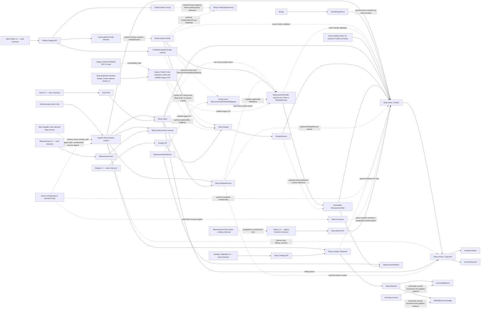

# 03 — DEPENDENCY IMPACT MAP

## 0. Purpose

This is a blast-radius map of **verified current local implementation**, not a target architecture or deployment claim. Its question is: **if this contract changes, which other valid flows might break?** The source is dirty `main` at `d6560c7c5457df11820686c6b6f3f204338c530a`; the parallel frontend checkout is dirty `frontend/parallel-foundation` at `9ff32bc30d94744cfa0c432e4bb1c57d4182a20c`. An edge below means a code-level reference, API consumer, or demonstrated workflow dependency—not automatic state propagation. See [01-DATA-FLOW.md](01-DATA-FLOW.md) for ownership and [02-API-FLOW.md](02-API-FLOW.md) for request execution. No runtime/deployment parity is established here.

**Verified local Phase 5 migration delta (2026-10-26):** the 9 pending migrations
are now applied to local `devdb` after a restorable backup and isolated restore
verification. Focused billing/pricing tests pass 21/21; no migration remains
pending. Existing business-table row counts match the pre-migration backup;
only new Phase 5 tables and expected Django content-type/permission/migration
rows were added. This removes the local schema-availability blocker, not
staging/production or operational release gates.

**Verified implementation delta (2026-10-18):** `main` now blocks Variant API writes, keeps legacy reads, and validates Work by Family. The active sibling frontend uses Family matching for Orders and does not mount Variant management; a legacy `?tab=variants` URL redirects into Families. Runtime inspection confirms Vite on port 5173 is running from `sgtp-frontend/frontend`, while Docker `django_app_web` is bind-mounted from canonical `sgtp` (`main`); its `.env.local` points the proxy to local port 8000. The sibling checkout's duplicate backend still requires Variant for Design creation, and the separate main-checkout frontend still mounts Variant UI. Both are runnable but explicitly deprecated/unsupported; worktree ownership rules prohibit changing their implementations in this task. The only supported local pair is canonical `main` backend + sibling active frontend. No database/schema migration or data rewrite occurred in this task.

**Historical baseline — R5-01 implementation delta (2026-10-21):** Shop-specific Design price feeds a creation-time Work snapshot and Billing API. The current Phase 5 delta below supersedes this earlier checkpoint.

**Historical PHASE-5-INTEGRATED-CLOSURE-01 baseline (2026-10-21):** Billing callers, financial lifecycle, idempotency, and private-document dependencies were source-mapped; the verification boundary below supersedes the then-unverified runtime/storage/restore status.

**Verified Phase 5 dependency delta (2026-10-22):** Billing UI now depends on the authorized Shop-context response for nullable `billing_currency`; backend emits it only for ADMIN and active CASHIER STAFF, and sibling `useCurrentShop` passes it to Billing. Non-finance context fields remain unchanged. Focused tests and authenticated E2E pass using disposable PostgreSQL. No schema/migration or financial ownership/history change resulted. The whole Billing flow is locally verified; persistent DB deployment, external R2, production recovery/retention/monitoring remain release gates.

**Verified A5 PDF dependency delta (2026-10-22):** `apps/common/pdf_layout.py` is shared by the Measurement and Billing renderers. Both need regression coverage for page geometry, long-content continuation, and retained financial source data. Five focused tests pass; the additive `billing.0005` layout-version migration was exercised only on disposable `test_devdb`, not the persistent application database.

**Verified manual financial purge dependency delta (2026-10-25; local, unpublished):** Main Supplier Super Admin selected-Shop invoice-history review and explicit purge now depend on the Back Office Shop selector, Billing invoice-history GET, purge API/service, Shop-scoped tombstone/idempotency rows, append-only audit, sequence retention, and private storage deletion. Failure handling must preserve DB financial rows until private files are removed; retry and download guards protect an in-progress/failed purge. Additive migration `billing.0006` is exercised only in disposable DB tests and remains unapplied to the persistent app DB. Full Django 486/486, pytest 593/593 (392 warnings), supported sibling frontend 226/226, typecheck/build, migration drift, and Django checks passed. The configured R2 `PrivateReferenceStorage` adapter passed a unique synthetic upload/read/checksum/delete probe; production financial-object behavior and backup/retention remain unverified.

**Release-blocker correction (2026-10-19):** current `main` source already enforces read-only Variant HTTP routes (405 for mutations) and existing API coverage checks this; the earlier report that `ShopVariantsView.post` was an active create endpoint is stale for this worktree. The unreachable mutation handler/service code remains but has no allowed HTTP method. New `catalog.0025_reconcile_family_design_defaults` follows `0024` and repairs only missing global Family defaults using the approved `0018` data, preserving same-name Designs/history and Shop-owned rows. Its dependency chain and fresh, Variant-absent, and representative upgrade behavior were verified on isolated PostgreSQL 15 on 2026-10-19; `works.0001` applied after `0025`. This did not apply migrations to a development/staging/production database. Selected DB tests remain partial because of stale test fixtures and an external R2 DNS failure.

## 1. System Dependency Overview — One-View Map

Solid arrows represent required direct record or request-context dependencies. Dotted arrows are labeled to distinguish optional persisted references, one-time materialization, and authorization/UI/service interactions (not foreign keys). Every protected Shop API authenticates first and resolves an explicitly selected active Shop. Ordinary users require active membership; Main Supplier access is a separate authorized path and does not imply membership. Context alone does not grant every action: Work creation, assignment, and stage transitions apply their own role/function rules.

Work requires a Shop, Client, published `DesignVersion`, and active same-Shop `MeasurementSet`; the wearer may be a RelatedPerson, while Material and assignment are optional. `DesignVersion` can optionally pin an exact published version on a `MeasurementSet`; it is not a `MeasurementProfile` dependency. Work refers to a `Material` only: it has no `InventoryBalance` or `StockMovement` relationship and does not reserve or consume stock. Inventory services separately write the movement and update the balance atomically. The measurement-review action navigates to the sibling checkout's `/orders/new` flow; it does not itself create Work. The Orders UI/Works API exists in the sibling frontend checkout, while Client and Measurement UI/API consumers are in this checkout. R5-01 billing now consumes Work and its Primary Client, with pricing from ShopDesignPrice and immutable Work-time price/currency snapshots; Reports remain a target area [B1,B5,B8].

**Resolved policy; implementation status (2026-10-18; release-blocker correction 2026-10-19):** `main` Shop initialization remains Family-level; Variant create/update/lifecycle HTTP requests return 405, legacy Variant GETs/Design/Profile fields remain readable, Work validation requires Family equality, and Measurement creation uses a Family-only API. The active sibling frontend uses Family-level Design and Orders flows, and does not mount its legacy Variant panel. Historical migrations `0002`, `0012`, and `0018` still seed Variant rows on clean replay and remain unchanged. New `catalog.0025_reconcile_family_design_defaults` repairs missing `0018` global Family configuration and published presets without requiring active Variant rows; existing Variant-linked Designs and versions remain unchanged. The dirty checkout contains `catalog.0024_retire_variant_measurement_mappings`, which drops only the mapping Variant field after a fail-closed data precondition. A disposable PostgreSQL 15 audit verified the fresh and Variant-absent replay, representative upgrade preservation, `0025` no-op reverse, and `works.0001` ordering after `0025`; these results do not establish migration application to dev/staging/production. Remaining checkout drift: the stale duplicate backend still requires `variant_id` for Design creation, while `main/frontend` still carries deprecated Variant selectors/management UI; project ownership rules prevented changing those copies here. The 2026-10-18 Render preflight verified the live backend artifact source at `4db6d9fe14d389c89721707e44ed4526af6a5be3`: it still contains Variant mutation methods and Variant-compatible Design/Profile create fields, and lacks `catalog.0024`. Live HTTP behavior, frontend deployment, and staging data/migration state remain unverified. Retirement is therefore partial across deployed/source checkouts, even though the canonical local backend plus active sibling frontend use the Family workflow.

Regression coverage now asserts Family-only Design creation and multi-Design families, Family-compatible Work validation, retired Variant mutations, legacy Variant reads, and family-based Orders/Profile matching. Focused test results for this change are recorded in `docs/PROJECT_STATE.md`; broader Measurements/Catalog suites still contain unrelated dirty-checkout assertion failures.

### Variant retirement implementation and remaining follow-up

1. **Implemented in canonical `main`:** Family-only Design/Profile creation; Family equality for new Work; Variant API create/update/lifecycle methods reject writes with 405 while legacy list/detail and response fields remain; Shop bootstrap continues to copy no Variant rows.
2. **Implemented in active sibling frontend:** Family-based Orders matching with fail-closed handling of ambiguous legacy Profiles; measurement entry creates a new Family-level Profile rather than extending a legacy Variant-linked Profile; Catalog/Design UI does not mount the legacy Variant panel. Existing `?tab=variants` deep links redirect into Families.
3. **Preserved:** this task applied no schema/data migration and left existing local DB records untouched. The pre-existing dirty checkout includes migration `catalog.0024_retire_variant_measurement_mappings` for removing only Variant-specific definition mappings; it has a guard against such rows. Historical seed migrations remain unchanged, and Design/Profile legacy FK/read compatibility is retained.
4. **Follow-up before using other checkout pairings:** reconcile `main/frontend` stale Variant controls and the sibling checkout's duplicate Variant-required backend only under their respective ownership instructions. Do not pair those stale copies with this Family-level contract.
5. **Environment gate:** staging DB contents and deployed code remain unknown. Before publishing the current dirty checkout, inspect each target migration ledger and mapping data for `catalog.0024`; its guard aborts if Variant-specific mappings remain. Any later physical cleanup of Design/Profile Variant FKs needs a separate per-environment audit and migration plan.

Physical removal of `GarmentVariant`, `Design.variant`, and `MeasurementProfile.variant` is a later decision gate, not a prerequisite for this staged application-level retirement. Do not delete rows or rewrite historical FKs until the preflight proves no compatibility/history requirement remains.

## 2. Module / Domain Registry

Risk measures breadth of a mistaken change, not defect severity.

| Module / domain | Owns what | Depends on | Consumed by | Risk level |
|---|---|---|---|---|
| Identity/auth | `User`, credential/version, refresh/CSRF, PIN recovery | Shop for ordinary ownership and reset request | Every protected API, AuthProvider, Shop context | CRITICAL |
| Shop/access | `Tenant`, memberships, roles, Work Functions, context including finance-only billing currency | User and Supplier | All Shop-owned domains, Back Office, Work assignment, Billing currency gate | CRITICAL |
| Clients/people | Client and RelatedPerson | Shop/access | Measurement profiles, Work, client UI | HIGH |
| Catalog/garment | Family, variant, options, definitions/mappings | Global/Shop ownership and access | Design, measurement, Work compatibility, catalog UI | HIGH |
| Designs/private references | Design/version, selections, reference metadata | Catalog, Shop/access | Measurement linking, Work, design UI | HIGH |
| Measurements | Person/garment profile, immutable sets/values | Clients, catalog, optional published DesignVersion, Shop/access | Client UI, review/export, Work | HIGH |
| Materials/inventory | Shop Material, balance and stock-movement ledger | Shop/access | Inventory UI; optional Work Material FK | MEDIUM |
| Work/orders | One-garment WorkOrder, status, assignment, soft delete | Shop/access, Client, published DesignVersion, active MeasurementSet, optional Material | Orders/review/archive UI | HIGH |
| Design pricing | Shop-specific Design price and currency | Shop/access, global or Shop Design, configured Shop default currency | Work snapshot and Billing | HIGH |
| Billing | Invoice, lines, payments, credit/refund history, audit/idempotency, versioned private FinancialDocuments | Shop/access including ADMIN/CASHIER-only context currency, Work, Primary Client/optional RelatedPerson, currency validation, private storage, shared A5 PDF geometry | Supported sibling Design price editor, Work Billing panel, Billing History UI | HIGH |
| Shared API client/frontend auth | Credentialed requests, refresh/retry, UI session state | Auth endpoints/CSRF; Shop context downstream | All frontend API consumers | HIGH |

Evidence: model FKs and constraints [B2–B7], registered routes [B1], frontend callers [F1–F4]. `CRITICAL` reflects cross-domain security reach, not an observed breach.

## 3. Direct Dependency Map

### 3.1 — Identity/auth

- Depends directly on: User and auth settings; Shop for `owning_shop` and Shop ADMIN reset requests.
- Directly consumed by: Shop context, all protected DRF views, frontend AuthProvider/API client.
- Shared contracts: JWT `auth_version`, refresh `{access,user}`, CSRF/HttpOnly cookie, User serializer, 401/403 handling, auth tests.
- Evidence: `apps/accounts/models/users.py`, `apps/accounts/models/reset.py`, `apps/accounts/views/__init__.py`, `apps/accounts/serializers/__init__.py`, `apps/accounts/authentication.py`, `frontend/src/services/{auth.ts,apiClient.ts}` [B2,F1].

### 3.2 — Shop/access

- Depends directly on: authenticated User; Supplier singleton for Shop creation; `TenantMember`/`MembershipWorkFunction` for role/function access.
- Directly consumed by: Shop-scoped Client, catalog, measurement, material, Work views/services, frontend Shop provider, and Billing's currency gate.
- Shared contracts: `/shops/{shop_id}/context/`, active membership, Shop 404 nondisclosure, role/function checks, tenant-scoped querysets; optional `billing_currency` is returned only for ADMIN/active CASHIER STAFF and is omitted for other roles.
- Evidence: `apps/tenants/{context.py,context_views.py,policy.py,permissions.py}`, `apps/tenants/models/{tenant.py,membership.py,work_functions.py}`, `apps/tenants/services/{membership.py,work_functions.py}`, `apps/common/views.py`, and sibling `frontend/src/{hooks/useCurrentShop.ts,services/shops.ts}` [B3,F2].

### 3.3 — Clients/related people

- Depends directly on: Shop/access, primary Client for a RelatedPerson.
- Directly consumed by: MeasurementProfile and WorkOrder FKs, client/measurement frontend pages.
- Shared contracts: Shop-scoped person IDs, related-person parent, soft-delete/read behavior, validation and API tests.
- Evidence: `apps/clients/{models.py,views.py,serializers.py,services.py,permissions.py}`, `apps/catalog/measurement_models.py`, `apps/works/models.py` [B4–B6].

### 3.4 — Catalog/garment

- Depends directly on: global or Shop scope, Shop/access for active Family/option mutations; parent Family and Family-level option/measurement-definition mappings. Variant records remain legacy references.
- Directly consumed by: Design Family plus nullable legacy Variant references and option selections; MeasurementProfile Family plus nullable legacy Variant references and definitions; Work garment-match validation uses Family identity.
- Shared contracts: IDs, active/archive status, template-source lineage, mapping and snapshot inputs, catalog routes/tests.
- Evidence: `apps/catalog/{models.py,measurement_models.py,services.py,urls.py}`, migrations `0017`–`0024` [B5,M1].

### 3.5 — Designs/private references

- Depends directly on: catalog family/variant/options; Shop/access; private media metadata.
- Directly consumed by: MeasurementSet optional DesignVersion, WorkOrder required published DesignVersion, design/editor/review UI.
- Shared contracts: version status, publish response `{published,next_draft}`, selection/image snapshot references, private-media authorization.
- Evidence: `apps/catalog/{models.py,services.py,views.py}`, `apps/works/models.py`, `frontend/src/features/designs/{api.ts,DesignEditor.tsx}` [B5,F3].

### 3.6 — Measurements

- Depends directly on: Client/RelatedPerson, catalog Family/Variant/definitions, optional published DesignVersion, Shop access.
- Directly consumed by: WorkOrder required MeasurementSet; client history, measurement review/export UI.
- Shared contracts: exactly one wearer, profile garment immutability, set/value snapshots, active set, copy/version and export APIs.
- Evidence: `apps/catalog/{measurement_models.py,measurement_services.py,measurement_views.py}`, `apps/works/models.py`, `frontend/src/features/measurements/{api.ts,ClientMeasurementsPage.tsx}` [B5,F3].

### 3.7 — Materials/inventory

- Depends directly on: Shop/access and Shop-owned Material.
- Directly consumed by: inventory UI; WorkOrder optional Material reference. Stock balances depend on ledger writes, **not** Work stage changes.
- Shared contracts: Material active state, movement category/unit and balance transaction, optional Work Material ID.
- Evidence: `apps/catalog/{measurement_models.py,inventory_models.py,inventory_services.py,inventory_views.py}`, `apps/works/models.py`, `frontend/src/features/materials/MaterialsInventoryPage.tsx` [B5,B6,F3].

### 3.8 — Work/orders

- Depends directly on: Shop/member/Work Function, Client/RelatedPerson, ACTIVE parent Family and Design plus published DesignVersion, active MeasurementSet, optional active Material.
- Directly consumed by: Orders list/detail/deleted archive and Measurement final-review entry in parallel frontend.
- Shared contracts: one garment/Work, Shop-local number, fixed stage map, due indicator, assign/advance permissions, Request-only soft deletion, API status/serializer.
- Lifecycle edge: archiving a Family or Design prevents new Work creation from its published versions; existing Work references remain readable. The Design response exposes read-only `family_status` so the Order picker can hide Designs under archived Families without another request.
- Evidence: `apps/works/{models.py,constants.py,services.py,serializers.py,views.py,urls.py}`, sibling `../sgtp-frontend/frontend/src/features/orders/{api.ts,OrdersPage.tsx,DeletedOrdersPage.tsx}` [B6,F4].

### 3.9 — Design pricing and billing

- Depends directly on: explicit active Shop context; finance-only `billing_currency` context field (ADMIN/active CASHIER STAFF); financial authority; Shop-specific Design price and Shop `default_currency`; Work's creation-time Design price/currency snapshot.
- Directly consumed by: Work creation copies any price to the Work snapshot; Billing creates AUTO lines from that snapshot, or MANUAL lines; invoice and payment reads stay Shop-scoped. RelatedPerson invoices use the Work's Primary Client as billing owner.
- Shared contracts: `/design-prices/{design_id}/`; Work invoice list/create; invoice detail, draft item mutation, issue, payment and outstanding endpoints. Currency minor-unit scale rejects excess decimal precision; issued invoices/lines are immutable; payments are append-only and bind to one invoice.
- PDF edge: catalog Measurement worksheets and Billing invoice/receipt/credit-note outputs consume `apps/common/pdf_layout.py`; layout changes therefore require page-size, overflow, and content-preservation tests for both renderers. Billing retains prior immutable renditions by `FinancialDocument.layout_version` while new exports use portrait A5.
- Evidence: `apps/catalog/{models.py,price_services.py,views.py,serializers.py}`, `apps/billing/{models.py,services.py,views.py,serializers.py,urls.py}`, `apps/works/{models.py,services.py}`, and migrations catalog `0026`, works `0003`, billing `0001` [B8].

## 4. Indirect / Transitive Dependency Map

| Source change → direct dependency → indirect dependency | Possible failure | Evidence |
|---|---|---|
| User active/auth-version policy → Shop context membership lookup → every Shop API/frontend route | Valid users denied, stale access accepted, refresh loops | [B2,B3,F1] |
| Shop deactivation or membership/function policy → Client/Design/Measurement access → Work creation/advance | Cross-Shop leak or valid Work blocked; assigned worker eligibility changes | [B3–B6] |
| Family identity/archive semantics → Design and MeasurementProfile compatibility → WorkOrder `clean()` and create locks | Family mismatch or archived parent Family rejects new Work; legacy Variant IDs no longer determine compatibility; historical refs may become unreadable if readers filter them incorrectly | [B5,B6] |
| Design ACTIVE/archive status + DesignVersion publish/selection → MeasurementSet design link → Work creation/final review | Archived Design cannot source new Work; existing Work remains readable; version selection can fail while old versions remain readable | [B5,B6,F3,F4] |
| Client/RelatedPerson ownership change → MeasurementProfile wearer → WorkOrder client/wearer check | Wrong wearer linked or legitimate saved measurements no longer usable | [B4–B6] |
| Measurement definition/label change → new MeasurementValue snapshots → history/export/Work review | Future values have altered meaning/labels; old snapshots must not be rewritten | [B5,F3,F4] |
| Material status/Shop change → optional Work Material validation → order creation | Selected fabric unavailable for new Work; **no** inferred stock-consumption effect | [B5,B6] |
| Shared `apiRequest` or refresh contract → Shop provider → feature API calls | Authentication failure cascades into apparent empty/error screens across all features | [B2,F1,F2] |

These are possible change failures derived from actual dependency edges, not claims that such failures currently occur. A full deployed chain is **UNVERIFIED**.

## 5. Change Impact Matrix

| Change area | Direct impact | Indirect impact | API impact | Data impact | Security/tenant impact | Tests |
|---|---|---|---|---|---|---|
| Identity/auth | login/refresh/credentials | all protected flows | refresh/user/401/CSRF | User/auth version | account eligibility, cookie/CSRF | [T1] |
| Shop/member/functions | context/roles/functions | all Shop data; Work stage | context/member APIs | membership/Shop | isolation and assignment | [T2,T5] |
| Client/person | contact APIs | profile and Work wearer | client/related routes | FK and soft delete | same-Shop/owner | [T3,T4,T5] |
| Catalog/garment | Family/options plus legacy Variant records/routes | Design→measurement→Work; canonical backend + active sibling UI are Family-based, stale duplicate copies remain | catalog/design setup; `main` and sibling duplicate Design-create contracts differ | template lineage, legacy FKs, historical seed migrations | global vs Shop | [T4,T5] |
| Design | draft/publish/media | MeasurementSet and Work | design-version shape | immutable published version | private references/scope | [T4,T5] |
| Measurement | profile/set/value | Work selection/review | history/copy/export | immutable set/value | wearer/Shop | [T4,T5] |
| Material/inventory | stock item/movement | optional Work Material | inventory/material routes | ledger/balance | Shop scope | [T4,T5] |
| Work/order | stage/assignment/archive | Orders UI/review | Work routes | protected FK, soft delete | Shop/function/assignee | [T5] |
| Design price and Billing | price edit, draft/issue/payment/void/credit/refund/history/PDF | Work snapshot, client balances, private documents | catalog price + billing/document routes | price/currency snapshot; immutable invoice/payment/credit/refund; response snapshots; derived private files | Shop financial authority and scope | [T8] |

Supplier-wide aggregate reports remain out of scope; current Shop invoice/outstanding history and document generation are in Billing. Billing UI/API source exists locally, but runtime integration, deployment, and application-DB migration parity are not verified [B8].

## 6. Frontend ↔ Backend Dependency Map

| Frontend feature → client → backend area | Compatibility-sensitive contract | Break risk / verified fallback |
|---|---|---|
| Login/AuthProvider → `services/auth.ts`,`apiClient.ts` → `/auth/` | `{access,user}`, cookie, CSRF, 401 retry | Broad; main consumes refresh `user`, sibling additionally calls `/users/me/`; no generic fallback claim [F1] |
| ShopProvider/BackOffice → `services/shops.ts`,`useCurrentShop.ts` → `/shops/.../context/`, tenant routes | selected Shop/active membership | Wrong Shop context blocks dependent pages; backend 404 nondisclosure [F2,B3] |
| Users → `features/users/api.ts` → user/membership/function routes | role/function fields | Lost management/Work eligibility display; backend remains authority [F2,B3] |
| Clients → `features/clients/api.ts` → client/related routes | IDs, pagination, soft-delete visibility | Client picker and measurement entry break [F3,B4] |
| Catalog/Designs → `features/catalog/api.ts`,`features/designs/api.ts` → catalog/design routes | Family IDs/publish result; active sibling UI is Family-only; main Variant writes return 405; stale duplicate backend still requires Variant | Pair only the canonical `main` backend with active sibling frontend until stale copies are reconciled [F3,B5] |
| Measurements → `features/measurements/api.ts` → profile/set/definition/export routes | set version/values/active state | History/review/order handoff break [F3,B5] |
| Materials → materials page API helpers → material/inventory routes | category/unit/balance/movement | Stock UI breaks; Work optional Material may remain valid independently [F3,B5] |
| Orders → sibling `features/orders/api.ts` → `/shops/{shop_id}/works/` | list/detail/assign/advance/deleted response | Order UI breaks; no verified offline fallback [F4,B6] |

The two dirty frontend copies are **not interchangeable**. Main implements phone/PIN recovery while active sibling retains email reset calls missing from main backend; see §15 [F1,B2].

## 7. Data Dependency Map

Cross-domain effects only; full lineage is in [01-DATA-FLOW.md](01-DATA-FLOW.md).

| Source data → consumer | Why used | Shape/ownership/meaning change risk |
|---|---|---|
| User/Shop/membership/function → Shop-scoped services | Authorize and scope reads/writes | Denial or cross-Shop disclosure; Work worker eligibility |
| Client/RelatedPerson → profile and Work | Define wearer and primary client | Broken owner check; historical FK mismatch |
| Family → Design/Profile → Work; legacy Variant FKs remain nullable | Family-level garment; Work requires Design/Profile Family equality | Preserve historical links/read fields; never infer a data rewrite from the active Family contract |
| Published DesignVersion → MeasurementSet/Work | Pin selected design | Draft/published semantics or deleted filtering invalidate selected source |
| Immutable MeasurementSet/Value → Work/review/export | Pin measured values and labels | Rewriting history corrupts past Work meaning |
| Shop Material → InventoryBalance/StockMovement and Work optional FK | Track stock; optionally identify Work fabric | Material archive/tenant changes break consumers; Work does not itself move stock |
| ShopDesignPrice → Work snapshot → invoice lines → invoice payments/outstanding | Preserve the Shop's selected Design price and invoice currency for each Work | Price edits or currency changes must not rewrite existing Work/invoice history; issued lines and payments are immutable |

## 8. API Dependency Map

Execution details are in [02-API-FLOW.md](02-API-FLOW.md).

- **Shared endpoints:** CSRF/login/refresh/User feed all protected feature clients; Shop discovery/context precedes scoped calls; `/users/me/` remains consumed by the sibling restore path.
- **Shared fields:** refresh `{access,user}`, Shop ID, canonical person/design/measurement/Material IDs, Design publish `{published,next_draft}`, Work `status`/assigned membership/soft-delete metadata. Removing or renaming requires consumer review.
- **Sequencing:** Shop context before Shop-scoped reads; published DesignVersion and active MeasurementSet before Work create; current-stage function/assignment before advance; history version is selected before copy/export.
- **Post-mutation UI:** frontend feature state is sometimes replaced from mutation response and sometimes refetched (e.g., client list and measurement history); a changed response can break either path. `apiRequest` coalesces identical in-flight reads but is not a durable cache [F1–F4].
- **Compatibility:** active sibling recovery endpoints do not match main backend. Work routes/create contract are present in both generated schema snapshots after CREATE-ORDER-ARCHIVE-ELIGIBILITY-AND-E2E-CLOSURE-01; live browser and deployed parity remain unverified [B1,F1,S1].

## 9. Auth / Permission / Tenant Impact Map

| Change area | Boundary touched / what could leak or break | Protecting tests |
|---|---|---|
| User eligibility, token version, refresh | inactive/disabled account, stale token, cookie/CSRF; every protected call | `apps/accounts/tests/{test_auth_lifecycle.py,test_login_pin_reset.py,test_auth_concurrency.py}`, `frontend/src/services/{auth.test.ts,apiClient.test.ts}` |
| Shop context and membership | Shop existence nondisclosure, active member/Supplier authority; wrong-Shop IDs | `apps/tenants/tests/{test_shop_context.py,test_membership_api.py,test_user_scope.py}` |
| Work Function and assignment | STAFF stage authority, current assignee, Shop member | `apps/tenants/tests/test_work_functions.py`, `apps/works/tests/test_work_api.py` |
| Design price and financial permission | Shop ADMIN/CASHIER STAFF, currency, Design price and Work snapshot | `apps/catalog/tests/test_catalog_api.py`, `apps/works/tests/test_work_api.py` |
| Client/person scope | client and related-person IDs from other Shops | `apps/clients/tests/{test_clients_api.py,test_concurrency.py}` |
| Catalog/design/private media | global vs Shop option visibility, draft/private reference access | `apps/catalog/tests/{test_catalog_api.py,test_private_upload_transactions.py}` |
| Measurement wearer/history | related-person ownership and cross-Shop version/export access | `apps/catalog/tests/{test_measurements_materials_api.py,test_measurements_concurrency.py}` |
| Material/Work | Shop Material balance and Work linked IDs | `apps/catalog/tests/{test_inventory_api.py,test_inventory_concurrency.py}`, `apps/works/tests/test_work_api.py` |

Frontend route/button hiding is UX, never the security boundary. Backend context, queryset filtering, object validation and service checks are authoritative [B2–B6].

## 10. History / Versioning Impact Map

| Current state → history/version consumers | Change risk |
|---|---|
| Published DesignVersion → measurement link, Work, design editor/review | A draft may change; published selection/snapshot meaning must remain stable. Do not repoint historical Work to current draft. |
| MeasurementProfile → immutable MeasurementSet/Value and label snapshots → client history, export, Work | Changes require a new set/version; deactivation is not deletion. Existing Work FK/history must remain readable. |
| Material balance → append-only StockMovement → inventory UI | A balance rewrite without matching ledger provenance loses auditability; Work currently does not consume stock. |
| Request Work → `deleted` soft-delete timestamp → admin deleted archive | Normal list excludes deleted; archive is read-only and Shop/admin scoped. No restore/permanent delete is implemented. |
| User credential/auth version → existing sessions | PIN/credential update invalidates sessions; old hashes are not bulk rewritten. |

Evidence: models/services [B2,B5,B6], client/export/archive API [B1,F3,F4]. These are current code contracts, not evidence that all live rows or backups were examined.

## 11. Migration / Schema Impact Map

Historical R5-01 baseline created additive `catalog.0026`, `works.0003`, and `billing.0001`. The current Phase 5 schema impact adds Billing migrations `0002`–`0004`; preserve these current schema links:

| Schema area | FK/M2M/constraint/index dependency | Downstream and migration risk |
|---|---|---|
| User/Shop/member | `User.owning_shop`; member→Shop/User; member-function FK and valid-code constraint | Auth/scoping and Work stage assignment; role/code migration needs eligibility review [M1] |
| Client/person | Client→Shop; RelatedPerson→Shop/primary Client | Profile and Work protected FK/read paths [B4,M1] |
| Catalog/design | nullable global/Shop scope; family→legacy variant/option; DesignVersion→Design and selection snapshot rows | Template lineage and historical versions; migrations `catalog.0017`–`0024` include data/constraint changes; old `0002`/`0012`/`0018` seeds remain historical replay behavior, not rewritten in this task [B5,M1] |
| Measurement | profile→person/family plus nullable legacy Variant FK; XOR wearer and active-profile unique constraints; set→profile/copy/design; unique `(profile,version)`; value→set/definition, unique `(set,definition)` | New writes create Family-level profiles; preserve legacy profile reads/lineage and avoid in-place rewrite [B5,M1] |
| Inventory | Material→Shop; balance↔Material; movement→Material; service-atomic balance/ledger | Stock integrity and old-unit compatibility [B5,M1] |
| Work | WorkOrder PROTECT FKs to Shop, Client, RelatedPerson, DesignVersion, MeasurementSet, optional Material/member; Shop+sequence/number unique; status/due and priority indexes. WorkEvent records lifecycle mutations with a protected Shop ref and DB-enforced Work FK | FK compatibility and migration ordering (`works.0001` depends on `catalog.0024`, `clients.0001`, `tenants.0010`, User; `works.0002` adds the event ledger); mutation/event rollback must remain atomic; existing Work rows require no backfill [B6,M1] |
| Pricing and Billing | ShopDesignPrice, immutable Work price snapshot, Invoice/line/payment, credit/refund, FinanceMutation response snapshot/status, FinancialAuditEvent, FinancialDocument private-file metadata/source FKs, FinancialPurgeRequest tombstone, and FinancialPurgeIdempotency | `catalog.0026`, `works.0003`, and Billing `0001`–`0006` are additive and applied to local `devdb`; pre-existing Work rows retain nullable price snapshots. Normal Work deletion still refuses linked invoices. Explicit Main Supplier purge deletes one invoice bundle and private files but preserves pre-existing audit/idempotency records and sequence high-water values [B8,M2] |

`schema.yml` and `docs/schema.yml` include registered Work, R5-01, and manual invoice-purge routes; drf-spectacular validation reports 0 errors and 29 existing warnings. These generated snapshots do not establish deployed API/schema parity [S1].

## 12. Regression Map

These are **tests to consider**, not test-pass claims. Exact runtime/manual checks require an authorized environment.

| Change area | Direct tests | Transitive regression tests | Runtime/manual checks |
|---|---|---|---|
| Identity/auth | `apps/accounts/tests/test_auth_lifecycle.py`, `test_login_pin_reset.py`; `frontend/src/services/auth.test.ts` | `apps/tenants/tests/test_shop_context.py`, `apps/works/tests/test_work_api.py` | Login→refresh→Shop→logout; CSRF and disabled-user negative paths |
| Shop/member/function | `apps/tenants/tests/test_shop_context.py`, `test_membership_api.py`, `test_work_functions.py` | `apps/clients/tests/test_clients_api.py`, `apps/works/tests/test_work_api.py` | Two-Shop cross-ID denial; role/function/stage transitions |
| Clients | `apps/clients/tests/test_clients_api.py`, `test_concurrency.py`; `frontend/src/features/clients/Clients.test.tsx` | `apps/catalog/tests/test_measurements_materials_api.py`, `apps/works/tests/test_work_api.py` | Client→person→measurement→order selection |
| Catalog/design | `apps/catalog/tests/test_catalog_api.py`, `test_variant_lifecycle_api.py`, `test_private_upload_transactions.py`; `frontend/src/features/designs/DesignEditor.test.tsx` | `apps/catalog/tests/test_measurements_materials_api.py`, `apps/works/tests/test_work_api.py` | Publish then select older/current version; private image ownership |
| Measurements | `apps/catalog/tests/test_measurements_materials_api.py`, `test_measurements_concurrency.py`; `frontend/src/features/measurements/ClientMeasurementsPage.test.tsx` | `apps/works/tests/test_work_api.py` and sibling `frontend/src/features/orders/OrdersPage.test.tsx` | Copy/export old version then select for Work |
| Inventory/material | `apps/catalog/tests/test_inventory_api.py`, `test_inventory_concurrency.py`; `frontend/src/features/materials/MaterialsInventoryPage.test.tsx` | `apps/works/tests/test_work_api.py` | Stock ledger/balance after movement; optional fabric on Work |
| Work/archive | `apps/works/tests/test_work_api.py`; sibling `frontend/src/features/orders/{api.test.ts,OrdersPage.test.tsx,DeletedOrdersPage.test.tsx}` | Measurement review tests in sibling | Create→assign→advance; delete Request→Shop-local archive filters |

`TEST GAP`: no executed cross-checkout end-to-end test proves active sibling recovery against main backend, or deployed frontend/backend/schema parity. `TEST GAP`: no test execution was performed for this documentation task. Some listed tests are in different dirty checkouts; run in the intended checkout/environment before claiming coverage.

## 13. Old-Flow Protection Map

### Flow: Login and session restore
Entry point: `/login`, AuthProvider mount. Dependencies: User eligibility, CSRF, refresh cookie/auth version. API dependencies: `/auth/csrf/`, `/login/`, `/token/refresh/`, sibling `/users/me/`. Data dependencies: User. Security dependencies: active/login-enabled, token version. Downstream consumers: all protected routes. Critical invariants: credential never in frontend persistent storage; stale session denied. Protecting tests: [T1] auth lifecycle/refresh/API client.

### Flow: Authorized Shop and staff management
Entry point: Back Office/ShopProvider/Users. Dependencies: Supplier/Shop/member/function services. API dependencies: Shop context, membership/user/function routes. Data dependencies: User, Tenant, TenantMember. Security dependencies: active Shop/role and nondisclosing wrong-Shop 404. Downstream consumers: all Shop screens; Work assignment. Critical invariants: ordinary User one owning Shop; backend authorizes every write. Protecting tests: [T2].

### Flow: Client and related wearer
Entry point: Clients page. Dependencies: Shop/client services. API dependencies: client/related routes. Data dependencies: primary Client/RelatedPerson. Security dependencies: same-Shop, parent relation. Downstream consumers: profiles and Work. Critical invariants: wearer attribution and soft-delete history remain coherent. Protecting tests: [T3,T4,T5].

### Flow: Catalog and published design
Entry point: Catalog/Design editor. Dependencies: global/Shop Family, option and Design services; retained legacy Variant reads. API dependencies: catalog/design/publish/private-media routes. Data dependencies: Family/DesignVersion/selections and optional historical Variant references. Security dependencies: global-vs-Shop scope; private references. Downstream consumers: measurement link and Work. Critical invariants: published version/history not silently replaced by draft; active creation is Family-based. Protecting tests: [T4,T5].

### Flow: Measurement save, copy, history and export
Entry point: Client Measurements. Dependencies: wearer, garment, definitions, profile/set services. API dependencies: set create/copy/list/export. Data dependencies: immutable version/value snapshots. Security dependencies: Shop/person scope. Downstream consumers: Work and client history. Critical invariants: no in-place mutation of saved values; copied version keeps lineage. Protecting tests: [T4,T5].

### Flow: Material stock movement
Entry point: Materials Inventory. Dependencies: Material/balance/ledger services. API dependencies: inventory item/movement routes. Data dependencies: stock ledger plus balance. Security dependencies: same-Shop Material authority. Downstream consumers: inventory display; optional Work Material reference. Critical invariants: balance and ledger transaction agree; no implicit Work consumption. Protecting tests: [T4,T5].

### Flow: One-garment Work lifecycle and deleted archive
Entry point: Measurement final review/Orders; `/orders/deleted`. Dependencies: compatible Client, DesignVersion, MeasurementSet, optional Material, current membership/functions. API dependencies: Work list/create/detail/assign/advance/delete/deleted; advance caller and backend must agree on `expected_status`. Data dependencies: Work FK, stage/soft-delete fields, append-only WorkEvent. Security dependencies: Shop, ADMIN or approved STAFF function, assignee/current-stage checks; deleted archive ADMIN only. Downstream consumers: Orders UI and internal audit ledger. Critical invariants: one garment/Work, fixed stage order, stale/replayed transition cannot double-advance, assignment cleared on transition, mutation/event atomicity, Request-only soft delete, history sources retained. Protecting tests: [T5].

## 14. High-Blast-Radius Areas

| Area | Why high impact / dependents | Common failure modes | Required pre-change checks |
|---|---|---|---|
| Auth response/client and CSRF | Every protected frontend request and backend User check | reload logout, retry loop, stale session, blocked writes | both frontend copies, refresh serializer, auth tests, browser contract |
| Shop context/membership/Work Functions | Every Shop domain; Work staffing | wrong-Shop leak, unauthorized stage, valid user denial | context/service/queryset/role matrix, cross-Shop negatives |
| Catalog family, legacy Variant paths, and DesignVersion status | Design, measurement, Work | old version hidden, contract mismatch, Work garment mismatch, unavailable default | remove active Variant writes/selection, keep verified history reads, align both frontends/backends and migrations |
| Measurement version/owner | Client history, export, Work | overwritten values, wrong wearer, order mismatch | profile/set/value immutability, copy/deactivate, Work FK and tests |
| Shared frontend API client/Shop provider | All consumer pages | duplicated/failed refresh, stale Shop, false empty states | request classification, 401/CSRF tests, dependent page smoke |

Inventory ledger and Work stage services are locally important but have narrower current fan-out; do not label every module high blast radius.

## 15. Current Dependency Risks

| ID | Severity | Area and evidence | Risk / affected modules | Recommendation |
|---|---|---|---|---|
| DEP-RISK-001 | B | Active sibling recovery vs main auth [F1,B2] | Sibling email-reset caller has no corresponding main routes; recovery integration fails if paired | Reconcile in separately approved integration task |
| DEP-RISK-002 | D | Work OpenAPI snapshot drift (resolved 2026-10-19) [S1,B1,B6] | Both snapshots include Work routes/create contract; deployed parity remains unverified | Regenerate and validate after future contract changes |
| DEP-RISK-003 | C | Two dirty frontend copies [F1,F4] | A consumer map can be correct for one checkout and wrong for the other | Select exact release artifact before validation |
| DEP-RISK-004 | C | Work creation retry [B6,F4] | Work pins historical sources, but repeated create has no verified idempotency key; stage retries are separately guarded by expected-status compare-and-set | Decide create idempotency only before adding a client retry key |
| DEP-RISK-005 | C | Catalog/design multi-selection writes [B5,F3] | Sequential selection mutations can leave partial saves | Define recovery/batch semantics before optimization |
| DEP-RISK-006 | D | Runtime parity [D1,S1] | Repo map cannot establish which migrations/API revisions are deployed | Verify target environment before release assertion |
| DEP-RISK-007 | A | Cross-checkout Variant retirement drift [B5,B6,F3,F4,M1] | Canonical backend bootstrap now materializes published Family-based Shop Design snapshots without requiring active Variant rows; stale main frontend UI and sibling duplicate backend contract remain, and historical migrations still seed Variant rows | Use only the canonical `main` backend + active sibling frontend; reconcile stale copies under their owners before any release using them. Preserve legacy rows and do not migrate staging without inspecting it |
| DEP-RISK-008 | B | Full backend 587/587 before the narrow context response addition; post-addition focused Shop-context/Work/Billing 54/54, including authorization, replay, and currency cases [B8,T9] | Persistent application DB migration and migrated-app old-row fallback are intentionally unverified; no full backend rerun occurred after the context-only addition | Preserve additive migrations; run deployment migration/old-row checks only in an authorized target environment |
| DEP-RISK-009 | B | Authenticated local Billing E2E and frontend/backend contract/schema alignment verified [B8,T9] | Production endpoint, browser, DB, and storage parity remain unverified | Use canonical backend + supported sibling frontend; require deployed parity before release |
| DEP-RISK-010 | B | Isolated PostgreSQL replay and restore passed for one invoice PDF artifact; API tests separately cover invoice/receipt/credit-note documents [B8,T9] | Production R2 restore, alert delivery/monitoring, retention and recovery procedures remain unverified; no background job API exists, so queue retry/dead-letter is not a current dependency | Keep production recovery/operations as a release gate; do not invent a job queue without asynchronous work requirement |

No other dependency or release risk is claimed as resolved by this test-triage task.

## 16. Unresolved / Business Decisions

- **RESOLVED (2026-10-18; implementation verified locally 2026-10-22):** active Variant workflows are retired, and Global/Shop bootstrap must not require active Variant materialization. `initialize_shop_default_catalog` now copies each available global published default Design into a Shop-owned published snapshot and creates the next editable draft; the reconciliation test passes with active Variant rows absent. No schema migration or legacy-data rewrite was made. Existing Shop copies are not refreshed/backfilled; stale alternate frontend/backend copies remain the separate DEP-RISK-007 release risk.
- **BUSINESS DECISION REQUIRED:** should active sibling session restoration use only canonical refresh `user`, or retain an additional authoritative `/users/me/` read? Both current copies differ [F1].
- **BUSINESS DECISION REQUIRED:** which recovery UI/contract should the active sibling ship with main's PIN-reset backend? Main and sibling routes differ [F1,B2].
- **PARTIALLY VERIFIED:** Render reports backend branch `staging` and live deploy SHA `4db6d9fe14d389c89721707e44ed4526af6a5be3`; its source is available locally and still exposes Variant mutation methods. The current executor could not resolve the API hostname, no Render frontend service was listed, Cloudflare Pages configuration was unavailable, and staging DB migration/data state is unverified. Local dev/test and auxiliary Compose ledgers were inspected read-only; Production is not provisioned.
- **UNVERIFIED:** full endpoint query counts and cross-domain end-to-end behavior; this document traces source dependencies, not a performance or release audit.
- **VERIFIED LOCALLY / UNVERIFIED FOR RELEASE:** Fresh disposable PostgreSQL replay and restore passed through current Billing migrations; authenticated synthetic browser E2E passed; API tests cover three protected document types and cross-Shop denial. At the 2026-10-22 checkpoint, persistent `devdb` was read-only inspected and not migrated; this was superseded locally by T11 on 2026-10-26. External R2, production restore, alerting/retention, and deployed parity remain unverified.

## 17. Change-Entry Checklist

- [ ] Current behavior inspected (§3)
- [ ] Direct dependencies identified (§3)
- [ ] Indirect dependencies identified (§4)
- [ ] Data Flow checked (§7 and `01-DATA-FLOW.md`)
- [ ] API Flow checked (§8 and `02-API-FLOW.md`)
- [ ] Security/Tenant impact checked (§9)
- [ ] History/version impact checked (§10)
- [ ] Migration/schema impact checked (§11)
- [ ] Old-flow compatibility checked (§13)
- [ ] Direct tests identified (§12)
- [ ] Transitive regressions identified (§12)
- [ ] Business decisions resolved (§16)

## 18. Evidence Index

All paths below are relative to `sgtp/` unless prefixed `../sgtp-frontend/`. Source inspection is repository evidence, not test execution or deployed proof.

| ID | Source |
|---|---|
| B1 | `core/urls.py`; `apps/{accounts,tenants,clients,catalog,works,billing}/urls.py` |
| B2 | `apps/accounts/models/{users.py,reset.py}`; `apps/accounts/{authentication.py,serializers/__init__.py,views/__init__.py}`; `apps/accounts/services/shop_admin_pin_reset.py`; `backend/config/settings/base.py` |
| B3 | `apps/tenants/models/{tenant.py,membership.py,work_functions.py}`; `apps/tenants/{context.py,policy.py,permissions.py}`; `apps/tenants/services/{membership.py,work_functions.py}`; `apps/common/views.py` |
| B4 | `apps/clients/{models.py,serializers.py,services.py,views.py,permissions.py}` |
| B5 | `apps/catalog/{models.py,measurement_models.py,inventory_models.py,services.py,measurement_services.py,inventory_services.py,views.py,measurement_views.py,inventory_views.py}` |
| B6 | `apps/works/{models.py,constants.py,services.py,serializers.py,views.py,urls.py}` |
| B8 | `apps/catalog/{models.py,price_services.py,views.py,serializers.py,urls.py}`; `apps/billing/{models.py,services.py,views.py,serializers.py,urls.py}`; `apps/tenants/{currency.py,financial_access.py}`; `apps/works/{models.py,services.py}` |
| F1 | `frontend/src/{App.tsx,services/auth.ts,services/apiClient.ts,services/pinReset.ts,PinResetPage.tsx}`; `../sgtp-frontend/frontend/src/{services/auth.ts,features/auth/PasswordResetPage.tsx}` |
| F2 | `../sgtp-frontend/frontend/src/{hooks/useCurrentShop.ts,services/shops.ts,features/users/api.ts,features/users/UsersPage.tsx,backoffice/BackOfficePages.tsx}` |
| F3 | `../sgtp-frontend/frontend/src/features/{clients/api.ts,designs/api.ts,measurements/api.ts,catalog/api.ts,materials/MaterialsInventoryPage.tsx}`; corresponding Client/Design/Measurement pages |
| F4 | `../sgtp-frontend/frontend/src/features/orders/{api.ts,OrdersPage.tsx,DeletedOrdersPage.tsx}`; `../sgtp-frontend/frontend/src/features/measurements/MeasurementReview.tsx` |
| M1 | `apps/accounts/migrations/0005_user_shop_ownership.py`, `0006_authattemptbucket_shopadminpinresetrequest_and_more.py`–`0008_login_id_preserve_case.py`; `apps/tenants/migrations/0009_membership_work_functions.py`, `0010_add_check_work_function.py`; `apps/clients/migrations/0001_initial.py`; `apps/catalog/migrations/0006_measurement_material_foundation.py`, `0008_inventorybalance_stockmovement_and_more.py`, `0017_measurement_version_deactivation_design_retry.py`–`0026_shopdesignprice.py`; `apps/works/migrations/0001_initial.py`–`0003_workorder_design_price_amount_and_more.py` |
| M2 | Generated R5-01 migrations `apps/catalog/migrations/0026_shopdesignprice.py`, `apps/works/migrations/0003_workorder_design_price_amount_and_more.py`, and `apps/billing/migrations/0001_initial.py`–`0006_financialpurgerequest_financialpurgeidempotency_and_more.py`; file presence is not proof of application |
| S1 | `schema.yml`, `docs/schema.yml`, `docs/API.md`; static route/schema inspection only |
| D1 | `docs/architecture/{01-DATA-FLOW.md,02-API-FLOW.md}`; `docs/{BUSINESS_RULES.md,DECISIONS.md,ARCHITECTURE.md,PROJECT_STATE.md,HANDOFF.md,PRODUCT_DEFINITION.md}`; `../sdb-master-audit-protocol.md` |
| T1 | `apps/accounts/tests/{test_auth_lifecycle.py,test_login_pin_reset.py,test_auth_concurrency.py}`; `frontend/src/services/{auth.test.ts,apiClient.test.ts}`; `frontend/src/PinResetPage.test.tsx` |
| T2 | `apps/tenants/tests/{test_shop_context.py,test_membership_api.py,test_work_functions.py,test_user_scope.py}` |
| T3 | `apps/clients/tests/{test_clients_api.py,test_concurrency.py}`; `frontend/src/features/clients/Clients.test.tsx` |
| T4 | `apps/catalog/tests/{test_catalog_api.py,test_variant_lifecycle_api.py,test_private_upload_transactions.py,test_measurements_materials_api.py,test_measurements_concurrency.py,test_inventory_api.py,test_inventory_concurrency.py}`; `frontend/src/features/{designs/DesignEditor.test.tsx,measurements/ClientMeasurementsPage.test.tsx,materials/MaterialsInventoryPage.test.tsx}` |
| T5 | `apps/works/tests/test_work_api.py`; `../sgtp-frontend/frontend/src/features/orders/{api.test.ts,OrdersPage.test.tsx,DeletedOrdersPage.test.tsx}`; `../sgtp-frontend/frontend/src/features/measurements/MeasurementReview.test.tsx` |
| T8 | Historical checkpoint 2026-10-21: focused 38-test PostgreSQL run; backend assertion correction, authenticated E2E, and restore were still pending at that point; superseded by T9 |
| T9 | 2026-10-22: backend suite 587/587 on disposable PostgreSQL before narrow context field; 54 focused post-addition Shop-context/Work/Billing tests; Vitest 225/225, typecheck/build; all four OpenAPI snapshots identical, validation 0 errors/29 existing warnings; authenticated synthetic AUTO/MANUAL billing E2E; restore verified for invoice PDF only. Persistent `devdb` read-only inspected, not migrated. See current goal handoff for exact synthetic resource cleanup and remaining release gates. |
| T10 | 2026-10-25: manual invoice-bundle purge; backend disposable DB tests 3/3, supported sibling UI/Billing tests 6/6, typecheck, Django check, migration drift and Project State Validator passed. Generated OpenAPI validates 0 errors/29 warnings; four snapshots match. No persistent DB migration or data purge. |
| T11 | 2026-10-26: nine catalog/works/billing migrations applied to local `devdb` after validated backup and disposable restore. Existing business/catalog/work row counts matched the backup restore; only Django auth/content-type/migration ledger counts changed, plus 12 new Phase 5 tables. Billing/pricing tests 21/21, Django check, migration drift check, readiness/root HTTP 200. Staging and production unchanged; authenticated E2E against migrated `devdb` not rerun. |

Test paths identify candidate protection, not proof that the test asserts every listed invariant. The nine Phase 5 migrations were applied to local `devdb` on 2026-10-26 after validated backup/restore and row-count comparison; staging/production migration/replay compatibility is still unverified. Historical status in docs is context; implementation paths define current local edges.

## 19. Verification Status

| Item | Last verified against |
|---|---|
| Git worktrees | Canonical backend `main` and supported sibling frontend `frontend/parallel-foundation`; both remain dirty. Existing unrelated work is preserved. |
| Backend source | Full backend 587/587 before the finance-context addition; post-addition focused 54/54. Django check, migration drift check, OpenAPI validation passed. |
| Frontend source | Full Vitest 225/225, typecheck, production build passed. |
| API/schema | Four backend/sibling OpenAPI snapshots identical; each validates with 0 errors/29 existing warnings. |
| Database/storage | Nine Phase 5 migrations applied to local `devdb` after validated backup/restore; business/catalog/work row counts match backup restore; 12 Phase 5 tables added. Focused Billing/pricing tests 21/21 passed on disposable PostgreSQL. External R2, production backup/restore, alerting/retention and staging/production parity remain unverified. |
| Date | 2026-10-26, local task date |

**Overall status: LOCAL PHASE 5 DATABASE SETUP VERIFIED; PRODUCTION READINESS PARTIAL.** Local source, contract, DB-backed API tests, previously authenticated synthetic UI flows and bounded restore evidence pass. The current refresh did not rerun authenticated E2E against migrated `devdb`. No asynchronous job API exists or is needed for the current synchronous PDF path. Staging/production parity, external R2 operations, production restore/alerting/retention remain unverified release gates.

## 20. Living Document Maintenance Rule

Update this document only after verified implementation materially changes module edges, API/data consumers, security/tenant dependencies, shared contracts, history/versioning, schema/migration impact, old-flow compatibility, or regression scope. Cosmetic/UI-only changes without dependency impact do not require an edit. Future tasks report either `DEPENDENCY IMPACT DOCUMENT UPDATE: UPDATED — <affected sections>` or `DEPENDENCY IMPACT DOCUMENT UPDATE: NOT REQUIRED — <reason>`. Proposed dependencies remain outside the current map until implemented and verified.
