# 04 — CHANGE COMPATIBILITY MAP

## 0. Purpose

This map records **verified current local** workflow, API, data, history and security contracts to protect when a future change is proposed. It is not a roadmap or proof of deployed behavior. Valid existing behavior must not be silently broken; compatibility is not a reason to retain a proven defect forever. A data/API/route migration must be explicit, evidence-based and approved where it changes a valid contract. Proposed behavior is never described here as current. Source baseline: dirty `main` at `d6560c7c5457df11820686c6b6f3f204338c530a` and dirty sibling `frontend/parallel-foundation` at `9ff32bc30d94744cfa0c432e4bb1c57d4182a20c`; deployment parity is **UNVERIFIED** [E1].

**Phase 5 local schema compatibility delta (2026-10-26):** after explicit user
authorization, `catalog.0025`/`0026`, `works.0003`, and `billing.0001`–`0006`
were applied to local `devdb`. A pre-migration backup was restored successfully
to a disposable copy; row-count comparison found no changes to pre-existing
business/catalog/work tables. The Family-default reconciliation did not remove
or overwrite existing Design/version history. Work price snapshot columns are
nullable, so old Work records remain valid. Staging/production were not changed.

**Variant retirement delta (2026-10-18):** canonical `main` now rejects active Variant API mutations while retaining legacy list/detail reads and nullable response references; Work and active sibling frontend matching are Family-based. This task did not apply or change a migration or rewrite historical links. The dirty checkout already contains `catalog.0024_retire_variant_measurement_mappings`, which removes the MeasurementDefinitionMapping Variant field after a fail-closed data precondition; its application is documented for the local dev snapshot in §19, but was not re-queried in this task. Staging migration/data state is unverified. The separate stale main frontend and duplicate sibling backend remain incompatible copies and must not be paired with this contract.

**Supported local pairing (2026-10-18):** only canonical `sgtp` backend `main` + `sgtp-frontend/frontend` on `frontend/parallel-foundation`. The `sgtp/frontend` UI and sibling `sgtp-frontend/apps/` backend remain manually runnable but deprecated; neither is supported with any pair. Runtime inspection confirmed the supported process/container origins locally. This policy is documented, not enforced by a startup guard.

**Release-blocker correction (2026-10-19):** current `main` already rejects Global/Shop Variant mutation requests at the HTTP-method layer while retaining legacy GET reads. Additive migration `catalog.0025_reconcile_family_design_defaults` follows `0024`; it repairs only absent global Family defaults from the frozen `0018` preset definitions, leaves same-name Design/history rows intact, does not touch Shop-owned records, and has a no-op reverse to avoid deleting potentially used default/history data. Fresh, Variant-absent, and representative upgrade replays plus reverse/reapply were verified on an isolated disposable PostgreSQL 15 instance. No application database was migrated; dev/staging/production ledgers and data remain unverified.

**Shop-default bootstrap correction (2026-10-22; local, unpublished):** `initialize_shop_default_catalog` now materializes each available global published default Design as a Shop-owned Family-based PUBLISHED snapshot plus the next editable DRAFT. It does not query or create active Variant rows. This affects newly materialized Shop copies only; no schema migration, historical rewrite, or backfill was performed, and existing Shop copies are not silently refreshed. Focused reconciliation coverage passes with active Variant materialization absent. The application `devdb` was not migrated; alternate stale frontend/backend copies remain outside this supported compatibility path.

## 1. Change Safety — One-View Map

```mermaid
flowchart LR
  request[Change request] --> current[Verify current behavior]
  current --> impact[Impact analysis]
  impact --> data[Data Flow check]
  data --> api[API Flow check]
  api --> deps[Dependency check]
  deps --> strategy[Compatibility / migration decision]
  strategy --> approval[Approval if gated]
  approval --> implementation[Implementation]
  implementation --> regression[Direct + transitive regression]
  regression --> verified[Verify resulting current state]
  verified --> docs[Update affected docs]
```

The checks reference [01-DATA-FLOW.md](01-DATA-FLOW.md), [02-API-FLOW.md](02-API-FLOW.md), and [03-DEPENDENCY-IMPACT-MAP.md](03-DEPENDENCY-IMPACT-MAP.md); they do not authorize a future change.

## 2. Current Valid Workflow Registry

| Workflow | Entry point | Core dependencies | Data dependencies | API dependencies | Security/Tenant rules | History | Protecting tests |
|---|---|---|---|---|---|---|---|
| Login, restore, logout | `/login`, AuthProvider | User, refresh/CSRF, shared client | active/login-enabled User, auth version | `/auth/csrf/`, `login/`, `token/refresh/`, `logout/`; sibling also `/users/me/` | authenticated protected calls; CSRF on cookie writes | credential change invalidates tokens | [T1] |
| Main local PIN recovery | `/forgot-password`, Supplier pending-request page | account/reset service | Shop ADMIN reset request/User | `/auth/pin-reset-requests/` and pending/approve/reject | public request, Supplier-only decision; no phone-only reset | request decision retained, credential changed only on approval | [T1] |
| Shop selection/management and staffing | `/backoffice`, ShopProvider, `/users` | Shop context, memberships, functions | Tenant, TenantMember, function rows | Shop/context, membership/user/function routes | Supplier vs Shop roles; denied/unavailable Shop nondisclosing 404 | member soft-delete/function history | [T2] |
| Client and related-person management | `/clients` | Shop access, client services | Client, RelatedPerson | Shop client/related routes | same-Shop/parent and role access | soft-delete metadata, not revision history | [T3] |
| Catalog and published design | `/catalog`, `/designs`, Back Office catalog/design | global/Shop catalog, design service, private media | Family/options; nullable legacy Variant refs; DesignVersion/snapshot | catalog/design/publish/private-reference routes; Variant GET only for compatibility | global vs Shop; draft/media permissions | numbered published versions | [T4] |
| Measurement save, copy, export | `/measurements`, `/clients/:clientId/measurements` | person, garment, definitions, optional design | profile, immutable set/value snapshots | profile/set/copy/export routes | Shop and wearer/function checks | numbered immutable values; active-set deactivation | [T5] |
| Material stock | `/materials` | Material, balance/ledger services | Shop Material, InventoryBalance, StockMovement | material/inventory/movement routes | Shop material policy | append-only movement provenance | [T6] |
| One-garment Work lifecycle/archive | `/orders`, `/orders/deleted`; measurement final review | compatible sources; parent Family and Design must be ACTIVE for new Work; current Shop functions/stage map | WorkOrder with protected source FKs plus append-only WorkEvent | Work list/create/detail/assign/advance/delete/deleted; advance requires `expected_status` | Shop role/function/assignee; archive ADMIN only; stale transition returns 409 | Request soft delete; lifecycle actor/action/state events retained; old Work remains readable if Family or Design is archived; active sibling UI sends expected stage and refreshes after conflict | [T7] |
| Shop Design price and Billing (Phase 5 local, unpublished) | Supported sibling Design editor, Work Billing panel, Billing History; Back Office Financial Purge page | Shop ADMIN/CASHIER STAFF for ordinary billing; Main Supplier Super Admin for selected-Shop history read and explicit purge | Work price snapshot; multiple invoices; immutable issued invoice/lines/payments/credits/refunds in ordinary flow; purge tombstone/idempotency; retained audit/idempotency/sequence rows; private PDF metadata/files | Shop price, Billing lifecycle/history, PDF create/download, explicit invoice-bundle purge | Explicit Shop selection; persisted Main Supplier role; exact invoice-number confirmation + reason + idempotency; same-Shop file ownership; storage must be deleted before financial rows | Additive migrations through `billing.0006` are applied to local `devdb`; old Work snapshots stay null and history is preserved; failed file delete keeps bundle for retry; staging/production remain unmigrated | [T8,T10] |

Main/frontend PIN recovery and active sibling frontend email-reset flow **do not have the same backend contract**. The sibling email-reset caller is not represented as a valid workflow against current `main` backend [E2,E3]. Phase 5 Billing UI/API and private document contracts are paired in local source; local migrations and health are verified, while an authenticated feature flow against migrated `devdb`, production private-storage behavior, and deployment parity remain unverified. Supplier-wide reports remain out of scope. Tests listed here are candidate protection unless the current handoff explicitly records execution.

**PDF layout compatibility delta (2026-10-22; local, unpublished):** current Measurement worksheet, invoice, receipt, and credit-note exports use portrait A5. Measurement worksheets are regenerated on request; immutable financial PDFs receive additive layout-version metadata, so existing version 1 A4 files remain unchanged and downloadable while new version 2 files are generated as A5. Routes, authorization, locale selection, canonical amounts, and existing financial source records are unchanged. Do not backfill or replace old files. Five focused renderer/API tests passed; fresh replay covered `billing.0005` only on disposable `test_devdb`, and persistent `devdb` was not changed.

## 3. Compatibility Classification

Classify a concrete proposed change only after current readers, writers and consumers are identified. Multiple labels may apply.

| Classification | Evidence required to assign it |
|---|---|
| NO COMPATIBILITY IMPACT | No current contract, data, route, security, history or consumer effect shown by impact check. |
| LOCAL INTERNAL CHANGE | Implementation detail changes while externally observed API/data/UI behavior remains equivalent; direct regression still needed. |
| BACKWARD-COMPATIBLE CHANGE | Existing valid consumers and persisted rows continue to work; additive field/behavior is verified, not assumed. |
| COMPATIBILITY ADAPTER REQUIRED | Old and new consumers must coexist during an approved transition; adapter lifetime/removal gate must be explicit. |
| DATA MIGRATION REQUIRED | Existing persisted rows cannot satisfy the new shape/constraint without transformation; exact migration remains proposal until approved. |
| API MIGRATION REQUIRED | Current request/response/path consumers must move to a new contract. |
| UI / ROUTE MIGRATION REQUIRED | Deep links or valid navigation/entry paths must move or redirect deliberately. |
| HISTORY PRESERVATION REQUIRED | Versioned, soft-deleted or ledger data could become unreadable or change meaning. |
| SECURITY / TENANT REVALIDATION REQUIRED | Identity, role, Shop ownership/context, global scope, object permission or private media boundary changes. |
| BREAKING CHANGE — APPROVAL REQUIRED | A valid current contract/workflow will cease to work, or data/security meaning changes. |
| BUSINESS DECISION REQUIRED | Correct target meaning, owner, authority or permitted compatibility window is not approved. |

The labels are evaluation outcomes, not blanket requirements to preserve obsolete paths indefinitely.

## 4. Change Type Matrix

| Change type | Typical impact in this repo | Compatibility need | Migration need | Required regression |
|---|---|---|---|---|
| UI-only styling | layout/touch/RTL, not API | preserve valid controls and responsive flow | none if behavior unchanged | focused page viewport/interaction checks |
| Frontend state/navigation | selection, refresh, back/deep link | preserve unsaved state and valid entry paths if used | route/state migration if paths change | affected page + auth/Shop provider tests |
| API request/response | serializers and typed callers | trace fields and all current consumers | API migration/adapter only if consumers cannot move together | API tests + callers + error states |
| Endpoint/path | URLs, links, proxy/client | trace existing usage before removal | route/API migration if current callers exist | route tests, deep link/browser, cross-checkout consumers |
| Model field/constraint | stored rows, serializers, filters | verify old rows and defaults | data/schema migration **if** old rows require it | model/service/API and migration replay/upgrade |
| FK/relationship | ownership, protected history refs | maintain referential integrity and old records | staged data migration may be needed | FK negative tests, source-to-Work flow |
| Shop/tenant ownership | queryset/service/context | same-Shop and Supplier authority preserved | **RE-AUDIT REQUIRED**; data migration only by approved meaning | cross-Shop negatives and dependent domains |
| Auth/permission | tokens, CSRF, roles/functions | never silently widen/narrow valid authority | client/session transition as applicable | auth, role matrix, all protected flows |
| History/versioning | published Design, saved Measurements, ledger | old versions/values remain interpretable/readable | explicit historical strategy if shape changes | old-version/export/copy/Work/ledger tests |
| Work stage/assignment | status map and function checks | preserve accepted orders or approved transition | stage/data migration if statuses change | Work transitions, due indicator, Orders UI |
| Archive/delete | active lists, history/archive | preserve existing references and visibility scope | explicit recovery/retention strategy if behavior changes | soft-delete, archive filters, FK consumers |

This matrix describes where a migration **may** be needed; it does not propose any migration.

## 5. API Compatibility Rules

The execution map is [02-API-FLOW.md](02-API-FLOW.md). “Compatible” below means existing valid local consumers can still submit/read the contract, not that staging/production has it.

| API family → active consumer | Fields/sequencing relied on | Auth/tenant and post-write dependency | Removal/change gate |
|---|---|---|---|
| Auth → AuthProvider, `apiClient`, login/PIN UI | login identifier/credential; refresh `{access,user}`, HttpOnly cookie; CSRF bootstrap before protected cookie mutations; sibling restore then `/users/me/` | 401 single-flight refresh/retry; active/auth-version checks; logout clears local state | Trace both frontend copies and backend/schema; no silent refresh field or recovery-path removal [E2,E3] |
| Shop/membership → ShopProvider, Back Office, Users | authorized Shop ID/context, member role/function fields; context before scoped reads | backend Supplier/member/Shop gate; user/function writes update local UI/refetch | Preserve `/api/v1/tenants/` unless separately approved routing decision; trace users/Work callers [E4] |
| Clients → Client list/detail, measurement chooser | Client/RelatedPerson ID, parent, Shop list/search/detail shape | same-Shop/related owner; create/delete prompts list refresh | Preserve ID/owner contract for profiles/Work and current UI [E5] |
| Catalog/design → Catalog, Designs, Measurements, Orders | Family/option IDs; additive read-only `family_status`; legacy Variant response refs; publish `{published,next_draft}`; private reference paths | global/Shop permission; Variant writes return 405; Order picker filters archived parent Families | Retain legacy read/version/source meaning; active design creation is Family-only [E6] |
| Measurement → Client history, measurement editor/review | profile/set/version/active, values and unit/label snapshots; copy/export selected version | Shop/wearer check; save/copy refreshes history/selection | Preserve old version lookup and exported meaning; trace Work selected set [E7] |
| Inventory/material → Materials Inventory, optional Work material picker | Material ID/status/category/unit, balance/movement | Shop material policy; inventory reload after stock mutation | Preserve ledger/unit semantics; Work's Material FK is not stock consumption [E8] |
| Work → Orders, deleted archive, measurement final review | Client/design/set/material IDs; parent Family and Design active at creation; status, assignment, number, due indicator; deleted date filters | Shop/function/assignee; mutation response/local reload; archive ADMIN only | Work routes/create contract and Design `family_status` are in both generated OpenAPI snapshots; preserve 400 validation and historical read behavior [E9,S1] |

Never infer endpoint redundancy solely from request count. Before changing a method/path/field: identify caller intent, errors, auth and exact post-mutation state; migrate the consumer or introduce a justified time-bounded adapter. Do not make a permanent compatibility layer by default. A hidden button is not proof an API has no consumer.

## 6. Data Compatibility Rules

Ownership/lineage details are in [01-DATA-FLOW.md](01-DATA-FLOW.md). “Target if changed” is deliberately **UNKNOWN until a future approved change**; no target schema or transformation is invented.

| Current data/source of truth and owner | Mutable/history, dependents, archive | If changed: migration requirement, preservation, recovery question |
|---|---|---|
| `User`/auth version; platform identity, ordinary `owning_shop` | controlled credential/eligibility; Shop access and every protected API; credential changes invalidate tokens | Determine old hash/session compatibility and row transformation from proposed change; preserve account identity; establish rollback without reopening revoked access [E2,E4] |
| `Tenant`, `TenantMember`, function assignments; Shop/Supplier boundary | active/soft-delete state; all Shop services, Work assignee | Assess existing memberships/functions and authority before migration; never infer a new owner; test reversion without cross-Shop access [E4] |
| Client/RelatedPerson; Shop-owned | mutable contact/soft-delete; MeasurementProfile and Work PROTECT FKs | Determine existing-row/parent migration if owner shape changes; preserve historical wearer reference and list/archive semantics [E5,E7,E9] |
| Global or Shop catalog Family/options; nullable legacy Variant refs; Family-only MeasurementDefinitionMapping in this checkout | Family/options remain controlled; Variant list/detail and historical FKs remain readable; Design, Measurement, Work match by Family | `catalog.0024_retire_variant_measurement_mappings` removes only Variant-specific definition mappings after asserting none remain; new `catalog.0025_reconcile_family_design_defaults` adds only missing global Family baseline groups/options/published Designs and never rewrites legacy Design/Profile IDs or Shop-owned rows. Preserve published selections and profiles. Disposable fresh/absent-Variant/upgrade replays verified the chain; application state and ledgers for dev/staging/production remain unverified [E6,E7,E9,M1] |
| Design/DesignVersion and selection snapshots; global or Shop | draft editable, published version retained; MeasurementSet and Work refs | Determine compatibility for already-published versions; preserve exact referenced version/snapshot; recovery must not repoint Work to a new draft [E6,E9] |
| MeasurementProfile/Set/Value; Shop+wearer+garment | profile ownership/garment fixed; sets/values create-only, numbered; set deactivation retains values; Work FK | Determine transformation of old versions and label/unit snapshots if shape changes; keep old selected set meaningful/readable; test restore/rollback with old rows [E7,E9] |
| Material/InventoryBalance/StockMovement; Shop | Material controlled, service-maintained balance, append-only movements; optional Work Material FK | Determine unit/category/ledger migration if changed; preserve provenance and balance equality; stock effects cannot be inferred from Work [E8,E9] |
| WorkOrder; Shop-owned | controlled until completed, Request-only soft delete; PROTECT source refs, admin deleted archive | Determine stage/number/FK compatibility for existing orders; retain source history and Shop/date archive visibility; no restoration or permanent-delete contract is assumed [E9] |

Archive/delete may hide a record from active queries while a protected historical FK remains. Changing display/read filters must be assessed separately from deleting stored rows. Rollback is a **planning question** for a concrete proposal, not a claim that a backup/restore path is currently verified.

## 7. Schema / Migration Compatibility

Before removing/retyping a current field, constraint or relation, a future task must record: (1) readers, (2) writers, (3) historical rows, (4) API exposure, (5) frontend consumers, (6) exact tests, (7) migration graph/order, (8) whether old and new code must coexist during rollout. Use an approved staged migration when current consumers cannot move atomically; do not drop a field merely because a new UI hides it.

Current anchor points: `accounts.0005`–`.0008` include User ownership/login/PIN changes; `tenants.0009`–`.0010` define function assignments and CHECK; `catalog.0006`/`.0008` create measurement/material and inventory structures; `catalog.0017`–`.0025` include constraint and data operations (not pure DDL); `catalog.0025` depends on `0024` and adds Family defaults without deleting/repointing existing history; `works.0001` depends on `catalog.0024`, `clients.0001`, `tenants.0010`, and User [M1]. Work has protected source FKs, Shop+sequence/number uniqueness and status/priority constraints/indexes [E9]. Measurement profile has one-wearer/uniqueness constraints, set `(profile,version)` uniqueness and value `(set,definition)` uniqueness [E7]. Inventory movement/balance changes must preserve ledger provenance [E8].

The 2026-10-18 preflight did not create, regenerate, apply or reverse migrations; its statement that replay was unverified describes that preflight only. On 2026-10-19, `CATALOG-0025-DISPOSABLE-POSTGRES-REPLAY-AND-DB-VERIFICATION-01` verified clean replay through `catalog.0025` and `works.0001`, the no-active-Variant `0018` scenario and `0025` repair, representative upgrade preservation, and the no-op reverse on a temporary loopback-only PostgreSQL 15 instance. `manage.py check` and `makemigrations --check --dry-run` passed. Selected DB tests were partial (100/108 passed): stale reconciliation/Measurement test fixtures and a DNS-blocked R2 upload remain; broader backend tests were not run. No development, staging, or production database was touched. Any future publication still requires exact target identification and target-specific ledger/data evidence before migration.

## 8. History / Version Compatibility

| Active model change → historical-data impact | Preservation rule from current code | Test required before change |
|---|---|---|
| Design draft/publish status or selection fields → existing published versions referenced by MeasurementSet/Work | Do not silently replace a referenced published version or its saved selections; old version lookup remains scoped | `apps/catalog/tests/test_catalog_api.py`, `apps/works/tests/test_work_api.py`; frontend design/version tests [T4,T7] |
| Measurement definition/unit/profile change → saved MeasurementSet/Value and export/Work meaning | Saved set/value rows are create-only; labels/units are snapshots, copy creates a new version; deactivation is not hard delete | `apps/catalog/tests/test_measurements_materials_api.py`, `test_measurements_concurrency.py`; frontend measurement tests [T5] |
| Material category/unit/balance change → historical StockMovement | Preserve append-only movement provenance and atomic balance; no silent conversion or Work stock deduction | `apps/catalog/tests/test_inventory_api.py`, `test_inventory_concurrency.py` [T6] |
| Work stage/delete change → existing/completed/soft-deleted orders | Preserve protected design/set/client refs, status meaning and ADMIN Shop archive; audit event writes commit with mutations and survive Request soft deletion. No synthetic events are backfilled for pre-existing Work. Advance contract now requires `expected_status`; old callers omitting it receive 400, stale/replayed expected status receives 409. Deploy/operate the canonical backend with the active sibling frontend contract together | `apps/works/tests/test_work_api.py` including stale replay, concurrent same-stage requests, and rollback; sibling Orders API/page tests [T7] |
| Family/Design archive-status change → new Work versus existing Work refs | Reject new Work from archived parent Family or Design; keep pre-existing Work and DesignVersion history readable; no FK/schema migration; picker uses additive Family status field | `apps/works/tests/test_work_api.py` and sibling `OrdersPage.test.tsx` [T4,T7] |
| Credential/Shop-member lifecycle change → existing accounts/sessions/membership history | Auth version revocation and member soft-delete/function history cannot be bypassed by an adapter | auth/tenant lifecycle tests [T1,T2] |
| Variant retirement → active Variant-linked Designs and their versions | The local snapshot in §19 has 16 active Variant-linked Designs and 26 associated DesignVersions (21 published, 5 draft); this implementation leaves those FKs and legacy read projections unchanged. Staging counts remain UNVERIFIED | `catalog.0024` concerns measurement-definition mappings only; it does not remove Design/Profile legacy FKs or rewrite history. Preserve those IDs/readers; any further schema cleanup requires environment-specific data audit and explicit migration approval [M1,T4,T5,T7] |

“Preserve” means keep valid saved meaning/readability or use an approved deterministic migration. It does not prohibit correcting a proven defect under §16.

## 9. Tenant / Ownership Compatibility

**RE-AUDIT REQUIRED** for any change to these current boundaries:

1. `Tenant` is the Shop isolation unit; unauthenticated requests retain 401 and denied/unavailable Shop context uses nondisclosing 404 [E4].
2. Ordinary User has one owning Shop; membership/role/function are Shop-scoped. Work Function does not replace Shop membership authority [E2,E4,D1].
3. Main Supplier can perform only explicitly authorized cross-Shop/Back Office operations; Supplier catalog authority does not grant arbitrary Client/Measurement history access [E4,E7,D1].
4. Client, RelatedPerson, MeasurementProfile, Material and Work are Shop-owned; linked IDs must match the selected Shop and wearer/garment rules [E5,E7–E9].
5. Catalog roots may be global (`tenant=NULL`) or Shop-owned. Global/default source lineage is not permission to expose another Shop's customized record [E6].
6. Private design/reference media needs object/Shop authorization independently of UI visibility [E6].

Re-audit includes same-Shop success, wrong-Shop denial, direct-ID/list/filter/export/media negatives, inactive-member behavior and object-level service validation. Frontend route guards are presentation, not enforcement. No migration may silently reassign ownership or widen Supplier/ordinary-user access.

## 10. UI / Route Compatibility

The active sibling frontend currently registers `/login`, `/reset-password`, `/backoffice/...`, `/clients`, `/clients/:clientId`, `/clients/:clientId/measurements`, `/measurements`, `/designs`, `/materials`, `/orders`, `/orders/deleted` and related detail routes [F1]. Main frontend instead has `/forgot-password` with phone/PIN recovery [F2]. Treat deep links and back-navigation from Client→Measurements→Orders as caller contracts while the route exists; inspect real navigation before removing/redirecting a path. `/orders/new` remains a registered sibling route, but the current creation entry/visibility must be verified separately—route presence alone does not establish an approved general New Order flow [F1].

When changing selected Client/Shop/measurement version, preserve the intended wearer and exact saved set in API calls; never let a stale selection create Work for a different garment. Changes to AuthProvider restore or `apiRequest` refresh can alter every protected route. Modal/drawer and responsive rearrangements should keep the same reachable actions, loading/error/disabled states and mobile touch/keyboard usability; cosmetic composition need not be frozen. Any proposed route removal needs consumer/deep-link review and, if valid users still rely on it, an approved UI/route migration rather than a silent deletion.

## 11. Old-Flow to New-Flow Migration Template

Use this blank template for a **future approved proposal**; empty fields are not a planned feature.

### CHANGE: &lt;name&gt;

#### Current Flow
&lt;verified entry, request, data and security behavior; evidence&gt;

#### Proposed Target
&lt;only after approval; otherwise BUSINESS DECISION REQUIRED&gt;

#### Direct Impact
&lt;current direct consumers&gt;

#### Indirect Impact
&lt;transitive chains from 03&gt;

#### Data Flow Impact
&lt;01 source/owner/history&gt;

#### API Flow Impact
&lt;02 callers/fields/order/refresh&gt;

#### Compatibility Requirement
&lt;§3 classification with evidence&gt;

#### Migration Required
YES / NO / UNKNOWN — &lt;why&gt;

#### Historical Data Impact
&lt;old-row meaning and visibility&gt;

#### Security/Tenant Impact
&lt;boundary and negative checks&gt;

#### Old Flow Protection
&lt;valid behavior during transition&gt;

#### Regression Scope
&lt;direct and transitive tests/runtime checks&gt;

#### Rollback / Recovery
&lt;environment-specific verified plan, if relevant&gt;

#### Approval
REQUIRED / NOT REQUIRED — &lt;authority and evidence&gt;

## 12. Breaking-Change Gate

A change is breaking when it materially removes/changes a valid API, required field, route, persisted meaning, ownership/permission rule, history record or required relationship. The gate is **impact analysis → explicit compatibility/migration plan → approval → implementation → direct tests → transitive regressions → verified docs update**. Stop before implementation if approval or business meaning is missing. A new frontend hiding a control does not by itself authorize backend endpoint/schema deletion. Preserve the old flow only for an approved transition window; do not create an indefinite adapter by habit.

## 13. Regression Requirements

Use [03-DEPENDENCY-IMPACT-MAP.md §12](03-DEPENDENCY-IMPACT-MAP.md) for the larger matrix. These are exact **test candidates**, not execution results.

| Change area | Existing flow to protect | Direct tests | Transitive tests | Runtime/manual checks |
|---|---|---|---|---|
| Auth/recovery | login/refresh/PIN decision | `apps/accounts/tests/test_auth_lifecycle.py`, `test_login_pin_reset.py`; `frontend/src/services/auth.test.ts`, `frontend/src/PinResetPage.test.tsx` | `apps/tenants/tests/test_shop_context.py`, `apps/works/tests/test_work_api.py` | refresh cookie/CSRF, forced PIN change, inactive account and Shop access |
| Shop/membership/functions | Shop context and Work authority | `apps/tenants/tests/test_shop_context.py`, `test_membership_api.py`, `test_work_functions.py` | Client/Work API tests | two-Shop denial, inactive member, stage assignee |
| Client/related wearer | contact→profile→Work | `apps/clients/tests/test_clients_api.py`, `test_concurrency.py`; `frontend/src/features/clients/Clients.test.tsx` | measurement/Work API tests | selected wearer stays same across navigation |
| Catalog/design | draft/publish and saved option history | `apps/catalog/tests/test_catalog_api.py`, `test_variant_lifecycle_api.py`; `frontend/src/features/designs/DesignEditor.test.tsx` | measurement/Work tests | old/current published version and private media scope |
| Measurements | save/copy/deactivate/export | `apps/catalog/tests/test_measurements_materials_api.py`, `test_measurements_concurrency.py`; `frontend/src/features/measurements/ClientMeasurementsPage.test.tsx` | `apps/works/tests/test_work_api.py`; sibling measurement review/Orders tests | old set PDF and Work creation with selected version |
| Inventory/material | stock mutation | `apps/catalog/tests/test_inventory_api.py`, `test_inventory_concurrency.py`; `frontend/src/features/materials/MaterialsInventoryPage.test.tsx` | Work API test | balance/ledger, optional Work fabric |
| Work/archive | create→assign→advance; deleted view; active/archived Family and Design eligibility | `apps/works/tests/test_work_api.py`; sibling `frontend/src/features/orders/{api.test.ts,OrdersPage.test.tsx,DeletedOrdersPage.test.tsx}` | measurement final-review tests | Request delete, ADMIN Shop/date archive, archived Family/Design direct API rejection; cross-stack browser E2E remains unverified |

`TEST GAP`: no executed cross-checkout browser test proves Create Order against an authenticated disposable browser session, and no deployed frontend/backend/schema parity check was run. Focused disposable-PostgreSQL Work API tests cover active/archived Family and Design eligibility; supported sibling Orders and Measurement suites/typecheck cover picker filtering and preselected Material handling. See the current task handoff for exact counts. A candidate test name alone is not proof of assertion coverage.

## 14. Rollback / Recovery Considerations

| Change category | Why recovery matters | Minimum future planning question (not a claimed existing mechanism) |
|---|---|---|
| Schema/data migration | existing rows and protected FKs may become incompatible | Which exact DB, backup, upgrade/reverse path and old-row validation are verified? |
| Destructive/history rewrite | published/set/ledger/Work meaning may be lost | Can old snapshots/ledger and consumer references be reconstructed, or must the change be blocked? |
| Auth/token/recovery | forced logout or unauthorized session may result | How to fail closed and restore login without reviving revoked tokens? |
| Tenant/ownership | a mistake can disclose another Shop's data | How to detect, contain and reverse bad ownership while preserving audit evidence? |
| API/route consumer migration | parallel frontend copies and deployed artifacts may differ | Which client versions coexist; how are old callers retired and monitored? |

Cosmetic-only layout work with no contract/data/security effect does not require a data rollback plan. Local Docker migration history in `docs/HANDOFF.md` is historical context, not production restore proof.

## 15. Change Approval Gate

Before a meaningful compatibility-sensitive change, future tasks answer:

- [ ] Current flow identified (§2)
- [ ] Data Flow checked (`01`)
- [ ] API Flow checked (`02`)
- [ ] Dependency Map checked (`03`)
- [ ] Existing consumers identified (§5, §10)
- [ ] Tenant/security impact checked (§9)
- [ ] Historical-data impact checked (§8)
- [ ] Migration need determined (§6–7)
- [ ] Compatibility strategy determined (§3–4)
- [ ] Regression scope identified (§13)
- [ ] BUSINESS DECISION REQUIRED items resolved (§18)

If an approval gate applies, **STOP before implementation**. A current-state document is not authorization for a future migration or breaking change.

## 16. System Defect vs Compatibility

Compatibility protects **valid** behavior, not a proven defect. For a verified defect: **current defect → verified target rule → impact analysis → safe transition/migration plan → approval → correction → direct/transitive regression → documentation update**. The sibling recovery/main backend mismatch remains for separate review; the saved Work OpenAPI gap was corrected and validated in CREATE-ORDER-ARCHIVE-ELIGIBILITY-AND-E2E-CLOSURE-01 (§17). If target meaning is not established, label **BUSINESS DECISION REQUIRED** instead of treating current code as policy.

## 17. Current Compatibility Risks

| ID | Severity | Area/current contract/evidence | Failure risk | Migration/compatibility concern | Recommendation |
|---|---|---|---|---|---|
| COMPAT-RISK-001 | B | Active sibling email reset caller vs main PIN-reset-only routes [E2,E3,F1,F2] | Recovery fails if paired | Old/new recovery UI/backend do not coexist on main | Select approved target and migrate active caller in separate task |
| COMPAT-RISK-002 | D | Work OpenAPI snapshot drift (resolved 2026-10-19) [E9,S1] | Both snapshots now include Work routes/create contract; deployed parity is still unverified | Future contract changes can reintroduce drift | Regenerate and validate snapshots after contract changes |
| COMPAT-RISK-003 | C | Sibling restore calls `/users/me/` after refresh `{access,user}`; main consumes payload [E2,F1,F2] | extra request/failure path, divergent restore assumptions | Cannot remove `/me/` based on one checkout alone | Decide freshness need, align clients with targeted tests |
| COMPAT-RISK-004 | C | Work create source refs and no verified idempotency key [E9,T7] | repeated submit may create separate Work rows | retry behavior cannot be changed blindly | Review in separately approved Work hardening task |
| COMPAT-RISK-005 | C | Catalog/design multi-selection write sequence [E6,F1] | partial save across requests | adapter/batch semantics need verified target | Define recovery or approved atomic path before optimization |
| COMPAT-RISK-006 | D | Dirty main/sibling + no deployment parity [E1] | local contract may not be deployed | release compatibility window unknown | Identify exact build/revision/environment before release claim |
| COMPAT-RISK-007 | B | Legacy Variant data/history after application-level retirement [E6,E7,E9,M1] | Removing legacy reads/FKs may break Design/version history or old Profiles | Local dev snapshot has 16 active Variant-linked Designs and 26 related versions; staging rows unknown | Keep read compatibility and FKs; treat schema/data cleanup as a separate, environment-audited task |
| COMPAT-RISK-008 | B | Focused disposable-PostgreSQL replay/concurrency/idempotency tests now pass [T8] | Backend run collected 587 tests (586 passed); the sole stale version-number expectation was corrected and passed focused rerun, but one full post-correction rerun remains pending. Authenticated runtime and old-row fallback against an upgraded application DB remain unverified | Additive `billing.0004` stores response snapshots for new records; older rows retain resource fallback | Preserve old rows; record the full-suite rerun boundary and verify exact release DB before migration |
| COMPAT-RISK-009 | B | Billing UI/API source is paired but authenticated runtime/browser parity is unverified [T8] | UI-to-API behavior and protected file download may diverge from local source | Preserve `/billing` and Work Billing callers; exercise them against the supported local pair before release |
| COMPAT-RISK-010 | B | Phase 5 background jobs and restore are incomplete [T8] | PDF generation is synchronous; no queue retries/dead letters or restore proof | Resolve worker architecture and provision isolated DB/private storage before claiming full Phase 5 closure |

These are documentation findings, not permission to fix unrelated code.

## 18. Unresolved / Business Decisions

- **BUSINESS DECISION REQUIRED:** Should restored user state come solely from refresh `user`, or does the active sibling need `/users/me/` freshness? Both implementations differ [F1,F2].
- **BUSINESS DECISION REQUIRED:** Which recovery path/contract is approved for the active sibling when paired with main's PIN-reset backend? Do not infer a permanent email-reset adapter [E2,E3].
- **ARCHITECTURE DECISION REQUIRED:** The project architecture still leaves the worker/queue provider unresolved. Phase 5 source currently generates PDFs synchronously; do not introduce asynchronous behavior until the queue choice and operational contract are decided.
- **PARTIALLY RESOLVED:** Main Supplier Super Admin manual invoice-bundle purge is approved and implemented locally with reason/number confirmation; no automatic deletion. **BUSINESS DECISION / RELEASE REVIEW STILL REQUIRED:** applicable legal retention duration, anonymization policy, and production backup/object-retention alignment are not determined by this manual feature.
- **PARTIALLY VERIFIED:** Render staging service uses `sgtp` on branch `staging` and live SHA `4db6d9fe14d389c89721707e44ed4526af6a5be3`, which is present on `origin/staging` and locally. That source still has Variant mutation methods and Variant-compatible Design/Profile create fields, and lacks `catalog.0024`; it is not the current Family-based release candidate. No Render frontend service was listed and Cloudflare Pages wiring is unverified. Live HTTP smoke failed at DNS resolution from this executor. Staging DB SQL is blocked by the empty IP allowlist, so applied migrations and Variant-specific mapping rows are **UNVERIFIED**. Production is not provisioned.
- **UNVERIFIED:** Production rows, backup/restore path, historical-data upgrade behavior and release rollout sequencing. In this task Docker and loopback PostgreSQL were unavailable; no isolated Phase 5 migration replay, application DB write, staging DB write/migration, deployment, commit, or push occurred.

## 19. Cross-Document Consistency

| Source | Compatibility reading / conflict result |
|---|---|
| `01-DATA-FLOW.md` | Matches Shop ownership, published Design/immutable Measurement history, optional Work Material and no automatic stock consumption. No substantive conflict found in inspected sections [D1]. |
| `02-API-FLOW.md` | Matches refresh consumer divergence and sibling recovery mismatch; both maps record the regenerated Work schema and its still-unverified deployed parity. No substantive conflict found [D1]. |
| `03-DEPENDENCY-IMPACT-MAP.md` | Matches transitive chains and risk classification. **Evidence-index defects only:** §1 references `D2` and §2 references `B7`, neither defined in that document's §18. Do not treat those citation labels as independent proof; underlying code/docs were inspected separately. No business-rule contradiction found [D1]. |
| `BUSINESS_RULES.md` / `DECISIONS.md` | One garment/Work, fixed stages/CHECK, two-day due-soon and reassignment; Shop/role authority and inventory non-consumption agree with current local code. Historical/target prose is not a deployed-state claim [D1]. |
| Phase 5 Billing | Shop prices, nullable Work snapshots, financial records, idempotency response snapshot fields and derived PDF metadata are additive; old Work snapshots remain NULL and old mutation rows remain readable. No price/history backfill occurred. Work deletion preserves linked invoice history. All 9 pending Phase 5 migrations are applied locally; staging/production migration state is unchanged [T11]. |

The Variant-retirement audit also updated the four architecture maps and staging environment/runbook status. The `03` citation defects remain reported; no unrelated citation cleanup was performed. A full line-by-line semantic audit of all documents is **UNVERIFIED**.

## 20. Living Document Maintenance Rule

Update this living current-state map only when verified implementation materially changes compatibility expectations, valid old flows, migration requirements, API consumers, schema transition, historical preservation, tenant/security boundaries or regression scope. Do not edit for every small/cosmetic task. Future tasks report `CHANGE COMPATIBILITY DOCUMENT UPDATE: UPDATED — <affected sections>` or `CHANGE COMPATIBILITY DOCUMENT UPDATE: NOT REQUIRED — <reason>`. An unimplemented proposal is never documented as current.

### Evidence and verification note

| ID | Inspected source |
|---|---|
| E1 | `git branch --show-current`, `git rev-parse HEAD`, `git status --short` in `sgtp` and sibling `sgtp-frontend`; local source only |
| E2 | `core/urls.py`; `apps/accounts/{urls.py,views/__init__.py,serializers/__init__.py,authentication.py,models/users.py,models/reset.py,services/shop_admin_pin_reset.py}` |
| E3 | `frontend/src/{App.tsx,PinResetPage.tsx,services/auth.ts,services/apiClient.ts,services/pinReset.ts}`; sibling `../sgtp-frontend/frontend/src/{App.tsx,features/auth/PasswordResetPage.tsx,services/auth.ts}` |
| E4 | `apps/tenants/{context.py,policy.py,permissions.py,models/tenant.py,models/membership.py,models/work_functions.py,services/membership.py,services/work_functions.py,views/membership.py}`; `apps/common/views.py` |
| E5 | `apps/clients/{models.py,services.py,serializers.py,views.py,permissions.py}`; sibling `frontend/src/features/clients/{api.ts,ClientsPage.tsx}` |
| E6 | `apps/catalog/{models.py,services.py,views.py,urls.py}`; sibling `frontend/src/features/{catalog/api.ts,designs/api.ts,designs/DesignEditor.tsx}` |
| E7 | `apps/catalog/{measurement_models.py,measurement_services.py,measurement_views.py,measurement_serializers.py}`; sibling `frontend/src/features/measurements/{api.ts,ClientMeasurementsPage.tsx}` |
| E8 | `apps/catalog/{inventory_models.py,inventory_services.py,inventory_views.py}`; sibling `frontend/src/features/materials/MaterialsInventoryPage.tsx` |
| E9 | `apps/works/{models.py,constants.py,services.py,serializers.py,views.py,urls.py}`; sibling `frontend/src/features/orders/{api.ts,OrdersPage.tsx,DeletedOrdersPage.tsx}` |
| E10 | Phase 5 `apps/catalog/`, `apps/works/`, `apps/billing/`, `apps/tenants/` models/services/API/migrations plus sibling `frontend/src/features/{designs,orders,billing}/` and `hooks/useCurrentShop.ts`; optional finance-only Shop-context currency is additive |
| F1 | `../sgtp-frontend/frontend/src/{App.tsx,services/auth.ts,services/apiClient.ts,features/measurements/MeasurementReview.tsx,features/orders/OrdersPage.tsx}` |
| F2 | `frontend/src/{App.tsx,services/auth.ts,PinResetPage.tsx}` |
| M1 | `apps/accounts/migrations/0005_user_shop_ownership.py`–`0008_login_id_preserve_case.py`; `apps/tenants/migrations/0009_membership_work_functions.py`, `0010_add_check_work_function.py`; `apps/catalog/migrations/0006_measurement_material_foundation.py`, `0008_inventorybalance_stockmovement_and_more.py`, `0017_measurement_version_deactivation_design_retry.py`–`0026_shopdesignprice.py`; `apps/works/migrations/0001_initial.py`–`0003_workorder_design_price_amount_and_more.py` |
| S1 | `schema.yml`, `docs/schema.yml`, `docs/API.md`; generated OpenAPI validation 0 errors / 29 warnings and saved snapshot parity; deployment parity UNVERIFIED |
| D1 | `docs/architecture/{01-DATA-FLOW.md,02-API-FLOW.md,03-DEPENDENCY-IMPACT-MAP.md}`; `docs/{BUSINESS_RULES.md,DECISIONS.md,PRODUCT_DEFINITION.md,PROJECT_STATE.md,ARCHITECTURE.md,HANDOFF.md}`; `../sdb-master-audit-protocol.md` |
| T1 | `apps/accounts/tests/{test_auth_lifecycle.py,test_login_pin_reset.py,test_auth_concurrency.py}`; `frontend/src/services/{auth.test.ts,apiClient.test.ts}`; `frontend/src/PinResetPage.test.tsx` |
| T2 | `apps/tenants/tests/{test_shop_context.py,test_membership_api.py,test_work_functions.py,test_user_scope.py}` |
| T3 | `apps/clients/tests/{test_clients_api.py,test_concurrency.py}`; `frontend/src/features/clients/Clients.test.tsx` |
| T4 | `apps/catalog/tests/{test_catalog_api.py,test_variant_lifecycle_api.py,test_private_upload_transactions.py}`; `frontend/src/features/designs/DesignEditor.test.tsx` |
| T5 | `apps/catalog/tests/{test_measurements_materials_api.py,test_measurements_concurrency.py}`; `frontend/src/features/measurements/ClientMeasurementsPage.test.tsx`; sibling `frontend/src/features/measurements/MeasurementReview.test.tsx` |
| T6 | `apps/catalog/tests/{test_inventory_api.py,test_inventory_concurrency.py}`; `frontend/src/features/materials/MaterialsInventoryPage.test.tsx` |
| T7 | `apps/works/tests/test_work_api.py`; sibling `frontend/src/features/orders/{api.test.ts,OrdersPage.test.tsx,DeletedOrdersPage.test.tsx}` |
| T8 | Historical 2026-10-21 Phase 5 checkpoint: 38 focused backend tests; full suite, authenticated E2E, non-memory storage and restore were pending at that point; superseded by T9 |
| T9 | 2026-10-22: backend suite 587/587 before context-only response addition; focused post-addition Shop-context/Work/Billing 54/54; frontend 225/225 plus typecheck/build; four identical OpenAPI snapshots validate 0 errors/29 existing warnings; synthetic authenticated AUTO/MANUAL billing E2E and disposable invoice-PDF restore passed. Persistent `devdb` read-only inspected/no migration; deployed parity and production operations remain unverified. |
| T10 | 2026-10-25 manual invoice purge: focused disposable PostgreSQL API tests 3/3, supported sibling UI/Billing tests 6/6 and typecheck passed; generated OpenAPI snapshots match and validate 0 errors/29 warnings. Persistent `devdb` and existing financial data were not changed. |
| T11 | 2026-10-26: nine catalog/works/billing migrations applied to local `devdb` after validated backup and disposable restore. Pre-existing business/catalog/work row counts match the restored backup; expected auth/content-type/migration-ledger rows changed and 12 Phase 5 tables were added. Focused Billing/pricing tests 21/21; Django check, migration drift check, frontend root and backend readiness passed. No staging/production change; authenticated E2E against migrated `devdb` not rerun. |

**Historical verification status (2026-10-18): PARTIAL.** The earlier audit recorded its test and migration evidence at that time; it does not certify the current Phase 5 changes.

### Historical baseline — 2026-10-21 R5-01 compatibility checkpoint

R5-01 adds Shop Design prices, immutable Work price snapshots, and multiple
draft/issued invoices with invoice-bound payments. The additive migrations
preserve existing Work, Design, Measurement, and Variant history and perform
no price backfill; they remain unapplied outside the disposable test database.
The local backend regression suite passed 30/30 and schema snapshots validate;
there is no frontend Billing caller or browser E2E. Payment idempotency,
invoice numbering/voiding, and production migration/replay compatibility remain
open release risks. Overpayment currently fails closed in the API but remains
an unresolved business policy, not an approved requirement.

### Historical baseline — 2026-10-21 PHASE-5-INTEGRATED-CLOSURE-01 checkpoint

New Work price snapshots remain nullable and no fictional historic prices were
backfilled. New `FinancialDocument` rows use protected Shop/source references;
documents are derived from existing financial rows and cannot change canonical
invoice/payment totals. New `FinanceMutation` response snapshot fields are
nullable, so prior idempotency records retain a compatibility lookup instead of
being rewritten. API routes and UI are additive; the supported frontend callers
consume the canonical backend contract. Migrations through `billing.0004` were
not applied to application/shared databases. Rollback should remove only
unapplied source migrations/code; never delete issued financial history or
private files from an existing environment.

At this checkpoint, deployment migration, live runtime, restore, and storage
behavior remained unverified; see current §19 for the superseding evidence.

### 2026-10-22 PHASE-5-INTEGRATED-CLOSURE-01 compatibility checkpoint

The finance-only nullable `billing_currency` property on Shop context is an
additive response field derived from existing `Shop.default_currency`.
ADMIN and active CASHIER STAFF receive it; other members retain the prior
context shape and see no new financial data. Existing consumers may ignore the
optional field, while the supported sibling explicitly consumes it for
Billing. No migration, schema, ownership, pricing snapshot, issued invoice,
payment, credit/refund, numbering, or historical record was changed by this
addition. No backfill is needed. The no-currency and non-finance cases are
covered by context tests.

Billing writes continue using existing additive migrations and immutable
history/idempotency behavior. Local synthetic PostgreSQL and authenticated UI
flows pass; four OpenAPI snapshots match. Restore validation covered the
invoice PDF artifact, with receipt and credit-note API generation/download
covered separately by tests. Persistent `devdb` was read-only inspected and
not migrated. Rollback of the context addition is source-only; do not remove
issued financial records, sequence numbers, payments, private documents, or
legacy references from any environment. Production DB migration, external R2
operations, restore/retention/alerting and deployed parity remain release
gates.

Validation: full backend 587/587 before the narrow context addition; focused
post-addition Shop-context/Work/Billing 54/54; full frontend 225/225,
typecheck/build, Django check, and migration-drift check passed. All four
OpenAPI artifacts validate with 0 errors and 29 existing warnings.
